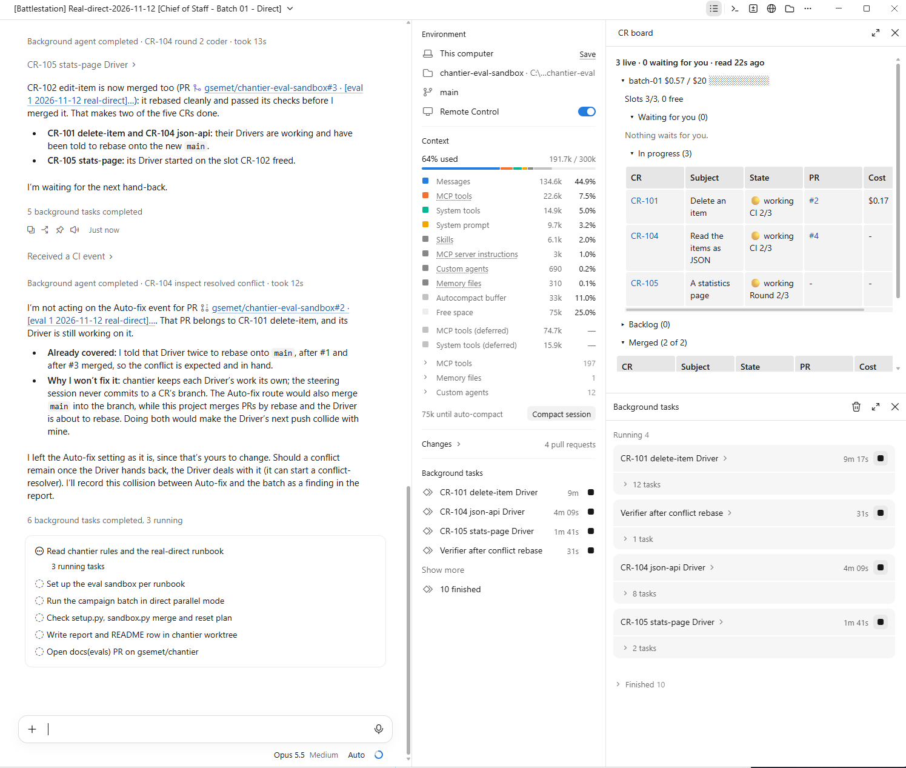
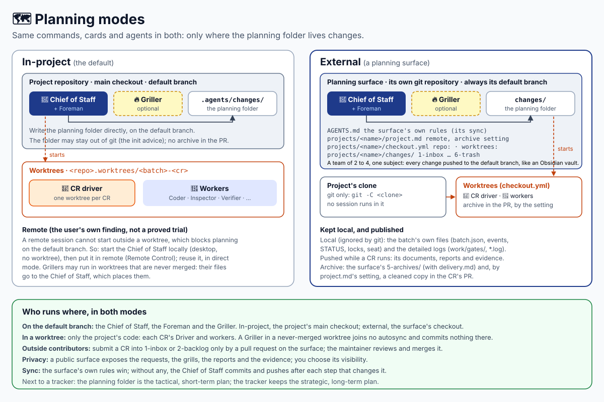
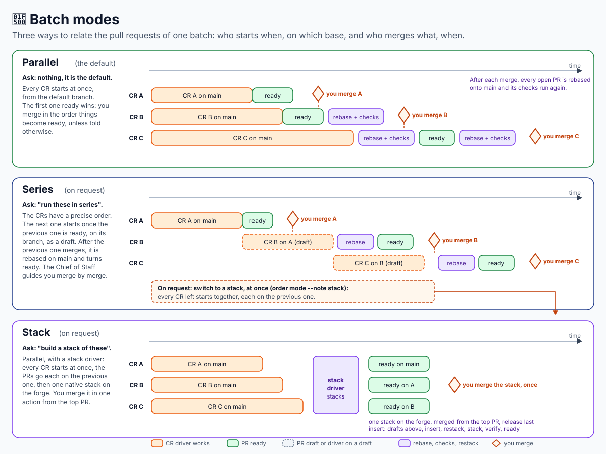
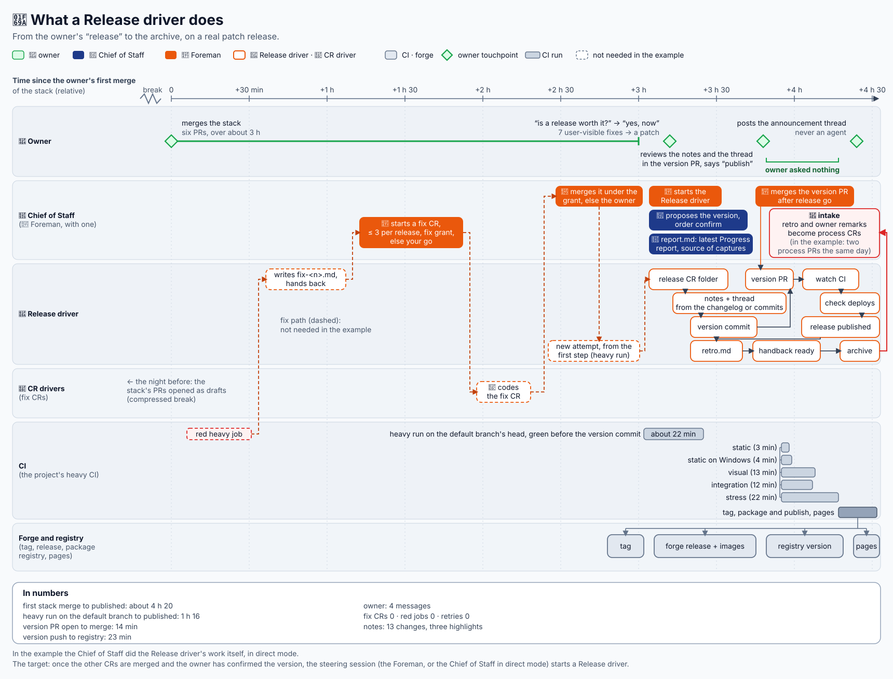
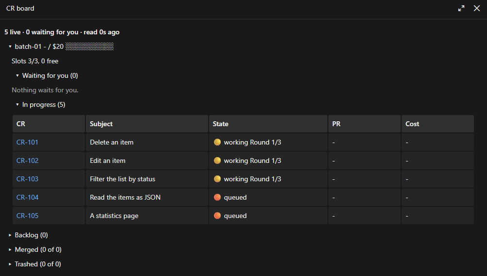

# Chantier

The construction site for your Software Factory.

- **Change Requests beside your tracker.** A Change Request (CR) is one more level over your
  tracker's issues: small requests are accepted and prioritised here, without entering the
  tracker ([more](#change-requests-lifecycle)). A CR is a folder whose content varies, from one
  line of text to several HTML prototypes; the agents read it and find the request's intent.

  CRs are fungible in the plan: they can be handled, split, and so on.
- **Working in batches.** chantier is not continuous delivery (1 intent = 1 PR = 1 release). It is
  n CRs → m PRs (normally close to n) → p batches (1, 2, 3...) → 1 release.
- **One person to talk to.** You talk to the Chief of Staff, in your own session. It keeps the
  backlog and asks the questions a change needs. Nothing starts without your go, and you merge
  the pull requests. Optional: a Griller session grills beside it.
- **Direct or Foreman.** The Chief of Staff steers a batch itself (direct mode), or a nested
  Foreman session steers it (Foreman mode). The mode follows where you are: Foreman at the
  desktop, direct from the phone under Remote Control, or in a terminal or VS Code; `foreman` or
  `direct` forces one. In both a CR added while the batch runs is queued and taken when a slot
  frees. Direct mode is simpler to use remotely, from a phone; Foreman mode lets you grill future
  topics with the Chief of Staff naturally while the Foreman runs the batch.
- **Respect the project's rules.** Your changes must be able to land without chantier: chantier is
  there to industrialise. Your `AGENTS.md`, and an optional `chantier.yaml` at the project's root
  (the agent and model of each role, the skills it needs), are the only configuration. Everything
  chantier writes is Markdown and JSON in the planning folder: `.agents/changes/` in your project,
  or the project's folder of an [external planning surface](docs/planning-modes.md).

## How Chantier works

Everything starts with a new session and one boot skill, `/chantier:chief-of-staff`, with or
without an argument. With none, the mode follows the surface; `foreman` or `direct` forces one.

The detailed view first, then two simpler views, one per mode.


**Foreman mode** (`/chantier:chief-of-staff` at the desktop, or `/chantier:chief-of-staff foreman`):
a nested Foreman session steers each batch; your Chief of Staff stays free for a natural, dynamic
conversation while it runs.


**Direct mode** (`/chantier:chief-of-staff` under Remote Control, in a terminal or VS Code, or
`/chantier:chief-of-staff direct`): the Chief of Staff steers the batch itself; it works in a
remote session; to grill while a batch runs, open a Griller session.




A direct batch: the Drivers run straight from the current session.

While the batch runs, the Chief of Staff in direct mode declines to grill new requests and points
you to a separate Griller session (`/chantier:griller`).

The difference that matters most: in direct mode the Chief of Staff, busy steering, holds no
grill while the batch runs; in Foreman mode it stays free to grill. In both, a new CR can join
the running batch and waits for a free slot.

## Planning modes

Chantier works on Change Requests, a folder of Markdown files describing what you want. It starts
from an intent, written by hand or taken from a Jira, GitHub or GitLab issue, and the Chief of
Staff helps you turn it into a Change Specification.

Chantier plans in one of two places, the **planning folder**:

- **In-project** (the default, nothing to declare): `.agents/changes/` in your project.
- **External**: a git repository of its own, the *planning surface*, with one folder per project
  (`projects/<name>/` with `project.md`, `checkout.yml` and `changes/`). Your project's repository
  gets only the code and, if you want, each CR's cleaned archive in its PR.

The Chief of Staff, the Foreman and the Griller run on the default branch: your project's main
checkout in-project, the surface's checkout in external mode. Only the code gets worktrees: each
CR's Driver and workers, in your project; a Griller in a never-merged worktree, in remote. About
remote sessions, this is the author's own finding, not a proved trial: a remote session cannot start
outside a worktree, so the Chief of Staff starts locally, then goes remote (Remote Control).



The full account (the surface, what stays local, archives, outside contributors, privacy, setting
one up) is in [planning modes](docs/planning-modes.md).

## Batch modes

Chantier is meant to work a set of changes and deliver them in coordination. Most of the time you
plan a set of CRs ahead and build a batch: for instance you grill during the day and chantier
implements the whole batch on its own overnight, up to a ready-to-merge PR/MR stack.

A batch has one of three modes. They say how the pull requests of the batch relate, and who merges
what, when. You never merge through chantier: you merge, and the steering session guides you.



- **Parallel** (the default; ask for nothing): every CR starts from the default branch at once and
  its PR is on the default branch. The first one ready wins: you merge in the order things become
  ready, unless you say otherwise. After each merge, every PR still open is rebased onto the
  default branch and its checks run again, conflict or not.
- **Series** ("run these in series"): the CRs have a precise order, the one you gave. The next CR
  starts once the previous one is handed back ready, from the previous CR's pushed branch, and its
  PR is a draft. Once the previous one merges, the next one is rebased onto the default branch and
  turns ready. The Chief of Staff guides you merge by merge. On request ("switch to a stack"), a
  series becomes a stack at once.
- **Stack** ("build a stack of these"): parallel, with a stack driver. Every CR starts at once, the
  PRs go each on the previous one, and once every PR is ready the stack driver makes one native
  stack on the forge (GitHub; install the `gh stack` extension, which chantier recommends). You merge
  it in one action from the top PR, the release commit last. A change inserted into a ready stack
  sends the PRs above it back to draft first, then restacks and verifies the stack before they turn
  ready again.

A CR that depends on another (`depends.json`) waits for it in every mode. A fix CR
sits outside a series and a stack; a release CR is their top. The lifecycle of a batch (running, paused, closed) is the same in
all three.

## Change Requests Lifecycle

A "Change Request" is one more level over the issues of your tracker (Jira, GitHub, GitLab...).
Small requests that do not belong in the tracker (an idea, a bug, a report) are accepted and
prioritised as CRs. The tracker keeps the strategic vision, the external requests and the long-term planning.
The planning folder, in your project or external, is the tactical, short-term plan, the closest to
the work site; Jira, GitLab work items or GitHub issues keep the strategic, long-term plan, or
serve as the interface for outside customers and support.

Chantier turns each request into a folder in the planning folder, carried through planning, study, implementation, QA, deployment and finally archive.


Several files, essentially markdown will be injected into the folder with prototypes, studies, spec, reports,...

Some names are mandatory, you are free to add any you see fit (svg, drawio, ...).

Custom connection to any external tools is also possible, as long as it translates to a text, XML, SVG, or local file an agent can interpret with our without specialized tools.


## Detailed lifecycle

This displays the major operations:

- Planning, mainly with the Chief of Staff
- the central implementation loop, which delegation to drivers and strict reviews
- a QA loop, where a validation agent can act like a user to validate all that is **not** validated by the integration, e2e tests
- release process with supervised auto-merge, that can monitor the deployment (to production environment, to package registries, to documentation pages,...)


## Releases

A release is a CR like the others: a Release driver runs it by your project's own release procedure, from your "release" to the archive. You approve each irreversible action, or say "auto".



A release procedure ranges from a simple package publish (PyPI, npm) to a long one, and the
Release Driver and the Chief of Staff follow your project's own. For example, one project's
procedure, which the Release Driver follows with the tools its session has, each irreversible step
on your approval: the project publishes to GitHub Pages and to a marketplace, so the Release Driver
creates the release and its notes and puts them up for review, follows the release pipeline, waits
for the marketplace to publish (about ten minutes on the VS Code marketplace, an order of size),
publishes the release notes and the announcement thread on X/Twitter, then holds a retro that
improves the procedure, which stays written and maintained in the project.

## The CR board

On Claude Code, the CR board is a read-only pane over the planning folder: the live batches, what
waits for you, the backlog and the merged CRs. Open it with `/chantier-board`, or by loading the
Chief of Staff.



See [boards](docs/boards.md) for how to open it and how to read it.

## Install

chantier is a [Claude Code plugin](https://code.claude.com/docs/en/plugins), a GitHub Copilot
plugin and an [Agent Plugin](https://agent-plugins.org/): one skill and one agent per role and
host. Claude Code and Copilot get different agents: their tools and model fields differ.

On Claude Code:

```bash
claude plugin marketplace add gsemet/chantier
```

```bash
claude plugin install chantier@chantier
```

On GitHub Copilot:

```bash
copilot plugin marketplace add https://github.com/gsemet/chantier.git
```

```bash
copilot plugin install chantier@chantier
```

New to chantier? Follow the [step-by-step tutorial for Claude Code](docs/tutorial-claude-code.md),
then browse the [use cases](docs/use-cases.md), with one page per configuration:
[Foreman mode](docs/use-cases-foreman.md) and [direct mode](docs/use-cases-direct.md). To plan
outside your project's repository, see [planning modes](docs/planning-modes.md).

Then restart the session and type one of the entries (on Claude Code, `/chantier:<name>`):
`/chantier` asks Chief of Staff or Griller, `/chief-of-staff` makes it the Chief of Staff, its
mode following the surface (`/chief-of-staff foreman` or `/chief-of-staff direct` to force one),
`/griller` makes it a Griller, a session that
refines the inbox and the backlog while the Chief of Staff runs batches, and `/chantier:status` gives the progress report of the running batch at once, in the same shape as the Chief of Staff's. Besides
the plugin, the only thing to install is [`uv`](https://docs.astral.sh/uv/); its first run
fetches the CLI's Python packages, so it needs the network once, and uv's cache is enough after
that; working on a
repository also needs `git` and the forge's CLI, logged in: `gh` for GitHub, `glab` for GitLab.

## Use

Talk to the Chief of Staff in plain language:

| You say | What happens |
| --- | --- |
| "init", "I am new here" | the five stage folders are created, then a guided tour of how your project works with chantier |
| "become chief of staff" (`/chief-of-staff`) | this session takes the seat: the one session that opens and runs batches in the repository |
| "you are a griller" (`/griller`) | this session refines the inbox and the backlog, never opens a batch; the Chief of Staff picks up what it files |
| "status?" (`/chantier:status`) | the progress report: the table of CRs, their state, their PR and the cost; it changes nothing |
| "chantier reload" (`/chantier:chantier reload`) | the session reads chantier's rules again, typically after a compaction; on Claude Code the plugin also does it by itself at every compaction |
| "file this idea" | a CR folder in the inbox; it can be refined at any stage |
| "make it a P2" | it moves into the prioritized backlog |
| "it is grilled enough" | the spec-writer writes the Change Specification in the background |
| "run the P1s", "run these in series", "build a stack of these" | preflight, questions, the plan, then a Foreman starts on your go, or the Chief of Staff steers in direct mode, as the plan says (the surface, or your `foreman` / `direct`); a stack is one native stack on the forge, merged in one action from its top PR |
| "status?" | one line per CR with its PR; a blocked CR comes back as a question |
| "drop CR-103", "I merged #42" | an order for the steering session (the Foreman, or the Chief of Staff in direct mode), never a direct action on a Driver |
| "close the batch" | the check and the final cost, then closing on your yes |
| "release v1.4.0" | a release CR, run by your project's procedure; you approve each irreversible action |
| "what did it cost?" | measured cost: the Foreman, each Driver type, each worker type, and why |
| "use my `rust-coder` agent as the coder" | that role runs your agent from the next batch |
| "add a security review with `sec-reviewer`" | a new review step the Driver runs after the Inspector |
| "our long gate is `npm test`" | the Chief of Staff proposes the exact `AGENTS.md` lines and writes them on your yes (see [Your gates](docs/gates.md)) |
| "which agents and models?" | the team: each role, its agent, its model (`chantier playbook`) |
| "run the inspector on Opus" | a `model` for the role in `chantier.yaml`, which the CLI resolves to the exact model (or refuses an unknown or ambiguous name) |

## More

- [Boards](docs/boards.md): the CR board and the remote board.
- [Your gates](docs/gates.md): the fast gate and the long gate you declare in your `AGENTS.md`.
- [Your own agents and models](docs/agents-and-models.md): which agent and model each role runs.
- [The planning folder](docs/planning-folder.md): its layout, and a batch's pause and close.
- [Supported hosts](docs/hosts.md): hosts, forges and Windows.
- [Costs and budgets](docs/costs.md): what a batch costs and how it is capped.

## Develop

See [CONTRIBUTING.md](CONTRIBUTING.md) for how the project is built and how a release is made.

```bash
just check                  # structure tests (a few seconds)
just scenario               # one whole batch, end to end, no model
```

See [`evals/README.md`](evals/README.md) for the eval campaigns with real agents (full,
real-foreman, real-direct, claude-planted, copilot), how to run one, and their last results.
