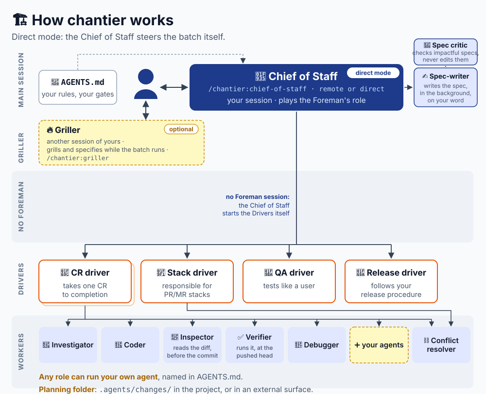
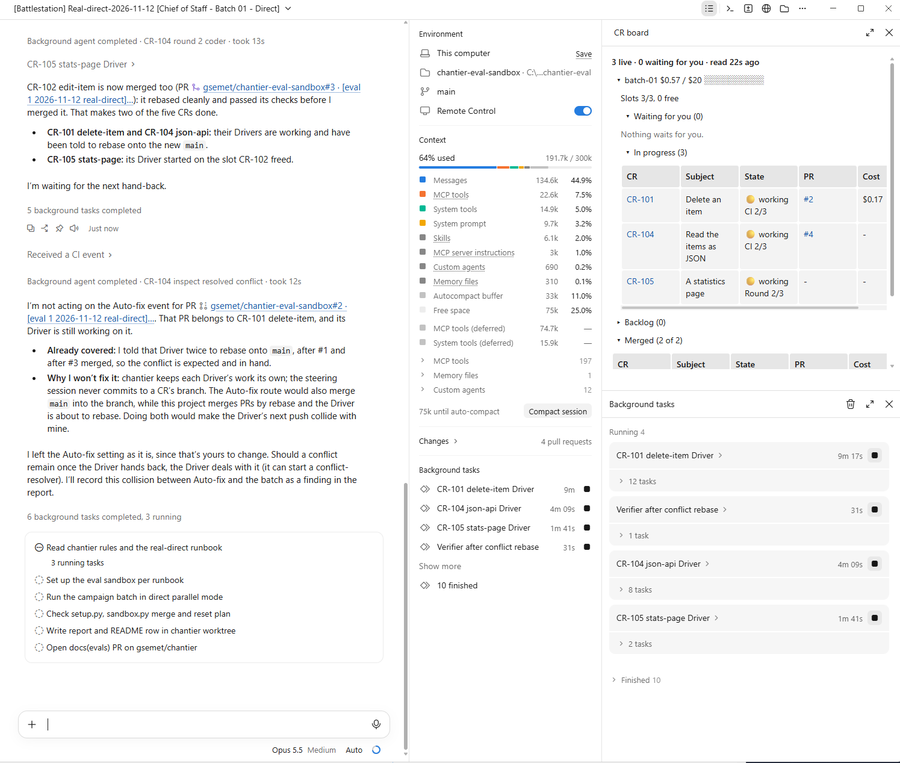
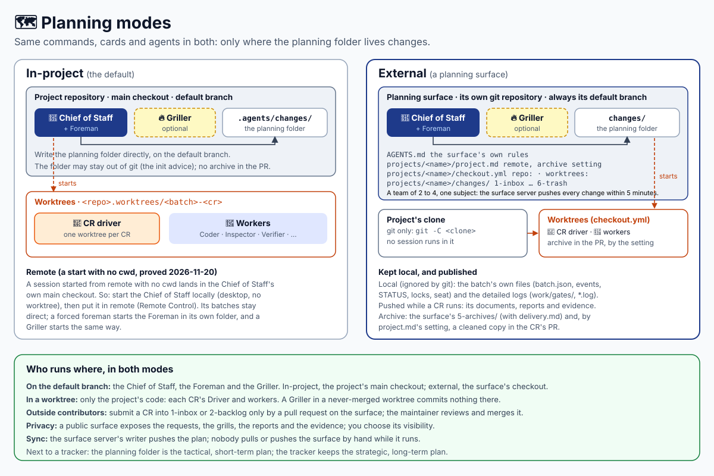
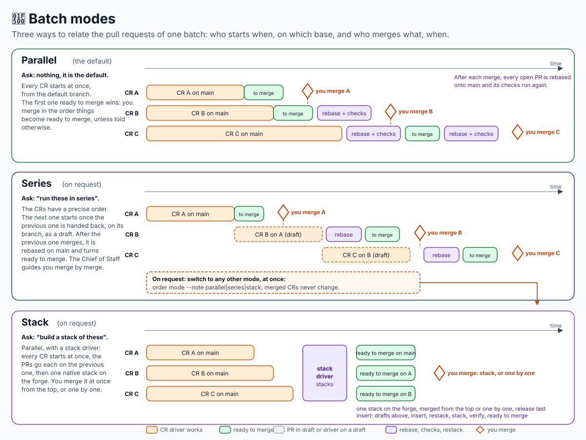
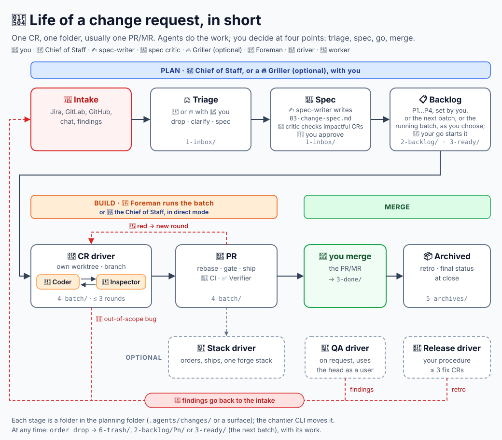
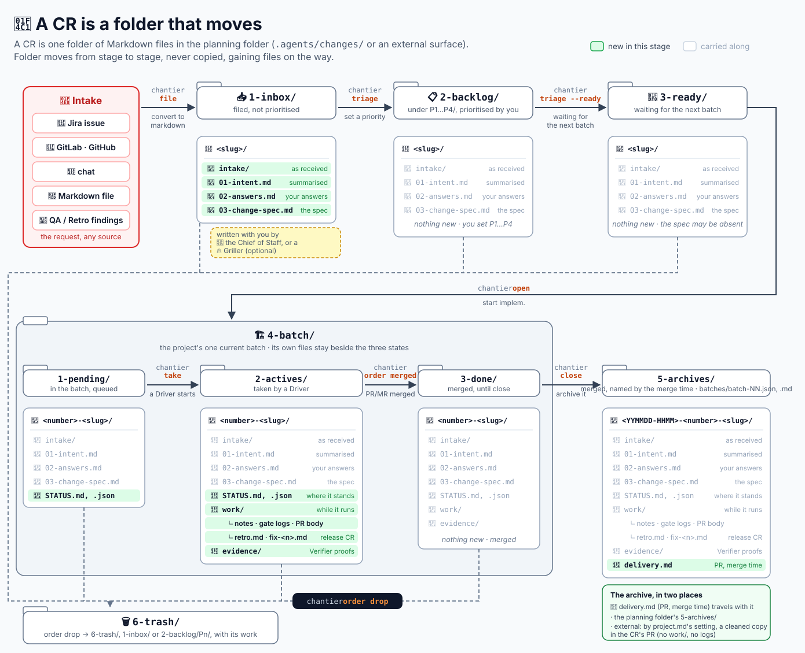
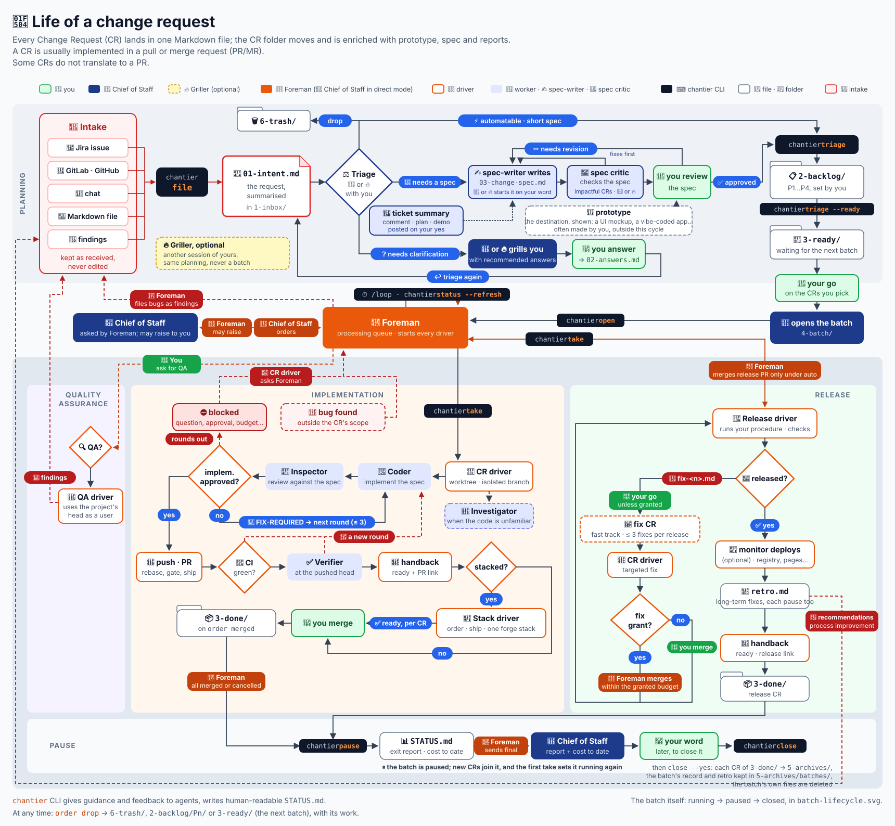
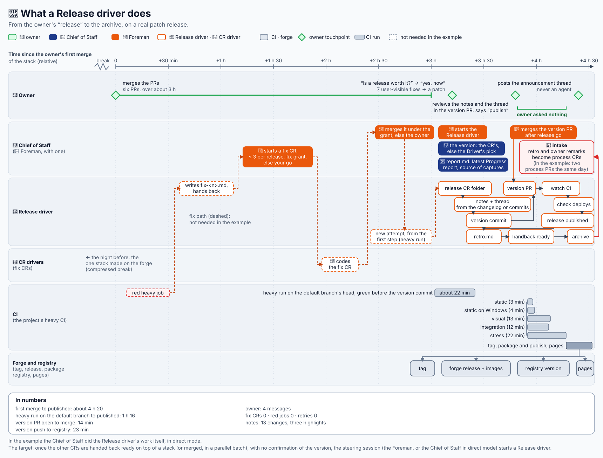
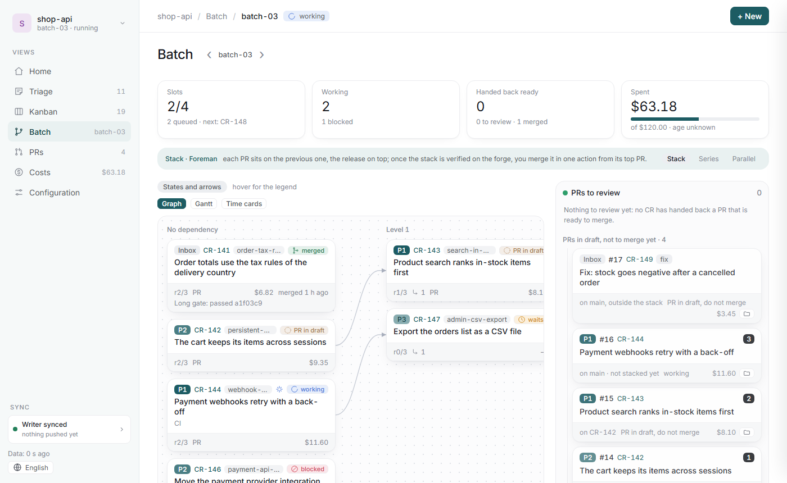

# Chantier

The construction site for your Software Factory.

- **Change Requests beside your tracker.** A Change Request (CR) is one more level over your
  tracker's issues: small requests are accepted and prioritised here, without entering the
  tracker ([more](#change-requests-lifecycle)). A CR is a folder whose content varies, from one
  line of text to several HTML prototypes; the agents read it and find the request's intent.

  CRs are fungible in the plan: they can be handled, split, and so on.
- **Working in batches.** chantier is not continuous delivery (1 intent = 1 PR = 1 release). It is
  n CRs → m PRs (normally close to n) → p batches (1, 2, 3...) → 1 release.
- **One person to talk to.** You talk to the Chief of Staff, in your own session. It keeps the
  backlog and asks the questions a change needs. Nothing starts without your go, and you merge
  the pull requests. Optional: a Griller session grills beside it.
- **Direct or Foreman.** The Chief of Staff steers a batch itself (direct mode), or a nested
  Foreman session steers it (Foreman mode). The mode follows where you are: Foreman at the
  desktop, direct from the phone under Remote Control, or in a terminal or VS Code; `foreman` or
  `direct` forces one. In both a CR added while the batch runs is queued and taken when a slot
  frees. Direct mode is simpler to use remotely, from a phone; Foreman mode lets you grill future
  topics with the Chief of Staff naturally while the Foreman runs the batch.
- **Respect the project's rules.** Your changes must be able to land without chantier: chantier is
  there to industrialise. Your `AGENTS.md`, and an optional `chantier.yaml` (the project's, and its planning surface's;
  the agent and model of each role, the skills it needs), are the only configuration. Everything
  chantier writes is Markdown and JSON in the planning folder: `.agents/changes/` in your project,
  or the project's folder of an [external planning surface](https://chantier.readthedocs.io/en/latest/explanation/planning-modes.html) (and, from the
  board, a project's `chantier.yaml` in its planning surface).

## How Chantier works

Everything starts with a new session and one boot skill, `/chantier:chief-of-staff`, with or
without an argument. With none, the mode follows the surface; `foreman` or `direct` forces one.


In **Foreman mode** a nested Foreman session steers each batch and your Chief of Staff stays free
to grill; in **direct mode** the Chief of Staff steers the batch itself.






The two modes, side by side, are in [How chantier works](https://chantier.readthedocs.io/en/latest/index.html#how-chantier-works).

## Planning modes

Chantier plans in one of two places, the **planning folder**: `.agents/changes/` in your project (the
default), or a git repository of its own, the *planning surface*, with one folder per project.



The full account is in [planning modes](https://chantier.readthedocs.io/en/latest/explanation/planning-modes.html).

## Batch modes

A batch has one of three modes, which say how its pull requests relate and who merges what, when:
parallel (the default), series or stack. You never merge through chantier: you merge.



See [batch modes](https://chantier.readthedocs.io/en/latest/explanation/batches-and-lifecycle.html#batch-modes).

## Factory mode

A factory batch stays open. You give the go once; from then on each CR you make ready joins it on
its own, with no go per CR, and the batch never ends by itself: it closes only on your word.

- **Open one:** ask to "open an empty batch" (a batch opened with no CR is a factory), or ask for a
  factory with CRs (`open --factory`), or turn the open batch into one (`order factory on`). The
  usual opening is `--mode stack --slots 4`: CRs stack up as they become ready, four at a time.
- **What joins on its own:** a CR made ready with `triage <folder> --ready`, specified or
  automatable, joins in the same call, as `order add` would. The budget is unchanged: a CR may join
  past it, but no Driver starts past it.
- **What does not:** a release CR, which joins with its own go (`order add --release`) and turns the
  factory off, so the batch ends after the release as an ordinary one; and a CR moved to `3-ready`
  on the board, which the Chief of Staff adds itself.
- **Stop it:** `order factory off`, on your word; the batch then ends like any other.
- **How it ends:** at its last CR's end the batch pauses, with no retro and no close offer, and
  waits for the next ready CR. On your `close`, the retro comes first, then the close.

## What a batch costs

Two real batches of chantier's own eval, steered by a Foreman and by the Chief of Staff in direct mode,
cost between $11 and $15 each on five frozen CRs. The figures, what they show and what they do not
are in [What a batch costs](https://chantier.readthedocs.io/en/latest/explanation/costs.html#what-a-batch-costs-measured); how the cost is
measured and capped is in [Costs and budgets](https://chantier.readthedocs.io/en/latest/explanation/costs.html).

## Change Requests Lifecycle

A "Change Request" is one more level over the issues of your tracker: small requests that do not
belong in the tracker are accepted and prioritised as CRs, and carried through planning, study,
implementation, QA, deployment and archive.






See [the lifecycle](https://chantier.readthedocs.io/en/latest/explanation/batches-and-lifecycle.html#change-requests-lifecycle).

## Detailed lifecycle

The major operations: planning, the central implementation loop, a QA loop and a release.



See [the detailed lifecycle](https://chantier.readthedocs.io/en/latest/explanation/batches-and-lifecycle.html#detailed-lifecycle).

## Releases

A release is a CR like the others: a Release driver runs it by your project's own release procedure,
and you approve each irreversible action, or say "auto".



See [releases](https://chantier.readthedocs.io/en/latest/explanation/batches-and-lifecycle.html#releases).

## The CR board

On any device, `chantier board` serves the CR board as a web page: the live batches, what waits
for you, the backlog and the merged CRs. On Claude Code, a read-only pane shows the same record.



See [boards](https://chantier.readthedocs.io/en/latest/reference/boards.html) for the pane and [the web board](https://chantier.readthedocs.io/en/latest/reference/web-board.html) for every view.

## Install

chantier is a [Claude Code plugin](https://code.claude.com/docs/en/plugins), a GitHub Copilot
plugin and an [Agent Plugin](https://agent-plugins.org/): one skill and one agent per role and
host. Claude Code and Copilot get different agents: their tools and model fields differ.

On Claude Code:

```bash
claude plugin marketplace add gsemet/chantier
```

```bash
claude plugin install chantier@chantier
```

On GitHub Copilot:

```bash
copilot plugin marketplace add https://github.com/gsemet/chantier.git
```

```bash
copilot plugin install chantier@chantier
```

The rest (the tutorial, `uv`, `git` and the forge's CLI, `init`) is in [Install](https://chantier.readthedocs.io/en/latest/installation.html).

## Use

Talk to the Chief of Staff in plain language: "init", "status?", "run the P1s", "close the batch",
"release v1.4.0", "what did it cost?". Every phrase and what it does is in
[what you say](https://chantier.readthedocs.io/en/latest/reference/what-you-say.html).

## Documentation

The documentation is at [chantier.readthedocs.io](https://chantier.readthedocs.io/en/latest/index.html).

- [Tutorials](https://chantier.readthedocs.io/en/latest/tutorials/index.html): your first batch, in Claude Code.
- [How-to guides](https://chantier.readthedocs.io/en/latest/how-to/index.html): use cases, your gates, your agents and models, the release process.
- [Explanation](https://chantier.readthedocs.io/en/latest/explanation/index.html): planning modes, batches and the life of a CR, costs.
- [Reference](https://chantier.readthedocs.io/en/latest/reference/index.html): what you say, the boards, the planning folder, the hosts.

## Develop

See [CONTRIBUTING.md](CONTRIBUTING.md) for how the project is built and how a release is made.

```bash
just check                  # structure tests (a few seconds)
just scenario               # one whole batch, end to end, no model
```

See [`evals/README.md`](evals/README.md) for the eval campaigns with real agents (full,
real-foreman, real-direct, claude-planted, copilot), how to run one, and their last results.
