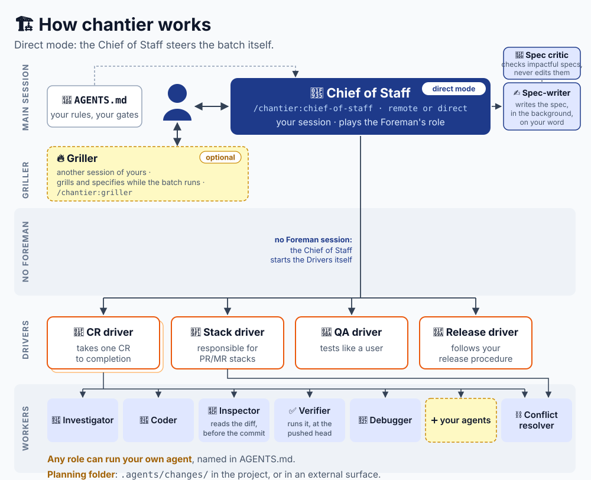
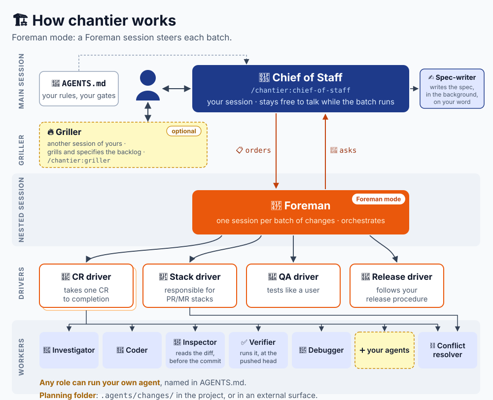
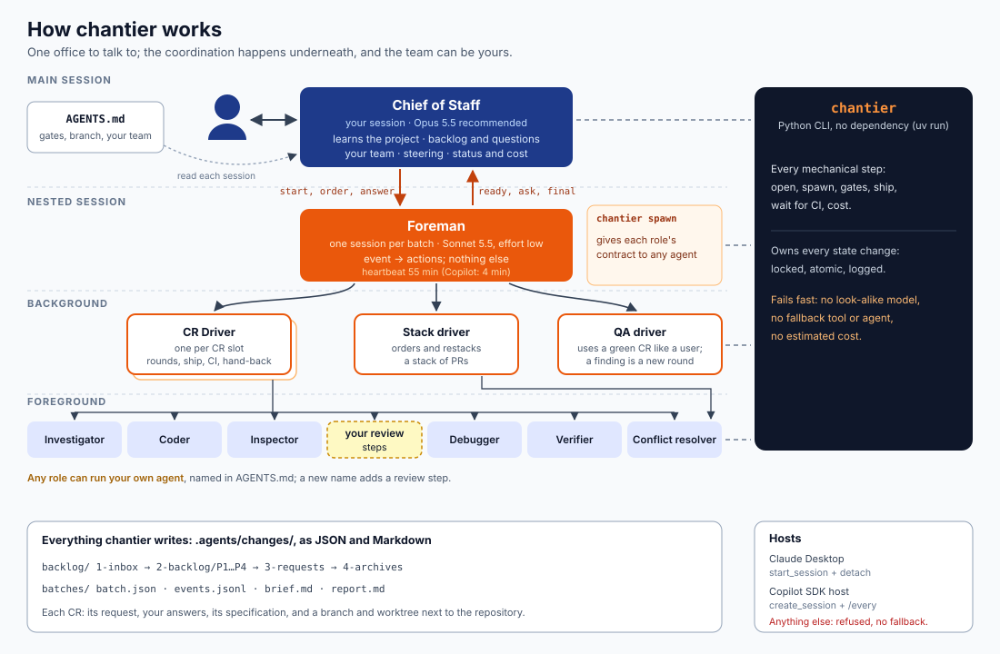
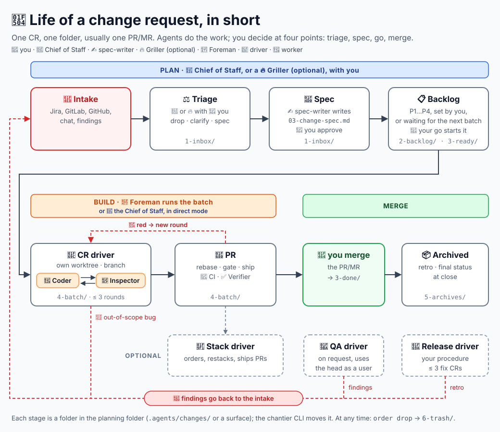
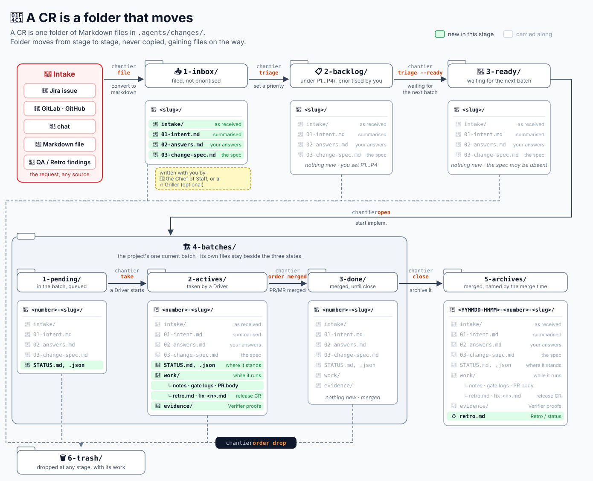
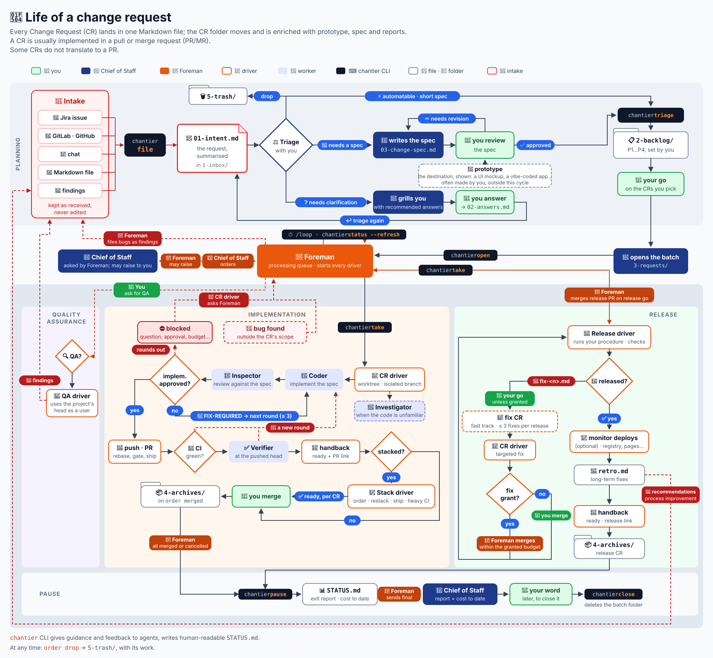

# Chantier

The construction site for your Software Factory.

- **Change Requests beside your tracker.** A Change Request (CR) is one more level over your
  tracker's issues: small requests are accepted and prioritised here, without entering the
  tracker ([more](#change-requests-lifecycle)).
- **One person to talk to.** You talk to the Chief of Staff, in your own session. It keeps the
  backlog and asks the questions a change needs. Nothing starts without your go, and you merge
  the pull requests. Optional: a Griller session grills beside it.
- **Direct or Foreman.** The Chief of Staff steers a batch itself (direct mode), or a nested
  Foreman session steers it (Foreman mode). In Foreman mode a CR can join a running batch; in
  direct mode, only once the batch is paused.
- **Zero configuration.** Your `AGENTS.md` is the only configuration. Everything chantier writes
  is Markdown and JSON in `.agents/changes/`, in your project.

## How Chantier works

**Direct mode** (`/chantier:chief-of-staff direct`): the Chief of Staff steers the batch itself;
it works in a remote session; to grill while a batch runs, open a Griller session.



**Foreman mode** (`/chantier:chief-of-staff`): a nested Foreman session steers each batch, at the
desktop; your Chief of Staff stays free for a natural, dynamic conversation while it runs.



The difference that matters most: once a batch runs in direct mode, a new CR, specified or not,
joins it only when all the other CRs are handled and the batch is paused; in Foreman mode a CR
can join while the batch runs.

The same, in detail:



## Change Requests Lifecycle

A "Change Request" is one more level over the issues of your tracker (Jira, GitHub, GitLab...).
Small requests that do not belong in the tracker (an idea, a bug, a report) are accepted and
prioritised as CRs. The tracker keeps the strategic vision, the external requests and the long-term planning.

Chantier turns each request into a folder in `.agents/changes/`, carried through planning, study, implementation, QA, deployment and finally archive.



Several files, essentially markdown will be injected into the folder with prototypes, studies, spec, reports,...

Some names are mandatory, you are free to add any you see fit (svg, drawio, ...).

Custom connection to any external tools is also possible, as long as it translates to a text, XML, SVG, or local file an agent can interpret with our without specialized tools.



## Detailed lifecycle

This displays the major operations:

- Planning, mainly with the Chief of Staff
- the central implementation loop, which delegation to drivers and strict reviews
- a QA loop, where a validation agent can act like a user to validate all that is **not** validated by the integration, e2e tests
- release process with supervised auto-merge, that can monitor the deployment (to production environment, to package registries, to documentation pages,...)



## What is Chantier?

You only ever talk to the **Chief of Staff**, in your own session.
It keeps the backlog, asks you the questions a change needs, and starts work only on your go.

1. **It learns your project.** It reads your `AGENTS.md` (or `CLAUDE.md`) for how you build,
   test, ship, merge and release, your default branch and your team, and asks you what it does
   not say. There is nothing else to configure: every agent reads the same file.
2. **You file work.** Each item becomes a **Change Request**: a folder that keeps the raw request
   (`intake/`), its analysis (`01-intent.md`), every answer you give (`02-answers.md`) and the
   self-contained **Change Specification** (`03-change-spec.md`), and, when it needs another CR
   first, a `depends.json` (`{"after": ["<slug>"]}`). After the grill, the Chief of Staff
   restates the CR and asks whether it is grilled enough; on your word a **spec-writer** agent
   writes `03-change-spec.md` in the background, and the Chief of Staff reviews it against your
   answers before showing it to you.
3. **You start a batch** ("run the P1s"; the CRs run in parallel and are stacked afterwards, four slots). After a preflight and your go, the
   Chief of Staff starts one **Foreman** in a nested session. In **direct mode** (proposed when the
   host cannot start a Foreman session, or the batch is small) no Foreman starts: the Chief of
   Staff steers the batch from its own session, with the same limits, folders and reports, and a
   strict batch (no CR joins it while it runs, but a paused batch takes new ones); it may switch to Foreman mode on your word.
   Direct mode is less dynamic than Foreman mode (a running batch takes no new CR, and the Chief
   of Staff, busy steering, holds no grill in that session) but has the same lifecycle: a batch is
   running, then paused, then closed on your word. See [direct mode](docs/use-cases-direct.md).
4. **The Foreman runs the batch.** It starts one background **Driver** per working CR (a slot is a
   running Driver), plus a stack driver and a QA driver, which takes a slot, when needed, and keeps itself warm with a heartbeat.
5. **Each Driver creates the CR's git worktree and branch, then runs short foreground workers**
   in it: Investigator, Coder, Inspector, Debugger, Verifier, Conflict resolver, and any review
   step you added. Then it commits, rebases, pushes, opens the PR and watches its CI itself,
   with `git` and `gh` or `glab`, as your project says. The Driver writes the PR description from
   the default template shipped in the skill
   (`skills/chantier/references/pr-template.md`), unless your project has its own template,
   which ranks above it.
6. **The Foreman reports back** (the Chief of Staff, in direct mode). You steer through the Chief
   of Staff (add, drop, a note on a CR; "I merged #42"); it forwards one `order` line to the
   Foreman. You merge; the Foreman merges only a release's PR or fix, on your word.
7. **A Release driver releases, when you ask.** It follows your project's own procedure, and
   stops for your approval before each irreversible action.

The agents do the work, git and the forge included. The `chantier` Python CLI (`uv run`) is
the frame beside them, in `.agents/changes/`, as plain JSON and Markdown: the CR lifecycle
(inbox, backlog, batch, archives, trash), the batch's limits (slots, budget, rounds, your word
on an irreversible action), the record (each CR's branch and worktree names, its PR, the long
gate's log, the cost, the `STATUS` files) and the lines that synchronise the team (orders, asks,
hand-backs, notes). It refuses what the batch does not allow and tells an agent what is off (an
unpushed head, a worktree not yet created); it decides nothing: the Foreman and the Drivers do,
under your project's own rules (`AGENTS.md` and what it links rank above chantier's cards).

## Install

chantier is a [Claude Code plugin](https://code.claude.com/docs/en/plugins), a GitHub Copilot
plugin and an [Agent Plugin](https://agent-plugins.org/): one skill and one agent per role and
host. Claude Code and Copilot get different agents: their tools and model fields differ.

On Claude Code:

```bash
claude plugin marketplace add gsemet/chantier
```

```bash
claude plugin install chantier@chantier
```

On GitHub Copilot:

```bash
copilot plugin marketplace add https://github.com/gsemet/chantier.git
```

```bash
copilot plugin install chantier@chantier
```

New to chantier? Follow the [step-by-step tutorial for Claude Code](docs/tutorial-claude-code.md),
then browse the [use cases](docs/use-cases.md), with one page per configuration:
[Foreman mode](docs/use-cases-foreman.md) and [direct mode](docs/use-cases-direct.md).

Then restart the session and type one of the three entries (on Claude Code, `/chantier:<name>`):
`/chantier` asks which role this session takes, `/chief-of-staff` makes it the Chief of Staff
(`/chief-of-staff direct` to steer batches itself), `/griller` makes it a Griller, a session that
refines the inbox and the backlog while the Chief of Staff runs batches. Besides
the plugin, the only thing to install is [`uv`](https://docs.astral.sh/uv/); working on a
repository also needs `git` and the forge's CLI, logged in: `gh` for GitHub, `glab` for GitLab.

## Use

Talk to the Chief of Staff in plain language:

| You say | What happens |
| --- | --- |
| "init", "I am new here" | the five stage folders are created, then a guided tour of how your project works with chantier |
| "become chief of staff" (`/chief-of-staff`) | this session takes the seat: the one session that opens and runs batches in the repository |
| "you are a griller" (`/griller`) | this session refines the inbox and the backlog, never opens a batch; the Chief of Staff picks up what it files |
| "file this idea" | a CR folder in the inbox; it can be refined at any stage |
| "make it a P2" | it moves into the prioritized backlog |
| "it is grilled enough" | the spec-writer writes the Change Specification in the background |
| "run the P1s", "build a stack of these" | preflight, questions, the plan, then a Foreman starts on your go, or the Chief of Staff steers in direct mode |
| "status?" | one line per CR with its PR; a blocked CR comes back as a question |
| "drop CR-103", "I merged #42" | an order for the steering session (the Foreman, or the Chief of Staff in direct mode), never a direct action on a Driver |
| "close the batch" | the check and the final cost, then closing on your yes |
| "release v1.4.0" | a release CR, run by your project's procedure; you approve each irreversible action |
| "what did it cost?" | measured cost: the Foreman, each Driver type, each worker type, and why |
| "use my `rust-coder` agent as the coder" | that role runs your agent from the next batch |
| "add a security review with `sec-reviewer`" | a new review step the Driver runs after the Inspector |
| "which agents and models?" | the team: each role, its agent, its model |

### The CR board (Claude Code)

`/chantier-board` shows or hides the **CR board**, a read-only pane over
`.agents/changes/3-requests/STATUS.json`: the live batches with what waits for you and what is in
progress, the backlog, and the merged and trashed CRs. Each live batch shows its slots
(`Slots 2/4, 2 free`). Press a CR for its sheet and its documents.
Loading the `chantier` or `chief-of-staff` skill opens it too (not `griller`). It refreshes every 15 seconds while open, writes
nothing, and runs no process but `git rev-parse` to find the main checkout from a worktree. It is
a Claude Code mod (early access): nothing of it on Copilot. The pane shows on the machine running
the session, not in a Remote Control view
([anthropics/claude-code#99217](https://github.com/anthropics/claude-code/issues/99217)).
### Your own agents

Any role can run one of your agents. Tell the Chief of Staff, and it writes it in a `chantier`
section of your `AGENTS.md`, shared with your team:

```markdown
## chantier

- coder: `rust-coder`
- security-review: `sec-reviewer`, after the Inspector: OWASP top 10 on the diff
```

The role's contract is its card in the skill, named in the prompt the Driver writes, so your
agent only needs the tools the role uses. A name that is not a built-in role becomes an extra
review step: it runs after the Inspector approves and answers with the same verdict. A running
batch keeps the team it started with.

### Models

| Role | Claude | Copilot |
| --- | --- | --- |
| Chief of Staff | your session (Opus 5.5 recommended) | your session |
| Foreman | Opus 5.5, effort medium | Claude Opus 5.5 |
| Stack and release drivers | Opus 5.5 | Claude Opus 5.5 |
| CR driver | Sonnet 5.5 | Claude Sonnet 5.5 |
| QA driver | Sonnet 5.5 | Claude Sonnet 5.5 |
| Coder, Investigator, Debugger, Conflict resolver, Demo explorer | Sonnet 5.5 | GPT-5.6 Luna |
| Inspector, Verifier | Sonnet 5.5 | GPT-6.1 Sol |
| Spec-writer | Opus 5.5 | Claude Opus 5.5 |

The roles that judge (which CR goes next, what a red check means, whether a diff breaks a
project rule) run Opus, except the CR driver, which reads red checks on Sonnet; they are given
room to judge: their cards state goals and boundaries, not procedures. The roles that do one
bounded task run Sonnet.

**No fallback:** if a host refuses a model, a tool or an agent, chantier stops and says so; it
never picks a look-alike or a workaround.

### Change Request lifecycle

Everything lives in `.agents/changes/`:

```text
.agents/changes/
├── 1-inbox/<slug>/                        filed, not prioritized
├── 2-backlog/P1…P4/<slug>/                prioritized by you
├── 3-requests/
│   ├── STATUS.md, STATUS.json             live batches, backlog table
│   └── batch-<n>/                         the one batch, until `close`; n counts all batches
│       ├── batch.json, events.jsonl, brief.md, .lock
│       ├── STATUS.md, STATUS.json         the batch; once paused, its exit report
│       └── <number>-<slug>/               a CR in the batch: STATUS.md, STATUS.json; named
│                                          branch chantier/batch-<n>/… and worktree next to the repo
├── 4-archives/<YYMMDD-HHMM>-<number>-<slug>/   merged (time of the merge, UTC)
└── 5-trash/<YYMMDD-HHMM>-<number>-<slug>/      dropped on your word
```

The folder moves, it is never copied; collisions are errors rather than overwrites. A CR moves
to `4-archives/` alone and at once when it merges, a stack's too. A dropped CR goes to
`5-trash/` and does not return to the backlog. A batch has no name, only a
number, and `--batch` takes it (`4` or `batch-04`). One batch at a time, from `open` to your `close`: new work joins it
through the Foreman (in direct mode, once it is paused). Its CRs run in parallel, each PR on the default branch, and a stack driver
stacks them afterwards unless the batch is `--parallel`. While a CR runs, the team writes its notes, gate logs and PR body in the CR's own
`work/` folder.

`STATUS.md` and `STATUS.json` exist at three levels (`3-requests/`, the batch, the CR), each
linking to the others. The CLI rewrites them at every state change, from the state alone; a
status cell reads like `🔴 blocked Question 1/3`.

The agents own the worktrees as they own git: a CR's Driver creates its worktree and branch
(named by chantier, next to the repository), the steering session (the Foreman, or the Chief of
Staff in direct mode) removes a merged CR's before the batch is paused, and the Chief of Staff
removes a dropped CR's only on your word. When every CR is merged or cancelled, the batch is
**paused** (`chantier pause`), not closed: its cost to date is computed and shown, and the
steering session stays idle. New work added to a paused batch sets it running
again; it pauses again at the end, with the cost to date grown. A batch is closed only on your
word ("close the batch"): `chantier close` refuses, naming the
cause, while anything still runs (a CR not merged, an open order, a stack agent, a session
written in the last 5 minutes); on a batch set running again it names what runs. Once nothing runs, it prices the final cost and shows it with
what goes (the batch folder, the dropped CRs' worktrees and branches); if it cannot price it (no
priced call, no Foreman transcript recorded) it refuses, naming the cause, and the Chief of Staff
reports it to you. On your yes, `chantier close --yes` deletes the folder and it removes the rest with git;
without a yes, everything stays. Close last: the batch folder holds the exit report and the
event log.

## Supported hosts

For Foreman mode:

| Host | Nested session | Foreman heartbeat |
| --- | --- | --- |
| Claude Desktop | `start_session`, left linked | 30 minutes |
| Copilot SDK host | `create_session` + `send_message` | 4 minutes (`/every`) |

Foreman mode refuses every other host (a VS Code tab, the terminal, ...), and the plan proposes
direct mode there. An unattended run and a linked worktree are refused in both modes, with no
fallback.

Direct mode runs on any Claude Code entry point (the Desktop app, the terminal, VS Code, a
Remote Control session with no Foreman to reuse) and in a Copilot agent session, checked by
`chantier preflight --direct`. The heartbeat is the same, run in the Chief of Staff's own
session.

**Recommended on Claude Desktop:** turn on "Connect new sessions to Remote Control" in the app's
settings, so the Foreman's session can be reached from your phone. A host classifier may refuse
the Foreman an action (starting a Release driver, say) until you allow it in that session: type
one line there saying so, from your phone if you are away, and it does that action once.

| Forge | CLI | Where |
| --- | --- | --- |
| GitHub | `gh` | github.com, or GitHub Enterprise when `gh` is logged in to its host |
| GitLab | `glab` | gitlab.com, or a self-managed server when `glab` is logged in to its host |

The agents use the forge's CLI as it is logged in (`gh auth login`, `glab auth login --hostname
<host>`), on the batch's git remote (`origin`, or `--remote`). Nothing is configured in chantier.

On Windows, the CLI runs natively (no WSL). `chantier gate` runs the long gate in `cmd.exe`, so
write it for it. `chantier cancel` ends a CR's processes at once, with no grace period, and
finds stray ones by their command line only, since Windows does not expose another process's
current directory.

## Costs and budgets

`chantier cost` reports what the Foreman's session and its subagents cost, in total and in one
line for the Foreman, one per Driver type and one per worker type (or by CR), and the lines add up
to the total. `chantier cost --explain` adds what explains each figure: the agents, the calls, the
model, the shares of cost in cache reads, cache writes and output, the calls made after the cache
expired and the Drivers restarted. The reports show these lines as printed. On Claude, chantier
prices the transcripts with its own rates for Opus, Sonnet and Haiku 5.5; on Copilot, it reads
per-call costs from
[copilot-session-usage](https://github.com/gsemet/copilot-session-usage), which uv fetches from
PyPI, and flags calls that were estimated rather than billed. In direct mode the steering is one
`Chief of Staff (steering)` line, counted in the batch's spend and budget as a Foreman's is; the
rest of the Chief of Staff's session stays apart. A missing transcript, an unknown
model or an unpriced call is an error, never a guess. The Foreman records the spend at each
heartbeat (`chantier status --refresh`); past the batch budget it starts nothing new.

You get the cost without asking: the Chief of Staff adds a CR's line when it tells you the CR is
ready or merged, and the batch's `STATUS.md` (its exit report) ends with the total, the budget,
the split between Foreman, Drivers alone and workers alone, the costliest CRs and the Foreman's
wakes and context (`chantier cost --summary`). The Chief of Staff's own session is priced apart:
its line shows two figures (since the batch opened, the whole session) and its context size, and
it is never in the batch's spend nor in its budget.

## Repository layout

```text
.claude-plugin/             ← Claude Code plugin manifest and marketplace
.github/plugin/             ← GitHub Copilot plugin manifest and marketplace
agents/                     ← Claude Code agents, one per role
hooks/, types/              ← Claude Code only: the CR board mod and its contract
com.github.copilot/agents/  ← Copilot agents, one per role (chantier-<role>)
skills/chief-of-staff/      ← the Chief of Staff's entry point (thin: it loads the cards below)
skills/griller/             ← the Griller's entry point (thin)
skills/chantier/
├── SKILL.md                ← the router: asks which role this session takes
├── references/             ← one file per running context: concepts, session-start,
│                             chief-of-staff, griller, foreman, driver, worker, routing,
│                             spec-writer, init,
│                             pr-template, release-template, and hosts/ (one
│                             reference per host: Claude Code, Copilot)
└── scripts/cli/            ← the `chantier` CLI and its tests
scenario/                   ← one whole batch, scripted, no model
evals/                      ← eval campaigns with real agents, and their reports
scripts/                    ← version tooling, run by `just`
docs/                       ← diagrams, the user docs (tutorial, use cases), release notes
```

## Develop

See [CONTRIBUTING.md](CONTRIBUTING.md) for how the project is built and how a release is made.

```bash
just check                  # structure tests (a few seconds)
just scenario               # one whole batch, end to end, no model
```

See [`evals/README.md`](evals/README.md) for the eval campaigns with real agents (claude-smoke,
claude-full, copilot), how to run one, and their last results.
