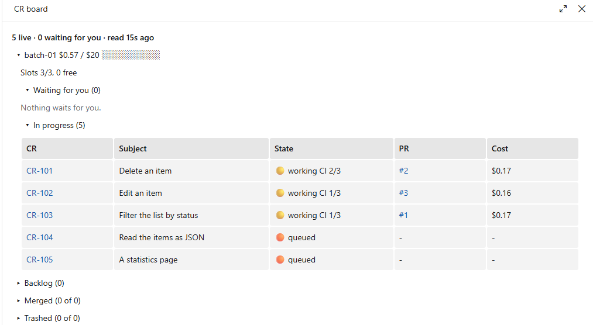
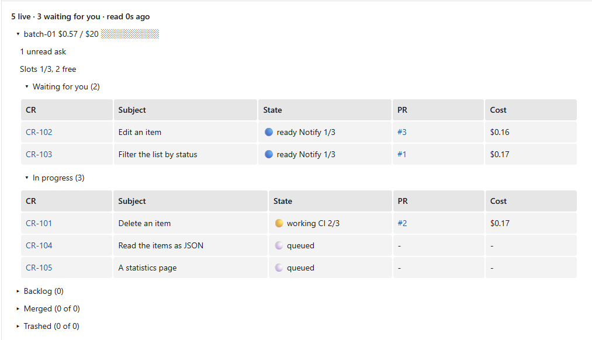
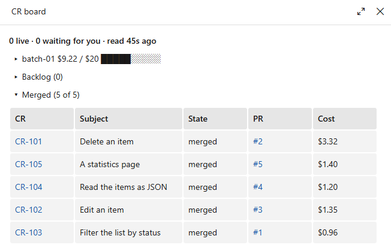

# Boards

The CR board in Claude Code, a read-only pane over the planning folder, and the web board ([its own page](web-board.md)), served by `chantier serve` on this machine, or to any device on the local network when you open it.

## The CR board (Claude Code)

### What it is

A Claude Code mod (early access): a read-only pane over the planning folder's `STATUS.json` (in a surface,
the projects whose seat or current batch, as its Foreman or Chief of Staff, names this session, else
every project under a line saying no seat names it). It shows the live batches, the backlog (and `3-ready`), and the
merged and trashed CRs. Nothing of it on Copilot, and the pane is not shown in a Remote Control view
([anthropics/claude-code#99217](https://github.com/anthropics/claude-code/issues/99217)). It writes
nothing and runs no process but `git rev-parse`, to find the main checkout from a worktree.

### How to open it

`/chantier-board` shows or hides it. Loading the `chantier` or `chief-of-staff` skill opens it too
(not `griller`).

### How to read it

At the top, a header line: `5 live · 0 waiting for you · checked 3s ago, every 15 s`: when the pane last checked, and its period. Under it, each batch has a
line (its id, its cost against its budget, a gauge, and how old that cost is: `12 min old`), its unread asks, its slots and its shape (`Slots 3/3, 0
free · parallel`). Then "Waiting for you" and "In progress", with the columns CR, Subject, State, Step, PR and Cost. The Step is what a working CR's Driver is doing (`coder r2`, `gate scenario`, `CI`), or "waits for the user" on a blocked one; the web board also marks the next CR to start.
The state says the state, the step and the round: `working Round 1/3`, `working CI 2/3`,
`🟢 ready to merge Notify 1/3`, `🟤 PR in draft, waits for …`, `🟣 ready locally Notify 1/3`, `queued`. Then Backlog, Merged (n of m) and Trashed (n of m). Press a CR for its
sheet and its documents. The pane checks every 15 seconds while open and reads a file again only when it changed. A **Refresh** button at the top of the pane (in every view) checks at once: it reads the files again, even unchanged ones, and looks for the planning folders again (a project added to a surface, a `.agents/changes/` created after opening), and for the projects that name this session again (a seat taken after opening; the 15 s check looks too), keeping the page shown and the folds. It does not refresh the batch's cost or record: that moves when the steering session refreshes the status.

### A batch in pictures

A batch just opened: three CRs working in round 1/3, two queued, no PR yet, no cost.


Three CRs in CI, with PRs #1 to #3 and their costs: $0.57 of $20.



"3 waiting for you": two CRs ready to merge, and one unread ask.



"Merged (2 of 2)" open.


The batch done: 0 live, $9.22 of $20, and "Merged (5 of 5)" with each CR's PR and cost.



### Two facts the pictures raise

They are not bugs.

- The header's "waiting for you" counts the unread asks as well as the table's rows: in the
  merged picture, "1 waiting for you" sits beside "Nothing waits for you".
- The batch's cost is priced when the steering session refreshes the status, not live: $0.57 over
  three pictures while the CRs moved on, then $9.22 once the batch was done.

### The guard of a worker's and a CR Driver's writes

The same mod starts an agent whose prompt holds a `writes:` line in its first folder (a worker's:
its worktree; a CR Driver's: its worktree, or the project's root before the worktree exists) and refuses its Write, Edit or NotebookEdit outside the
folders named. It judges the agent's Bash or PowerShell writes the same way when it can see them (a
redirection, `Set-Content`, `sed -i`, `rm`...); what it cannot see, such as an interpreter's inline
code, is covered by the cards, and the steering session reports what changed in the main checkout.

## The web board

The web board is a small web server, `chantier serve`, for any device. Every view, how to start it, keep it on the machine and stop it are in [the web board](web-board.md); its API, which the page and any other client use, is in [the server's API](server-api.md).

## The live terminal view

`chantier live` watches one to four running boards in the terminal, read-only: the second client
of [the server's API](server-api.md), beside the web page. It never starts a board, writes nothing
and messages no agent. Its keys only change what its own screen shows.

What it shows, redrawn once a second:

- the header: the folder served, the board's version, the transport (`ws` or `http`), the link's
  state (`live`, or `reconnecting since HH:MM:SS`), the server's date and time in your local zone
  with its UTC offset (`2026-11-23 12:26:25 UTC+01:00`), and four counts in the board's colours:
  working, ready (to review), held (blocked), done (merged). Every time on the screen is in the
  local zone;
- on the left (from 100 columns), two rounded boxes. Projects: each project watched with its
  batch and its backlog. Agents: the project's sessions, in this order: `Chief of Staff (seat)
  <title>` (who holds the seat; it says nothing of whether that session runs), `Foreman` with its
  heartbeat (`beat <n> min ago`, followed by `late` in red when it is more than 5 minutes past the
  steering wake, or `heartbeat stopped`) while the batch runs under a Foreman, one `Driver <cr>
  <phase>` per working CR (the phase names the worker the Driver runs), and `Stack driver`. A
  paused batch lists no Foreman and no Driver. QA drivers are not shown; the server's `project`
  topic does not carry them;
- in the centre, the flow, a table (`Time`, `Who`, `Event`): the record's events and the journal's
  lines of every project watched, newest at the bottom; it keeps the last 2000 lines of each
  board, merged by time. Each line's time reads `MM-DD HH:MM:SS` in the local zone (the year is in
  the header); the key `t` switches the column to `Ago`, the time since the event, rounded down:
  `46 s`, `2 min`, `1 h`, `1 day`, `3 days`. It starts on the date and time at every start;
- on the right, Ready above Tasks;
  - Ready is a table (`PR`, `CR`, `State`, `Age`, `Title`) of the CRs the record says are to
    review or to merge, in the batch's merge order, in a running or a paused batch. The PR is `#<n>`
    (`!<n>` for a GitLab MR); where the terminal knows OSC 8 links, the number opens the PR on a
    click, for an `http(s)` address only. `Age` is the time since the hand-back. The `State` word
    comes from the server's `prs` topic, with the board's colours: `ready to merge` (green),
    `checks running` (amber), `to review` (grey), `draft` (brown), `conflicting`, `checks
    failing` and `closed` (red), `merged, not recorded` (green), and `not read` (grey) when the
    forge has no row for that PR yet. The words are this screen's own, not the web PRs page's tags.
    The box reads `no batch`, `no PR ready`, or `no PR matches <text>` when it is empty; a forge
    error shows in its title (`Ready  forge: <error>`);
  - Tasks is a table (`State`, `Task`): the working CRs with their round and their lease's time
    left (from the server's clock, so a machine with a wrong clock shows the right time), then the
    blocked ones with their reason. The CRs to review are in Ready.

`live` calls neither `gh` nor `glab`: Ready comes from the server's `prs` topic, which the server
reads on the forge (with its user's own `gh` or `glab`) at most once every 10 s per project and
batch while `live` watches, for a project that has a batch in `4-batch/` only. That same server
read may append one "merged, not recorded" line (`merged@1`) to the project's
`forge-journal.jsonl` when it finds a merge the record does not hold: it is the server's write,
the one it makes for the web PRs page, never `live`'s.

With several boards the boards are labelled `a` to `d`, in the order of their `--url`: the header
has one line per board (`<label>  <address>  <folder>  v<version>  <transport> <link state>`), the
counts are summed, a project is named `<label>/<project>` and a task's CR reads `<label> <CR>`.

How to start it:

- `chantier live`: the board recorded as running for this surface or project, on the loopback
  address. With none: `live: no board runs for this surface: start one with chantier serve, or
  pass --url <link>` (exit 4).
- `chantier live --url <link>`: a board on another machine, from the link it printed (with its
  `?k=` key); the environment's proxies apply. `--url` is repeatable: one to four boards, one key
  and one connection each. A fifth, or the same board twice, is refused at start (two spellings of
  one host, `localhost` and `127.0.0.1`, are not detected). The recorded board joins others only
  by its own link.
- `--only <project>` (repeatable) watches those projects only; without it, every project, the
  first 15 of each board. `--transport auto|ws|http`: the WebSocket first, else the HTTP
  long-poll, or one only. Both apply to every board. A lost link is tried again every 5 s while
  the other boards go on; a refused key on any board exits 4 with the server's sentence and that
  board's address (never its key).
- `--once` prints the screen once as plain text (no colour, no link, no control code) and exits,
  once every board has answered: for a script, a test or a bug report. It reads no key and
  always prints the clock form of the Flow's time. When the forge has not answered the `prs`
  subscription within 10 s, it prints anyway and the Ready rows read `not read`; any other
  missing first answer exits 4. Without it, a stdout that is not a terminal is
  refused. `q` or Ctrl-C leaves the screen.

Keys:

| Key | Effect |
|---|---|
| Up / Down | the Flow one line older / newer |
| PgUp / PgDn | the Flow one page older / newer |
| Home | the oldest kept line of the merged Flow |
| End | back to the live end (follows again) |
| `t` | the Flow's time: date and time / time since the event |
| `/` | type a filter: characters add, Backspace removes, Enter applies (empty clears), Esc cancels |
| `?` | show the keys over the screen; any key closes them |
| Esc | clear the filter; leave the help |
| `q`, Ctrl-C | quit, exit 0 |

- Only the Flow scrolls. Scrolled back, it does not move when lines arrive and its title reads
  `Flow  paused, <n> new`, until End, or Down or PgDn reaching the newest line, follows live again.
- The filter is one text, matched without case against a Flow line's board label, project, CR,
  who and text, a task's board label, project, CR, title and phase, and a Ready row's board
  label, project, CR, title and PR number. It narrows the Flow, Ready and the Tasks, not the left
  column nor the counts, and the footer says `filter: <text>`. It is
  local: nothing more is asked of the server (`--only` watches fewer projects).
- With no keyboard (the input is not a terminal), there are no keys and the footer reads
  `Ctrl-C to quit`; the screen runs as before.
- The terminal is given back on every way out (`q`, Ctrl-C, a refused key, an error, SIGTERM on
  POSIX) but a killed process (SIGKILL, a closed terminal window), which cannot.

One `--once` capture, on a running batch of a scratch project with a working CR, two CRs to
review (one ready to merge, one with its checks running) and a held one (120 columns, the zone
Europe/Paris):

```text
chantier live  /work/demo  v0.15.1  ws  live  2026-11-23 12:26:25 UTC+01:00
working 1  ready 2  held 1  done 0
╭─ Projects ───────────────╮╭─ Flow ───────────────────────────────────────╮╭─ Ready ──────────────────────────────────╮
│ demo  batch-01 running … ││ Time           Who        Event              ││ PR  CR     State          Age Title      │
│   inbox 0 backlog 2      ││ 11-22 18:40:12 chief-of-… open               ││ #13 CR-103 ready to merge 35m Add the a… │
╰──────────────────────────╯│ 11-23 10:02:31 foreman    take CR-101        ││ #12 CR-102 checks running 12m Fix the l… │
╭─ Agents ─────────────────╮│ 11-23 11:51:00 foreman    handback CR-103    │╰──────────────────────────────────────────╯
│ Chief of Staff (seat)  … ││ 11-23 12:14:00 foreman    handback CR-102    │╭─ Tasks ──────────────────────────────────╮
│ Foreman  beat 3 min ago  ││                                              ││ State   Task                             │
│ Driver CR-101 coder r1   ││                                              ││ working CR-101  Export the report as CSV │
│                          ││                                              ││         lease 08:55  round 1/3  coder r1 │
│                          ││                                              ││ blocked CR-104  Rename the config key    │
╰──────────────────────────╯╰──────────────────────────────────────────────╯╰──────────────────────────────────────────╯
Ctrl-C to quit
```
