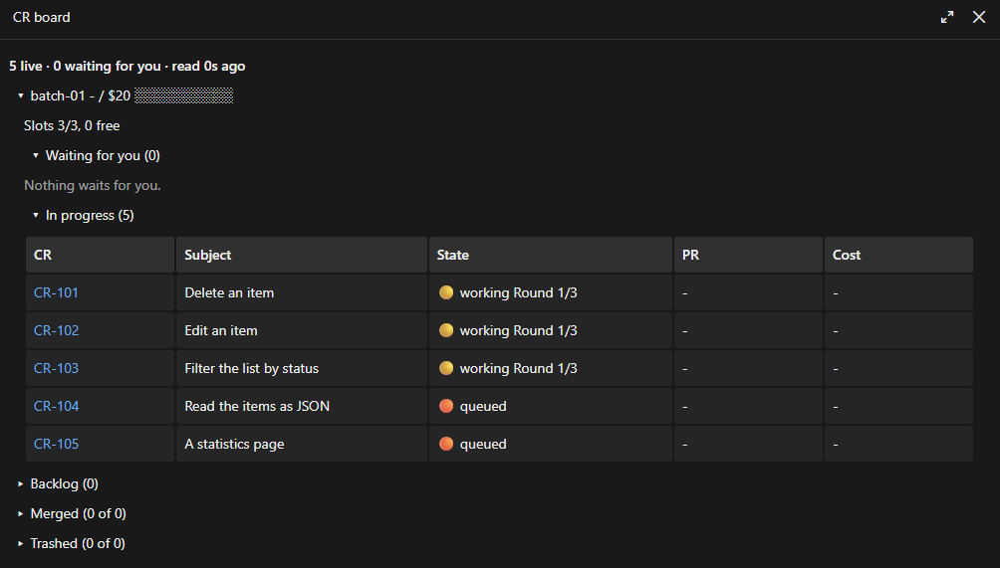
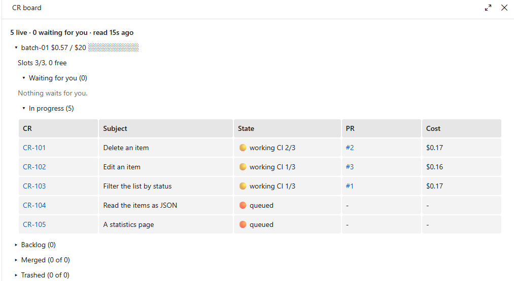
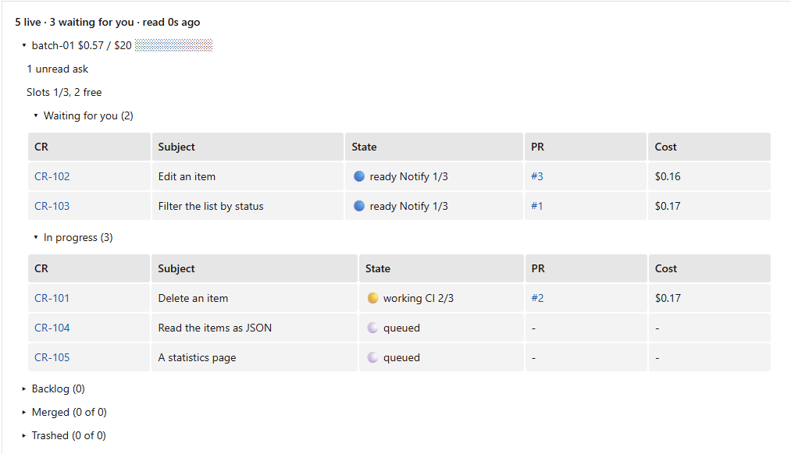
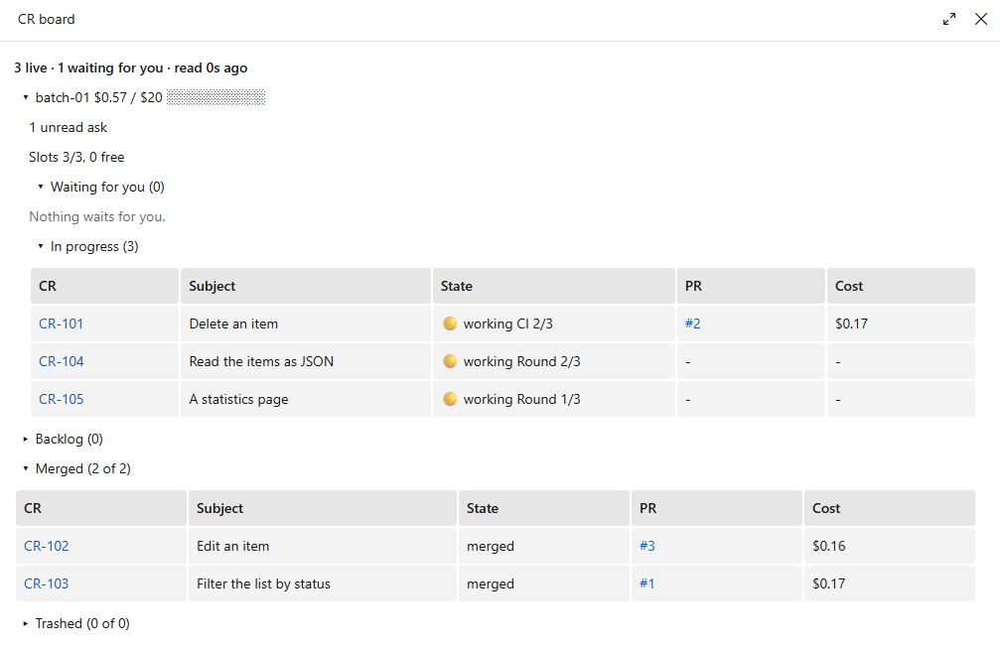
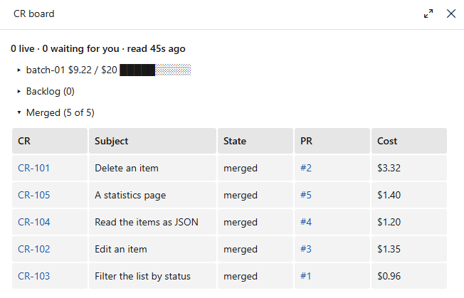

# Boards

The CR board in Claude Code and the remote board, two read-only views of the planning folder.

## The CR board (Claude Code)

### What it is

A Claude Code mod (early access): a read-only pane over the planning folder's `STATUS.json` (one
section per project in a surface). It shows the live batches, the backlog (and `3-ready`), and the
merged and trashed CRs. Nothing of it on Copilot, and the pane is not shown in a Remote Control view
([anthropics/claude-code#99217](https://github.com/anthropics/claude-code/issues/99217)). It writes
nothing and runs no process but `git rev-parse`, to find the main checkout from a worktree.

### How to open it

`/chantier-board` shows or hides it. Loading the `chantier` or `chief-of-staff` skill opens it too
(not `griller`).

### How to read it

At the top, a header line: `5 live · 0 waiting for you · checked 3s ago, every 15 s`: when the pane last checked, and its period. Under it, each batch has a
line (its id, its cost against its budget, a gauge), its unread asks and its slots (`Slots 3/3, 0
free`). Then "Waiting for you" and "In progress", with the columns CR, Subject, State, PR and Cost.
The state says the state, the step and the round: `working Round 1/3`, `working CI 2/3`,
`ready Notify 1/3`, `queued`. Then Backlog, Merged (n of m) and Trashed (n of m). Press a CR for its
sheet and its documents. The pane checks every 15 seconds while open and reads a file again only when it changed. A **Refresh** button at the top of the pane (in every view) checks at once: it reads the files again, even unchanged ones, and looks for the planning folders again (a project added to a surface, a `.agents/changes/` created after opening), keeping the page shown and the folds. It does not refresh the batch's cost or record: that moves when the steering session refreshes the status.

### A batch in pictures

A batch just opened: three CRs working in round 1/3, two queued, no PR yet, no cost.



Three CRs in CI, with PRs #1 to #3 and their costs: $0.57 of $20.



"3 waiting for you": two CRs ready, and one unread ask.



"Merged (2 of 2)" open.



The batch done: 0 live, $9.22 of $20, and "Merged (5 of 5)" with each CR's PR and cost.



### Two facts the pictures raise

They are not bugs.

- The header's "waiting for you" counts the unread asks as well as the table's rows: in the
  merged picture, "1 waiting for you" sits beside "Nothing waits for you".
- The batch's cost is priced when the steering session refreshes the status, not live: $0.57 over
  three pictures while the CRs moved on, then $9.22 once the batch was done.

### The guard of a worker's writes

The same mod starts an agent whose prompt holds a `writes:` line in its first folder and refuses
its Write, Edit or NotebookEdit outside the folders named; a shell write is not guarded: the
steering session reports what changed in the main checkout.
## The remote board

In remote there is no pane, so the Chief of Staff also starts a small web page, `chantier board`,
that shows the same view: the batch with its CRs (state, round, cost, PR), the inbox, `3-ready`
and the backlog, the last merged and trashed CRs, and each CR's files as text. It reloads
itself every 30 seconds, is **read only** (to act, you talk to the Chief of Staff), writes no file
and stops when its session leaves the seat. It listens on `127.0.0.1:8765` by default, so only the
machine itself reaches it. To open it from your phone, set the address once in `chantier.yaml`
(on your word, the Chief of Staff writes it):

```yaml
board:
  host: 0.0.0.0   # or the machine's Tailscale address; default 127.0.0.1
  port: 8765      # default 8765
```

Reach it over your private network: Tailscale (the tailnet's address) or your LAN (`0.0.0.0`
listens on every network of the machine). **There is no password**: the Chief of Staff tells you
the address and that fact when the board listens beyond the machine. You can also run it by hand:
`chantier board --host <address> --port <n>`.
