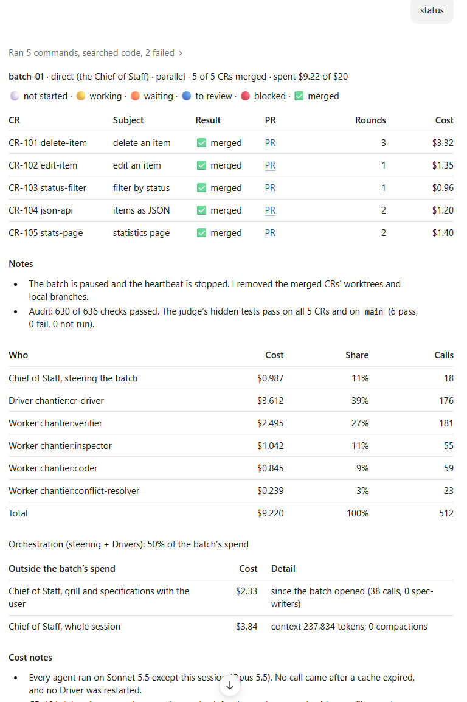

# Costs and budgets

How chantier measures what a batch costs, and the budget.

`chantier cost` reports what the Foreman's session and its subagents cost, in total and in one
line for the Foreman, one per Driver type and one per worker type (or by CR), and the lines add up
to the total. `chantier cost --explain` adds what explains each figure: the agents, the calls, the
model, the shares of cost in cache reads, cache writes and output, the calls made after the cache
expired and the Drivers restarted. The reports show them as a table with the ratio of orchestration
(steering + Drivers over the batch's spend), the figures as printed. On Claude, chantier
prices the transcripts with its own rates for the models the host offers; on Copilot, it reads
per-call costs from
[copilot-session-usage](https://github.com/gsemet/copilot-session-usage), which uv fetches from
PyPI, and flags calls that were estimated rather than billed. In direct mode the steering is one
`Chief of Staff, steering the batch` line, counted in the batch's spend and budget as a Foreman's is; the
Chief of Staff's grill and specifications with you (its spec-writer's and spec critic's calls included), and the rest of its session, stay apart on their own lines (a part that
cannot be measured says `unknown`, and the compactions are counted, not priced). A missing
transcript is an error, never a guess. The calls of a model with no price are counted and
named, the figure is a floor (`at least`), and you add the price under `prices:` in
`chantier.yaml`. The Foreman records the spend at each
heartbeat (`chantier status --refresh`); past the batch budget it starts nothing new.

An example of the report's cost tables, for a batch that is done: the cost by role with the
orchestration share, the spend outside the batch and the cost notes.

You get the cost without asking: the Chief of Staff adds a CR's line when it tells you the CR is
ready or merged, and the batch's `STATUS.md` (its exit report) ends with the total, the budget,
the split between Foreman, Drivers alone and workers alone, the costliest CRs and the Foreman's
wakes and context (`chantier cost --summary`). The Chief of Staff's own session is priced apart:
its line shows two figures (since the batch opened, the whole session) and its context size, and
it is never in the batch's spend nor in its budget.
