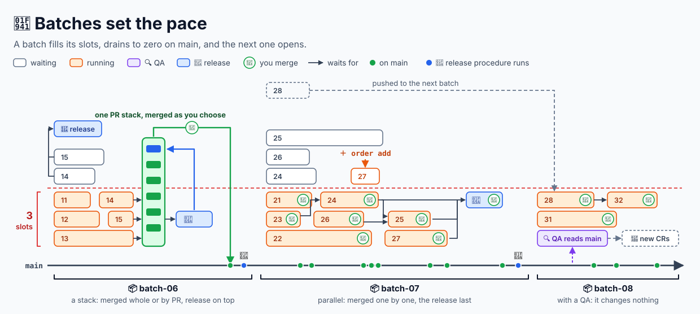

# Batches and the life of a Change Request

Understand how a set of Change Requests becomes a batch, how a batch is run and merged, how one
Change Request goes from an idea to the archive, and how a release is made.

## Batch modes

chantier works a set of changes and delivers them in coordination. Most of the time you plan a set
of CRs ahead and build a batch. For instance, you grill during the day and chantier implements the
whole batch on its own overnight, up to a ready-to-merge PR/MR stack.

A batch has one of three modes. They say how the pull requests of the batch relate, and who merges
what, when. You never merge through chantier: you merge, and the steering session guides you.

| Mode | You say | How the PRs relate | How you merge |
| --- | --- | --- | --- |
| Parallel (the default) | nothing | Every CR starts from the default branch at once, and its PR is on the default branch. | In the order the PRs become ready to merge, unless you say otherwise. After each merge, every PR still open is rebased onto the default branch and its checks run again, conflict or not. |
| Series | "run these in series" | The CRs have the order you gave. The next CR starts once the previous one is handed back ready, from its pushed branch, and its PR is a draft. | One PR after the other: once the previous one merges, the next is rebased onto the default branch and turns ready to merge. The Chief of Staff guides you merge by merge. |
| Stack | "build a stack of these" | Parallel, with a stack driver. As soon as two PRs are handed back ready, the stack driver makes one native stack on the forge (on GitHub, with the `gh stack` extension, which chantier recommends). The CRs started afterwards are built on it. | In one action from the top PR, or one PR at a time from the bottom, as you choose. The release commit is last. |

On request ("switch to a stack", "switch to parallel"), a running batch changes to any other mode at
once. Merged CRs never change. A change inserted into a stack ready to merge sends the PRs above it
back to draft first, then restacks and verifies the stack before they turn ready to merge again.

A CR that depends on another (`depends.json`) waits for it in every mode. A fix CR sits outside a
series and a stack, and a release CR is their top. The lifecycle of a batch (running, paused,
closed) is the same in all three modes.

### Batches set the pace

A batch fills its slots, drains to zero on the default branch, and the next one opens. At most three
Drivers run at once; the release CR waits for every other CR of its batch.

### The life of a batch

There is one batch at a time: it is running, then paused, and closed only on your word. The states
are the same in Foreman and direct mode. The use cases show them in
[Foreman mode](../how-to/use-cases-foreman.md) and [direct mode](../how-to/use-cases-direct.md).

## Change Requests Lifecycle

A Change Request is one more level over the issues of your tracker (Jira, GitHub, GitLab...). Small
requests that do not belong in the tracker (an idea, a bug, a report) are accepted and prioritised
as CRs. The tracker keeps the strategic vision, the external requests and the long-term planning.
The planning folder, in your project or external, is the tactical, short-term plan, the closest to
the work site.

chantier turns each request into a folder in the planning folder, carried through planning, study,
implementation, QA, deployment and finally archive.

The agents add files to the folder, essentially Markdown: prototypes, studies, the specification,
reports. Some names are mandatory, and you are free to add any you see fit (SVG, drawio, ...).

You can connect any external tool, as long as it translates to a text, XML, SVG or local file that
an agent can interpret, with or without specialised tools.

## Detailed lifecycle

The figure below shows the major operations:

- Planning, mainly with the Chief of Staff.
- The central implementation loop, with delegation to Drivers and strict reviews.
- A QA loop, where a validation agent acts like a user to validate what the integration and
  end-to-end tests do not.
- The release process, with supervised auto-merge, which can monitor the deployment (to production,
  to package registries, to documentation pages, ...).

## Releases

A release is a CR like the others: a Release driver runs it by your project's own release
procedure, from your "release" to the archive. You approve each irreversible action, or say "auto".

A release procedure ranges from a simple package publish (PyPI, npm) to a long one. The Release
Driver and the Chief of Staff follow your project's own.

For example, one project publishes to GitHub Pages and to a marketplace. Its Release Driver follows
the procedure with the tools its session has, each irreversible step on your approval:

1. It creates the release and its notes, and puts them up for review.
2. It follows the release pipeline.
3. It waits for the marketplace to publish (about ten minutes on the VS Code marketplace, an order
   of size).
4. It publishes the release notes and the announcement thread on X/Twitter.
5. It holds a retro that improves the procedure, which stays written and maintained in the
   project.
