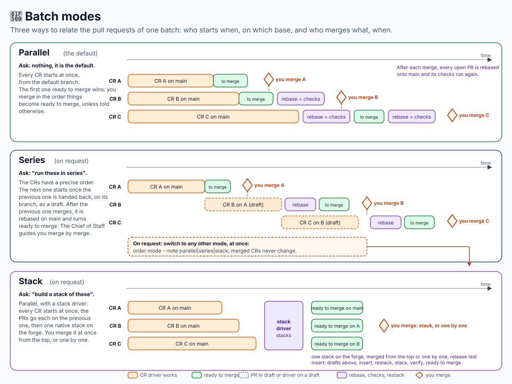
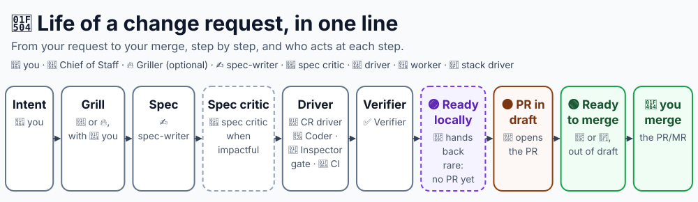
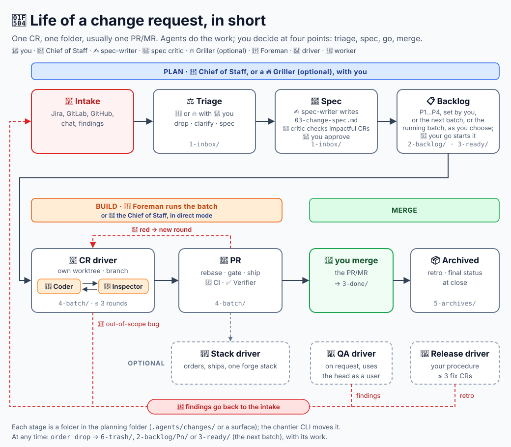
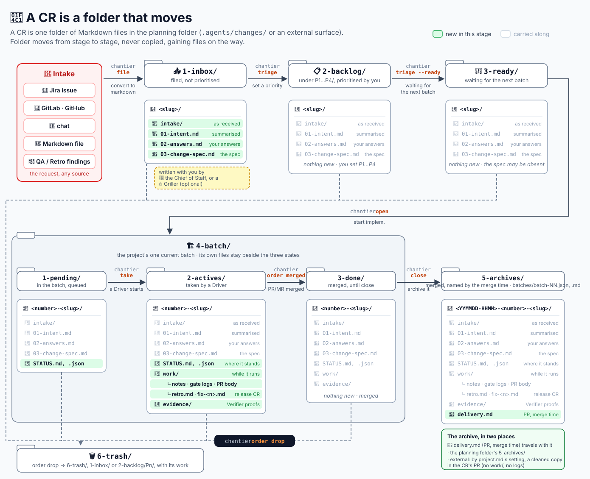
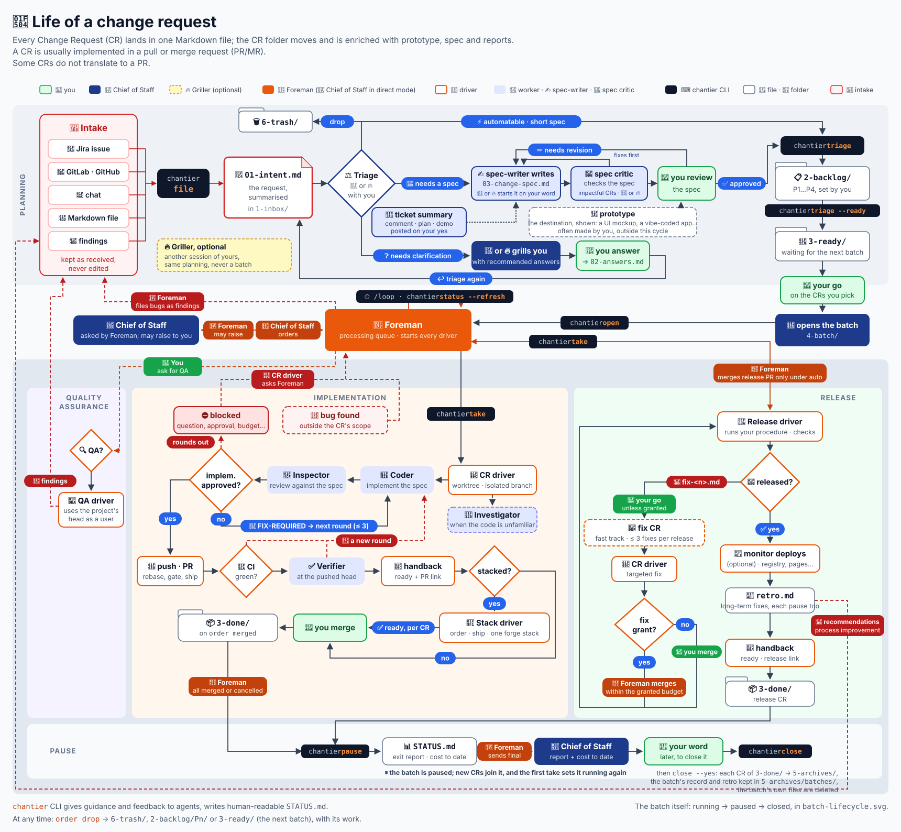
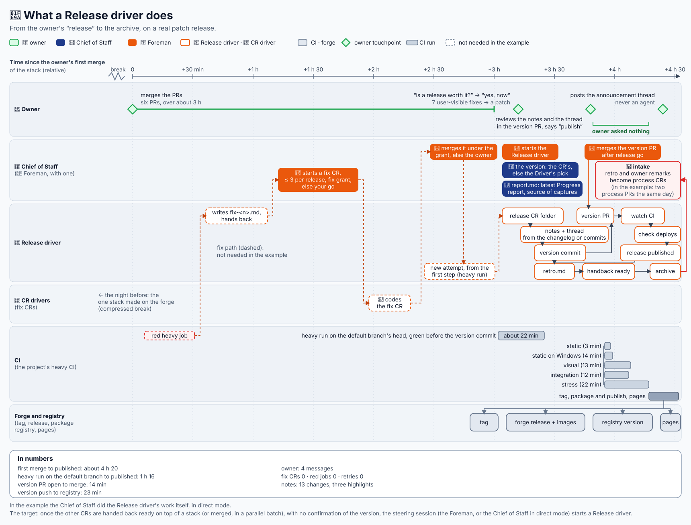

# Batches and the life of a Change Request

How a set of Change Requests becomes a batch, how a batch is run and merged, how one Change Request goes from an idea to the archive, and how a release is made.

## Batch modes

Chantier is meant to work a set of changes and deliver them in coordination. Most of the time you
plan a set of CRs ahead and build a batch: for instance you grill during the day and chantier
implements the whole batch on its own overnight, up to a ready-to-merge PR/MR stack.

A batch has one of three modes. They say how the pull requests of the batch relate, and who merges
what, when. You never merge through chantier: you merge, and the steering session guides you.

- **Parallel** (the default; ask for nothing): every CR starts from the default branch at once and
  its PR is on the default branch. The first one ready to merge wins: you merge in the order things become
  ready to merge, unless you say otherwise. After each merge, every PR still open is rebased onto the
  default branch and its checks run again, conflict or not.
- **Series** ("run these in series"): the CRs have a precise order, the one you gave. The next CR
  starts once the previous one is handed back ready, from the previous CR's pushed branch, and its
  PR is a draft. Once the previous one merges, the next one is rebased onto the default branch and
  turns ready to merge. The Chief of Staff guides you merge by merge. On request ("switch to a stack", "switch to parallel"), a
  running batch changes to any other mode at once; merged CRs never change.
- **Stack** ("build a stack of these"): parallel, with a stack driver. Every CR starts at once, the
  PRs go each on the previous one, and as soon as two PRs are handed back ready the stack driver makes one native
  stack on the forge, and the CRs started afterwards are built on it (GitHub; install the `gh stack` extension, which chantier recommends). You merge
  it in one action from the top PR, or one PR at a time from the bottom, as you choose merge by
  merge; the release commit is last. A change inserted into a stack ready to merge
  sends the PRs above it back to draft first, then restacks and verifies the stack before they turn
  ready to merge again.

A CR that depends on another (`depends.json`) waits for it in every mode. A fix CR
sits outside a series and a stack; a release CR is their top. The lifecycle of a batch (running, paused, closed) is the same in
all three.

### Batches set the pace

A batch fills its slots, drains to zero on the default branch, and the next one opens. At most three
Drivers run at once; the release CR waits for every other CR of its batch.

### The life of a batch

One batch at a time: it is running, then paused, and closed only on your word. The states are the same in Foreman and direct mode; the use cases show them in [Foreman mode](../how-to/use-cases-foreman.md) and [direct mode](../how-to/use-cases-direct.md).

## Change Requests Lifecycle

A "Change Request" is one more level over the issues of your tracker (Jira, GitHub, GitLab...).
Small requests that do not belong in the tracker (an idea, a bug, a report) are accepted and
prioritised as CRs. The tracker keeps the strategic vision, the external requests and the long-term planning.
The planning folder, in your project or external, is the tactical, short-term plan, the closest to
the work site; Jira, GitLab work items or GitHub issues keep the strategic, long-term plan, or
serve as the interface for outside customers and support.

Chantier turns each request into a folder in the planning folder, carried through planning, study, implementation, QA, deployment and finally archive.

Several files, essentially markdown will be injected into the folder with prototypes, studies, spec, reports,...

Some names are mandatory, you are free to add any you see fit (svg, drawio, ...).

Custom connection to any external tools is also possible, as long as it translates to a text, XML, SVG, or local file an agent can interpret with our without specialized tools.

## Detailed lifecycle

This displays the major operations:

- Planning, mainly with the Chief of Staff
- the central implementation loop, which delegation to drivers and strict reviews
- a QA loop, where a validation agent can act like a user to validate all that is **not** validated by the integration, e2e tests
- release process with supervised auto-merge, that can monitor the deployment (to production environment, to package registries, to documentation pages,...)

## Releases

A release is a CR like the others: a Release driver runs it by your project's own release procedure, from your "release" to the archive. You approve each irreversible action, or say "auto".

A release procedure ranges from a simple package publish (PyPI, npm) to a long one, and the
Release Driver and the Chief of Staff follow your project's own. For example, one project's
procedure, which the Release Driver follows with the tools its session has, each irreversible step
on your approval: the project publishes to GitHub Pages and to a marketplace, so the Release Driver
creates the release and its notes and puts them up for review, follows the release pipeline, waits
for the marketplace to publish (about ten minutes on the VS Code marketplace, an order of size),
publishes the release notes and the announcement thread on X/Twitter, then holds a retro that
improves the procedure, which stays written and maintained in the project.
