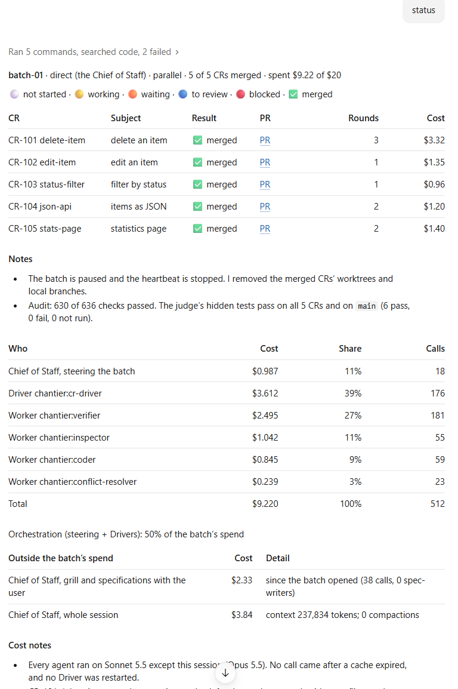

# Costs and budgets

How chantier measures what a batch costs, and how it caps it with a budget.

## What `chantier cost` reports

`chantier cost` reports what the Foreman's session and its subagents cost. It gives the total and
one line for the Foreman, one per Driver type and one per worker type (or by CR). The lines add up
to the total.

`chantier cost --explain` adds what explains each figure: the agents, the calls, the model, the
shares of cost in cache reads, cache writes and output, the calls made after the cache expired and
the Drivers restarted.

The reports show them as a table with the ratio of orchestration (steering + Drivers over the
batch's spend), the figures as printed.

## Where the prices come from

- On Claude, chantier prices the transcripts with its own rates for the models the host offers.
- On Copilot, it reads per-call costs from
  [copilot-session-usage](https://github.com/gsemet/copilot-session-usage), which uv fetches from
  PyPI, and flags calls that were estimated rather than billed.
- A missing transcript is an error, never a guess.
- The calls of a model with no price are counted and named, and the figure is a floor (`at least`).
  You add the price under `prices:` in `chantier.yaml`.

## Steering, and the Chief of Staff's own session

In direct mode the steering is one `Chief of Staff, steering the batch` line, counted in the
batch's spend and budget as a Foreman's is.

The Chief of Staff's grill and specifications with you (its spec-writer's and spec critic's calls
included), and the rest of its session, stay apart on their own lines. A part that cannot be
measured says `unknown`, and the compactions are counted, not priced. That line shows two figures
(since the batch opened, the whole session) and its context size. The whole-session figure covers
the whole session and, in a direct batch, names its part in the batch's spend. It is never in the
batch's spend nor in its budget.

## The budget

The Foreman records the spend at each heartbeat (`chantier status --refresh`). Past the batch
budget, it starts nothing new.

## Where you see it

You get the cost without asking. The Chief of Staff adds a CR's line when it tells you the CR is
ready to merge or merged. The batch's `STATUS.md` (its exit report) ends with the total, the
budget, the split between Foreman, Drivers alone and workers alone, the costliest CRs and the
Foreman's wakes and context (`chantier cost --summary`).

Below, the report's cost tables for a batch that is done: the cost by role with the orchestration
share, the spend outside the batch and the cost notes.



`close` also keeps the same figures as data, `cost_receipt`, in the batch's record
(`batch-NN.json`). It holds:

- the steering, and one entry per Driver;
- the split, each part with its priced `calls`;
- the `models`: one entry per model of the batch's spend, with `model`, priced `calls`, `usd`
  apportioned in cents to add up to the total, and `unpriced`. A record without `models` was closed
  before it existed;
- what is outside the budget.

The web board's Costs page prints them as a receipt. Each CR of the record also carries its `order`
and its `after` list (the CR ids it waited for at close), from which the board's Batch page draws a
closed batch's graph.

## What a batch costs, measured

These figures come from two real batches of chantier's own eval, run on 2026-11-15 on a small
sandbox repository: the same five frozen CRs, a $20 budget, one run each. Run 1 was steered by a
Foreman on Sonnet 5.5, in stack mode. Run 2 was steered by the Chief of Staff in direct mode on
Opus 5.5, in parallel mode. The workers (Drivers, Coder, Inspector, Verifier, conflict resolver) ran
on Sonnet 5.5 in both. The figures are orders of magnitude, not averages.

| | Run 1: Foreman (Sonnet 5.5), stack | Run 2: direct (Opus 5.5), parallel |
|---|---|---|
| The batch (its budget's spend) | $10.28 | $11.52 ($11.91 once closed) |
| Steering, inside that spend | $2.10 (20%) | $3.39 (30%) |
| The Chief of Staff's session, outside the budget | about $4.67 | $0.05 |
| All in | about $14.6-15.0 | about $11.5-11.9 |

In Foreman mode the Chief of Staff's $4.67 came from being woken at each Foreman turn, with a context
of about 200k tokens.

What the two runs show:

- Steering and Drivers together are over 60% of the batch in both runs; coding is 7-8%.
- A steering session starts at about 70k tokens of context before any work.
- Inside the budget, the Sonnet Foreman cost less than the Opus Chief of Staff steering the same five
  CRs ($2.10 against $3.39, with about as many calls). But Foreman mode adds a second session, the
  Chief of Staff's, and in run 1 it cost more outside the budget than the Foreman saved: all in, run 1
  cost about $3 more than run 2.
- The workers' cost follows the batch mode, not the steering: parallel mode spent more on Verifiers
  and on rebases, stack mode spent on its stack driver.

What they do not show:

- No general conclusion that a Foreman is cheaper or dearer than direct mode: one run each, and the
  two runs differ in batch mode as well as in steering.
- Nothing on whether a Sonnet Foreman steers as well as the Opus Chief of Staff: both batches ended
  green, on a small sandbox, with an operator who knew the answers.
- No spread: a fair comparison needs the same batch mode in both steerings and a few runs each.

To measure your own, ask "what did it cost?" or run:

```bash
chantier cost
```

```bash
chantier cost --by cr
```

```bash
chantier cost --explain
```

The first gives the batch's spend by role (the steering line, each Driver type, each worker type),
the second by CR, the third what explains each figure (agents, calls, model, cache shares).
