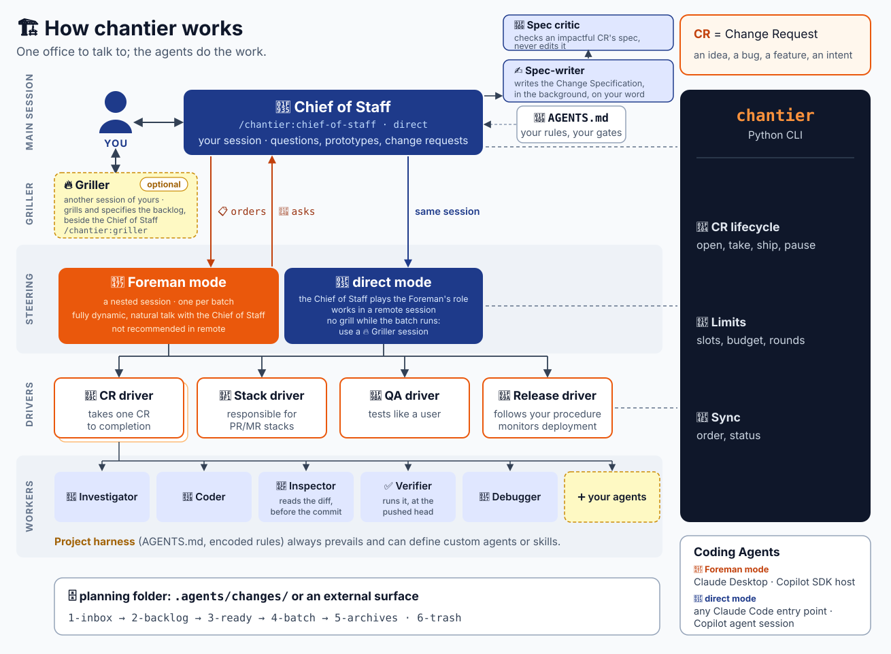
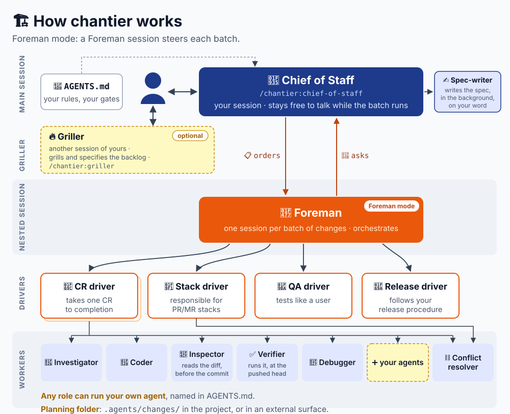
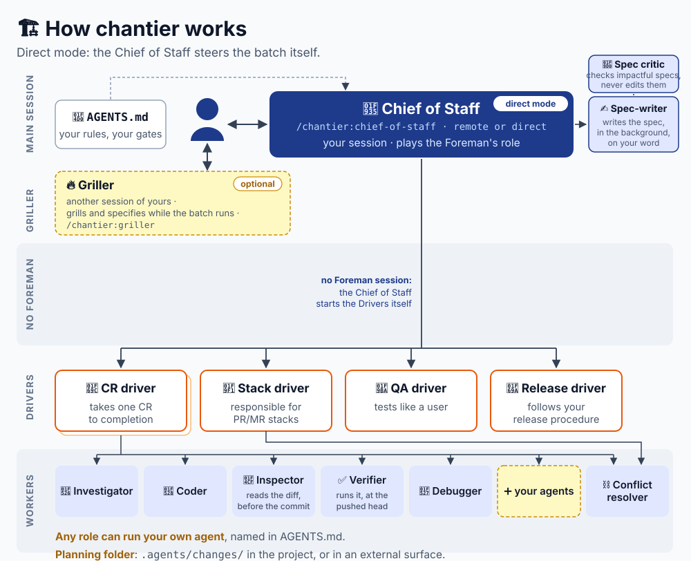
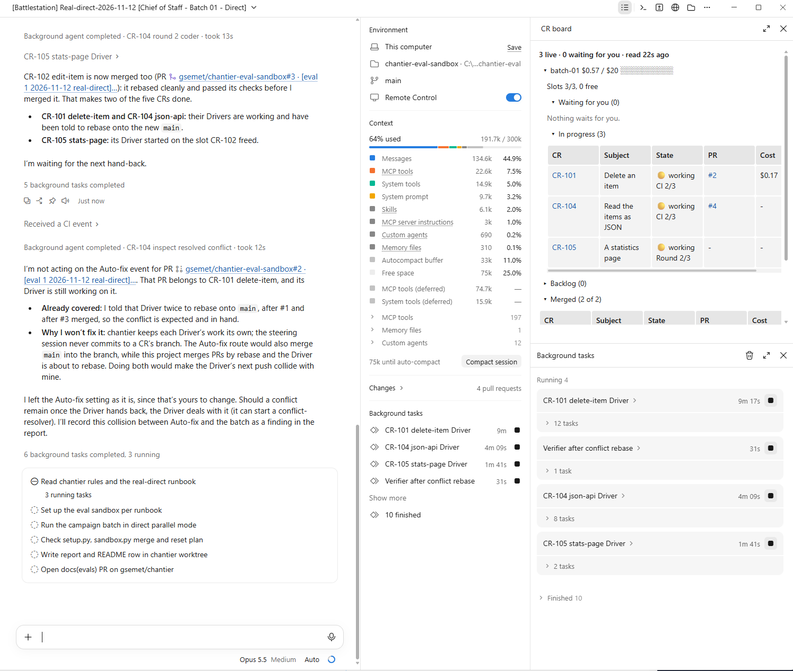

# chantier

The construction site for your Software Factory.

- **Change Requests beside your tracker.** A Change Request (CR) is one more level over your
  tracker's issues: small requests are accepted and prioritised here, without entering the
  tracker ([more](explanation/batches-and-lifecycle.md#change-requests-lifecycle)). A CR is a folder whose content varies, from one
  line of text to several HTML prototypes; the agents read it and find the request's intent.

  CRs are fungible in the plan: they can be handled, split, and so on.
- **Working in batches.** chantier is not continuous delivery (1 intent = 1 PR = 1 release). It is
  n CRs → m PRs (normally close to n) → p batches (1, 2, 3...) → 1 release.
- **One person to talk to.** You talk to the Chief of Staff, in your own session. It keeps the
  backlog and asks the questions a change needs. Nothing starts without your go, and you merge
  the pull requests. Optional: a Griller session grills beside it.
- **Direct or Foreman.** The Chief of Staff steers a batch itself (direct mode), or a nested
  Foreman session steers it (Foreman mode). The mode follows where you are: Foreman at the
  desktop, direct from the phone under Remote Control, or in a terminal or VS Code; `foreman` or
  `direct` forces one. In both a CR added while the batch runs is queued and taken when a slot
  frees. Direct mode is simpler to use remotely, from a phone; Foreman mode lets you grill future
  topics with the Chief of Staff naturally while the Foreman runs the batch.
- **Respect the project's rules.** Your changes must be able to land without chantier: chantier is
  there to industrialise. Your `AGENTS.md`, and an optional `chantier.yaml` (the project's, and its planning surface's;
  the agent and model of each role, the skills it needs), are the only configuration. Everything
  chantier writes is Markdown and JSON in the planning folder: `.agents/changes/` in your project,
  or the project's folder of an [external planning surface](explanation/planning-modes.md) (and, from the
  board, a project's `chantier.yaml` in its planning surface).

::::{grid} 1 2 2 2
:gutter: 3

:::{grid-item-card} Tutorials
:link: tutorials/index
:link-type: doc

Learn chantier by doing one batch from start to finish, step by step, in Claude Code.
:::

:::{grid-item-card} How-to guides
:link: how-to/index
:link-type: doc

Do one thing: pick a mode, declare your gates, choose your agents and models, cut a release.
:::

:::{grid-item-card} Explanation
:link: explanation/index
:link-type: doc

Understand how it works: planning modes, batches and the life of a Change Request, what a batch costs.
:::

:::{grid-item-card} Reference
:link: reference/index
:link-type: doc

Look it up: the boards, the planning folder, the supported hosts, what you say to the Chief of Staff.
:::
::::

New here? [Install chantier](installation.md), then follow the [tutorial](tutorials/claude-code.md).
Past releases and their notes are on [GitHub Releases](https://github.com/gsemet/chantier/releases).

## How Chantier works

Everything starts with a new session and one boot skill, `/chantier:chief-of-staff`, with or
without an argument. With none, the mode follows the surface; `foreman` or `direct` forces one.

The detailed view first, then two simpler views, one per mode.



**Foreman mode** (`/chantier:chief-of-staff` at the desktop, or `/chantier:chief-of-staff foreman`):
a nested Foreman session steers each batch; your Chief of Staff stays free for a natural, dynamic
conversation while it runs.



**Direct mode** (`/chantier:chief-of-staff` under Remote Control, in a terminal or VS Code, or
`/chantier:chief-of-staff direct`): the Chief of Staff steers the batch itself; it works in a
remote session; to grill while a batch runs, open a Griller session.





A direct batch: the Drivers run straight from the current session.

While the batch runs, the Chief of Staff in direct mode declines to grill new requests and points
you to a separate Griller session (`/chantier:griller`).

The difference that matters most: in direct mode the Chief of Staff, busy steering, holds no
grill while the batch runs; in Foreman mode it stays free to grill. In both, a new CR can join
the running batch and waits for a free slot.

```{toctree}
:hidden:
:caption: Start

installation
```

```{toctree}
:hidden:
:caption: Documentation

tutorials/index
how-to/index
explanation/index
reference/index
```
