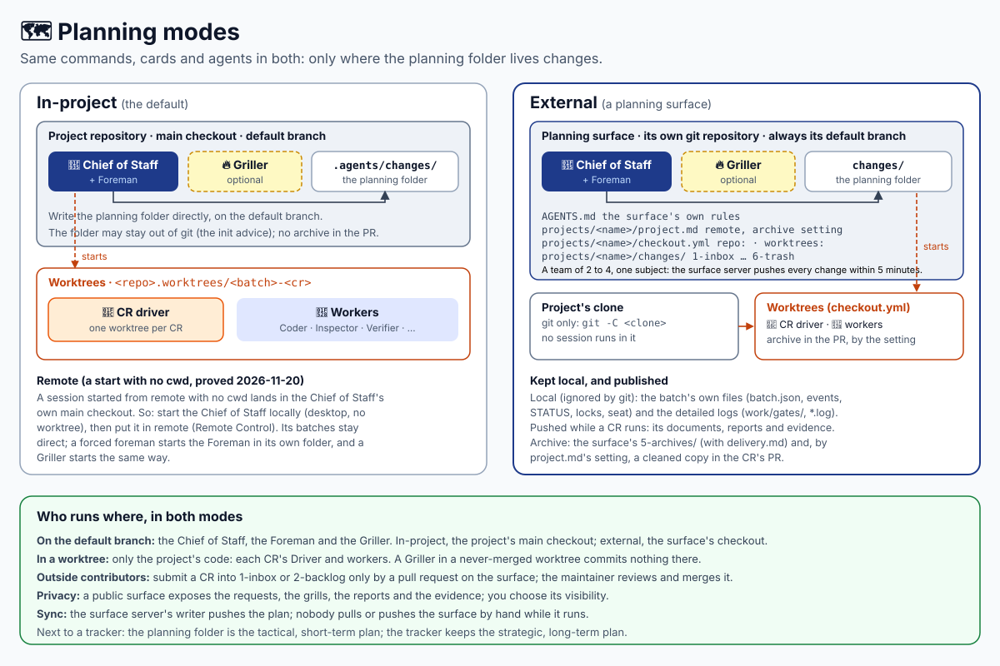

# Planning modes

Chantier plans in a **planning folder**, in one of two modes. Every command, card and agent works
the same in both.



| | In-project (the default) | External |
| --- | --- | --- |
| Planning folder | `<project>/.agents/changes/` | `<surface>/projects/<name>/changes/` |
| Declared by | nothing | the surface's `projects/<name>/` (`checkout.yml`, `changes/`) |
| CLI | `$CHANTIER <command>` | `$CHANTIER --project <folder> <command>` (the `cli:` lines carry it) |
| Archive in the PR | no | by the project's setting, default no |

## What runs where

| Session | In-project | External |
| --- | --- | --- |
| Chief of Staff | the project's main checkout, default branch | the surface's checkout, its default branch; one session per project |
| Griller | the main checkout; or a never-merged worktree, files sent to the Chief of Staff | the surface's checkout; or a never-merged surface worktree, files sent to the Chief of Staff |
| Foreman | the project's main checkout; it fast-forwards it after each merge | the surface's checkout; the CLI removes merged CRs' worktrees with `git -C <clone>`; it fast-forwards the clone after each merge |
| Driver, workers | the CR's worktree of the project | the CR's worktree of the project, under `checkout.yml`'s `worktrees` |

The surface's writer runs in the surface server (`chantier board`), on one machine per surface:
it is the only process that commits and pushes the plan. Only the project's code gets worktrees. The surface is never worked in a worktree by the Chief of
Staff or the Foreman.

## The planning surface

A git repository of its own, with one folder per project:

```text
<surface>/
├── AGENTS.md                      the surface's own rules
└── projects/<name>/
    ├── project.md                 the project: its remote, its default branch, its rules
    ├── checkout.yml               where the project's clone and worktrees are
    └── changes/                   the planning folder: 1-inbox … 6-trash
```

It is an isolated, multi-user workspace for a very small active team (2 to 4 people) working
around one subject. It works like an Obsidian vault with obsidian-git: the surface server's
writer commits, rebases and pushes the plan, within 5 minutes of a change
([below](#the-surfaces-writer)). Chantier does not coordinate several Chiefs of Staff's work
beyond that: two machines, each with its writer, meet as two git clones.

- `checkout.yml` has two keys, `repo:` and `worktrees:`, paths relative to `projects/<name>/`
  (defaults `.repo/` and `.worktrees/`). The project's clone is used for git only
  (`git -C <clone>`); no chantier session runs in it.
- `project.md` is your prose. One fixed line is read: `- Archive in the PR: yes` or `no`
  (`no` when absent).
- The surface root and each project's folder may hold a `chantier.yaml` (or `chantier.yml`): the
  configuration of all its projects, and of that project. The code repository's own `chantier.yaml`
  is the strongest layer, and the plugin's shipped defaults the weakest (see
  [your own agents and models](agents-and-models.md#the-layers)).
- A tracker issue, when there is one, is a link inside the CR, not part of its folder's name.

## Pointing a project to its surface

The project's `AGENTS.md` may hold one optional line in its `chantier` section:

```markdown
- planning: https://github.com/<you>/<surface>, projects/<name>
```

The Chief of Staff reads it, the CLI does not. A session started in the project that finds it
says "this project plans in the surface at …; start the session there" and plans nothing in the
project. You write the line.

## What stays local, what is pushed

Never in the surface's git (the CLI keeps a `.gitignore` in the planning folder): the batch's own
files (`batch.json`, `events.jsonl`, `brief.md`, the STATUS files, locks, `.batch-number`,
`seat.json`) and the detailed logs (`work/gates/`, `*.log`). Pushed while a CR runs: its
documents (`intake/`, `01`–`03`), its `evidence/` and the reports in `work/`, by the writer,
within 5 minutes of a change. The writer pushes every local commit of the surface's branch, the
ones you made by hand included; it never commits the surface's other files (`AGENTS.md`,
`scripts/`), an ignored path, or the project's clone and worktrees. With no surface server
running, chantier writes nothing to the surface.

## Archives, in two places

- In the surface's `5-archives/<YYMMDD-HHMM>-<number>-<slug>/`: the CR's folder as the surface
  holds it (no detailed logs), with a `delivery.md` that names the PR, the merge time and whether
  the archive is also in the PR.
- In the CR's PR, in external mode, when `project.md` says `yes`: the Driver
  commits, before each hand-back `ready`, a cleaned archive at `.agents/changes/5-archives/…/`
  with `intake/`, `evidence/`, `01-intent.md`, `02-answers.md`, `03-change-spec.md`,
  `delivery.md` and `STATUS.md`, and the retained prototype (`prototypes/NN-<idea>/`, zipped if
  it is big); no `work/`, no logs. A project that ignores `.agents/changes/`
  gets the PR as it is and the Chief of Staff asks you.

## Grillers

A Griller writes prototypes, plans and other artifacts cleanly in the CR's folder, in every mode,
never in the host's scratchpad. Its writes are published by the writer, as every session's. In a
never-merged worktree it commits nothing: its files go to the Chief of Staff, who places them in
the planning folder. If the surface's rules rank above the cards, they can say so: "a session in a
worktree of the surface sends its files to the Chief of Staff."

## The surface's writer

One writer per surface and machine, the one that keeps the state and exposes the server (chantier's
equivalent of Vercel Board). It runs in the surface server, as long as the server does, and:

- **commits** the plan's published files, once they have been still for 10 s (or the oldest change
  is 2 minutes old), with your own git identity and hooks; **fetches**, **rebases** on the upstream
  and **pushes**, never forcing. It pushes every local commit of the branch, the surface's other
  files' commits included. Nobody pulls or pushes the surface by hand while it runs.
- **shows its state:** `synced`, `pending`, `syncing`, `offline`, `conflict` or `blocked` (with the
  reason), as a `writer:` line in `status` and `seat`, and as a pill on the board
  ([`web-board.md`](web-board.md#the-surfaces-writer)). `$CHANTIER sync now` (or the board's
  **Sync now**) asks for a cycle at once.
- **stops with the server:** after one final cycle, up to 30 s, that commits and pushes what is
  pending.
- **hands a conflict to the Chief of Staff:** a rebase that conflicts is left for the Chief of
  Staff to resolve; the writer pushes once it is done.
- **writes nothing with no server running:** every command that writes in the surface is
  refused, with the way to start the board.

Preflight P13 warns when the surface's `AGENTS.md` still tells the sessions to pull or push by
hand, or an autosync of the surface's own is running.

## With no agent

Start the board from the surface's root with
`uvx --from git+https://github.com/gsemet/chantier@v<version> chantier board` (the version the
surface's planners use). The board serves and runs the writer until you stop it; you guarantee it
is running while you work. A Chief of Staff session that starts later reuses it (`board already running
at`), and its leaving does not stop it. A session running another chantier version is refused
with the board's version, PID and stop command, as today ([`web-board.md`](web-board.md), "When
it stops"): keep the surface's pinned version on the planners' release.

## Two sessions on one surface

Several Chief of Staff sessions may work one surface on one machine (two projects, two batches).
None stages, pulls or pushes: one writer commits and pushes for all, and the other sessions write
the working tree under the CLI's locks. One board serves the surface, whatever the port. `preflight` (P14) and `status` list the
other batches of the surface (project, batch, state, steering, and how many Drivers each runs), so
a session picks its slots knowing the machine's load; there is no cap and no message between
sessions. Only the projects of the same surface are seen.

## Outside contributors

They submit a CR, into `1-inbox` or a priority of `2-backlog`, only by a pull request on the
surface. You review and merge it on the forge; the Chief of Staff reads the CR like any other.

A PR or MR merged on the project without chantier is archived on your word ("archive <link>") as
`5-archives/<YYMMDD-HHMM>-outside-<number>-<slug>/`, with `intake/request.md` and `delivery.md`. In
a planning surface the writer publishes it; with no writer, nothing is written.

## Remote

Proved 2026-11-20: a session the Chief of Staff starts from remote with no `cwd` and no preset
lands in its own main checkout. A session you create from the remote client lands in a worktree
(batch-06), which blocks planning on the default branch. So start the Chief of Staff locally
(desktop, no worktree), then put it in remote (Remote Control): its batches stay direct with no
argument, a forced `foreman` starts the Foreman in its own folder, and on your word it starts a
Griller the same way. See the
[Claude Code reference](../skills/chantier/references/hosts/claude-code.md). On Copilot: not tried.

## Privacy

A public surface exposes the requests, the grills, the reports and the evidence. You choose the
surface's visibility.

## Next to a tracker

The planning folder, in the project or external, is the tactical, short-term plan, the closest to
the work site. Jira, GitLab work items or GitHub issues keep the strategic, long-term plan, or
serve as the interface for outside customers and support.

## Setting one up

1. In the surface, create `projects/<name>/` with `project.md` and `checkout.yml`.
2. Clone the project where `checkout.yml` says (`preflight` names the path when it is missing).
3. Let the host write there: the clone and its worktrees are outside the surface's folder (Claude
   Code: additional working directories; unproved, see its reference).
4. Start the Chief of Staff in the surface and say `init`.
