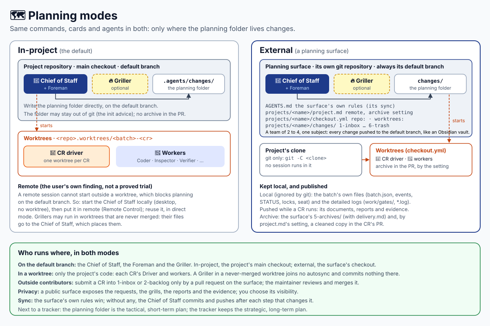

# Planning modes

Chantier plans in a **planning folder**, in one of two modes. Every command, card and agent works
the same in both.



| | In-project (the default) | External |
| --- | --- | --- |
| Planning folder | `<project>/.agents/changes/` | `<surface>/projects/<name>/changes/` |
| Declared by | nothing | the surface's `projects/<name>/` (`checkout.yml`, `changes/`) |
| CLI | `$CHANTIER <command>` | `$CHANTIER --project <folder> <command>` (the `cli:` lines carry it) |
| Archive in the PR | no | by the project's setting, default yes |

## What runs where

| Session | In-project | External |
| --- | --- | --- |
| Chief of Staff | the project's main checkout, default branch | the surface's checkout, its default branch; one session per project |
| Griller | the main checkout; or a never-merged worktree, files sent to the Chief of Staff | the surface's checkout; or a never-merged surface worktree, files sent to the Chief of Staff |
| Foreman | the project's main checkout; it fast-forwards it after each merge | the surface's checkout; it removes merged CRs' worktrees with `git -C <clone>` and fast-forwards the clone after each merge |
| Driver, workers | the CR's worktree of the project | the CR's worktree of the project, under `checkout.yml`'s `worktrees` |

Only the project's code gets worktrees. The surface is never worked in a worktree by the Chief of
Staff or the Foreman.

## The planning surface

A git repository of its own, with one folder per project:

```text
<surface>/
├── AGENTS.md                      the surface's own rules (its sync, among others)
└── projects/<name>/
    ├── project.md                 the project: its remote, its default branch, its rules
    ├── checkout.yml               where the project's clone and worktrees are
    └── changes/                   the planning folder: 1-inbox … 6-trash
```

It is an isolated, multi-user workspace for a very small active team (2 to 4 people) working
around one subject. It works like an Obsidian vault with obsidian-git: every change is pushed to
the default branch as fast as possible, like OneDrive. Its own sync rules win; without any, the
Chief of Staff commits and pushes after each step that changes it. Chantier does not coordinate
several Chiefs of Staff's pushes (a later change). A surface can also name an autosync of its own
([below](#the-surfaces-autosync)).

- `checkout.yml` has two keys, `repo:` and `worktrees:`, paths relative to `projects/<name>/`
  (defaults `.repo/` and `.worktrees/`). The project's clone is used for git only
  (`git -C <clone>`); no chantier session runs in it.
- `project.md` is your prose. One fixed line is read: `- Archive in the PR: yes` or `no`
  (`yes` when absent).
- A tracker issue, when there is one, is a link inside the CR, not part of its folder's name.

## Pointing a project to its surface

The project's `AGENTS.md` may hold one optional line in its `chantier` section:

```markdown
- planning: https://github.com/<you>/<surface>, projects/<name>
```

The Chief of Staff reads it, the CLI does not. A session started in the project that finds it
says "this project plans in the surface at …; start the session there" and plans nothing in the
project. You write the line.

## What stays local, what is pushed

Never in the surface's git (the CLI keeps a `.gitignore` in the planning folder): the batch's own
files (`batch.json`, `events.jsonl`, `brief.md`, the STATUS files, locks, `.batch-number`,
`seat.json`) and the detailed logs (`work/gates/`, `*.log`). Pushed while a CR runs: its
documents (`intake/`, `01`–`03`), its `evidence/` and the reports in `work/`.

## Archives, in two places

- In the surface's `5-archives/<YYMMDD-HHMM>-<number>-<slug>/`: the CR's folder as the surface
  holds it (no detailed logs), with a `delivery.md` that names the PR, the merge time and whether
  the archive is also in the PR.
- In the CR's PR, in external mode, when `project.md` says `yes` (or says nothing): the Driver
  commits, before each hand-back `ready`, a cleaned archive at `.agents/changes/5-archives/…/`
  with `intake/`, `evidence/`, `01-intent.md`, `02-answers.md`, `03-change-spec.md`,
  `delivery.md` and `STATUS.md`; no `work/`, no logs. A project that ignores `.agents/changes/`
  gets the PR as it is and the Chief of Staff asks you.

## Grillers

A Griller writes prototypes, plans and other artifacts cleanly in the CR's folder. In a never-merged
worktree it joins no autosync and commits nothing: its files go to the Chief of Staff, who places
them in the planning folder. If the surface's rules rank above the cards, they can say so: "a
session in a worktree of the surface does not join the autosync; it sends its files to the Chief
of Staff."

A Griller in the surface's checkout joins the autosync group like the other sessions.

## The surface's autosync

A surface names its autosync when its `AGENTS.md` (or the rules it points to) mentions
`.agents/guidelines/autosync.guidelines.md` and `scripts/ai-autosync-git.py` exists. Chantier then
reports it and never replaces it:

- **Preflight P13** and a line of `status` give the state: active (leader, participants, last
  push), stopped, blocked (with the reason), or waiting for your approval of an incident. A script
  that is missing is a warning. Chantier only reads the files under
  `<surface git dir>/ai-autosync/`; it deletes none, a dead participant's included.
- **The board** joins the group once, at a fresh start (never when it reuses a running board), as
  `join . --owner-pid <its pid> --harness generic --session-id chantier-board`, and shows the
  state as a pill (a dot on a phone) with a panel. Its buttons run the script's
  `start . --enable-only`, `stop .` and, for an incident, `approve . <id>` then
  `start . --enable-only`, on your click only. A blocked group has no button: the Chief of
  Staff integrates, then restarts it. The first join needs the network once (uv's cache);
  offline, the board says `board: autosync not joined`.
- **Who joins:** the Chief of Staff, the Foreman and a Griller in the surface's checkout join the
  group at session start. Drivers, and a Griller in a surface worktree, never join. While the group
  is enabled, nobody commits or pushes the surface by hand.
- **The four states:** active (green), stopped (grey, commit by hand), blocked (red, with its
  reason) and waiting for approval (orange, with the incident).
- **Who fixes a block:** the Chief of Staff. When upstream moved it integrates by rebase, loses no
  change, never force-pushes, then restarts the group; for LFS, Gitleaks or a conflict it repairs
  what is its own, else tells you the reason and waits.
- **The Chief of Staff** never runs `approve`, even on your word in the chat; it shows you the
  incident and waits for your click on the board or your own terminal.

## Outside contributors

They submit a CR, into `1-inbox` or a priority of `2-backlog`, only by a pull request on the
surface. You review and merge it on the forge; the Chief of Staff reads the CR like any other.

## Remote

This is the author's own finding (2026-11-10), not a proved trial: a remote session cannot be
started outside a worktree, which blocks planning on the default branch, and nested sessions are
a problem in remote too. So start the Chief of Staff locally (desktop, no worktree), then put it
in remote (Remote Control); reuse that session, in direct mode, and optionally add Griller
sessions in worktrees that are never merged. See the
[Claude Code reference](../skills/chantier/references/hosts/claude-code.md). On Copilot: not tried.

## Privacy

A public surface exposes the requests, the grills, the reports and the evidence. You choose the
surface's visibility.

## Next to a tracker

The planning folder, in the project or external, is the tactical, short-term plan, the closest to
the work site. Jira, GitLab work items or GitHub issues keep the strategic, long-term plan, or
serve as the interface for outside customers and support.

## Setting one up

1. In the surface, create `projects/<name>/` with `project.md` and `checkout.yml`.
2. Clone the project where `checkout.yml` says (`preflight` names the path when it is missing).
3. Let the host write there: the clone and its worktrees are outside the surface's folder (Claude
   Code: additional working directories; unproved, see its reference).
4. Start the Chief of Staff in the surface and say `init`.
