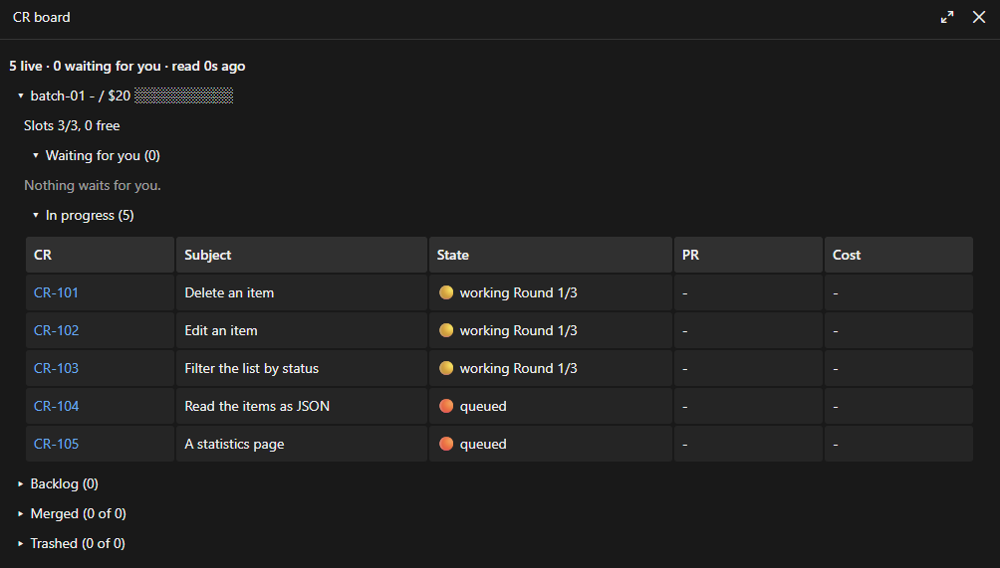
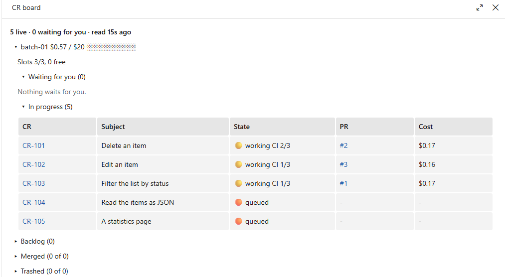
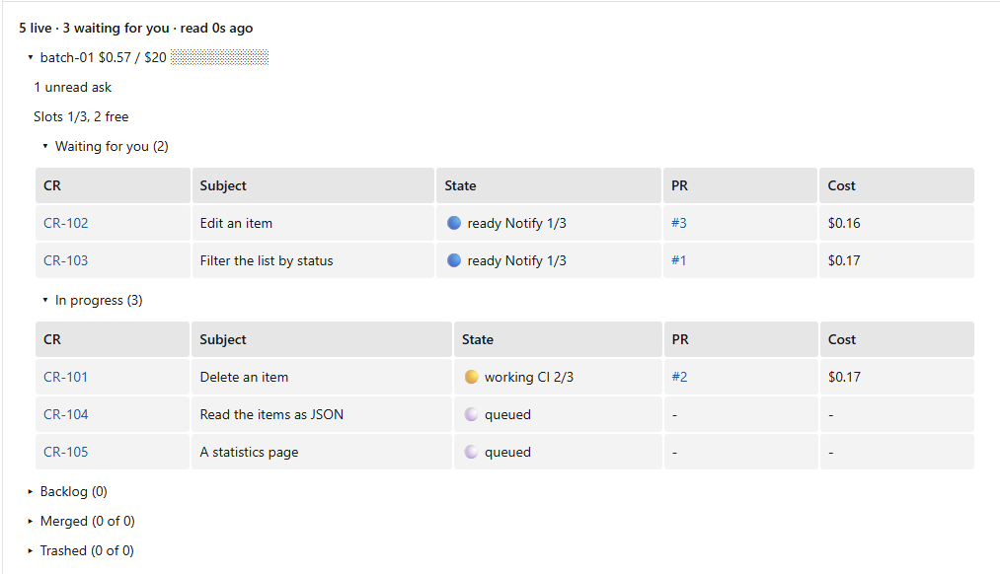
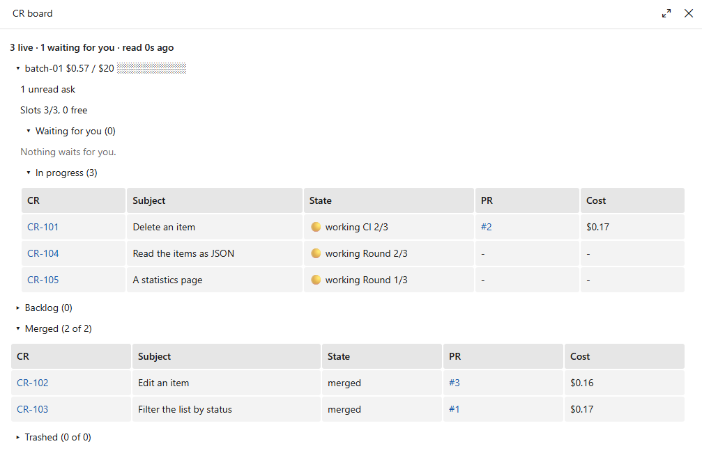
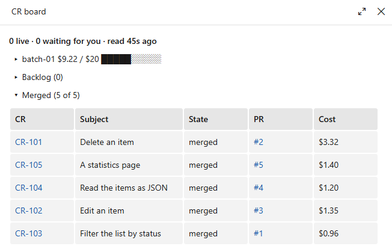

# Boards

Two boards show your batches: the CR board, a read-only pane in Claude Code, and the web board ([its own page](web-board.md)), which `chantier board` serves to any device on the local network.

## The CR board (Claude Code)

### What it is

A Claude Code mod (early access): a read-only pane over the planning folder's `STATUS.json`. In a
planning surface, it shows the projects whose seat or current batch (as its Foreman or Chief of
Staff) names this session. If none does, it shows every project under a line saying so.

It shows the live batches, the backlog (and `3-ready`), and the merged and trashed CRs. There is
nothing of it on Copilot, and the pane is not shown in a Remote Control view
([anthropics/claude-code#99217](https://github.com/anthropics/claude-code/issues/99217)). It writes
nothing and runs no process but `git rev-parse`, to find the main checkout from a worktree.

### How to open it

`/chantier-board` shows or hides it. Loading the `chantier` or `chief-of-staff` skill opens it too
(not `griller`).

### How to read it

From the top down:

- A header line, `5 live · 0 waiting for you · checked 3s ago, every 15 s`: when the pane last
  checked, and its period.
- One line per batch: its id, its cost against its budget, a gauge, how old that cost is (`12 min old`), its unread asks, its slots and
  its shape (`Slots 3/3, 0 free · parallel`).
- "Waiting for you" and "In progress", with the columns CR, Subject, State, Step, PR and Cost.
  The Step is what a working CR's Driver is doing (`coder r2`, `gate scenario`, `CI`), or "waits
  for the user" on a blocked CR. The web board also marks the next CR to start.
- Then Backlog, Merged (n of m) and Trashed (n of m).

The State gives the state, the step and the round: `working Round 1/3`, `working CI 2/3`,
`🟢 ready to merge Notify 1/3`, `🟤 PR in draft, waits for …`, `🟣 ready locally Notify 1/3`,
`queued`.

Press a CR for its sheet and its documents. The pane checks every 15 seconds while open and reads a
file again only when it changed.

The Refresh button at the top of the pane (in every view) checks at once. It reads the files again,
even unchanged ones, and looks again for the planning folders (a project added to a surface, a
`.agents/changes/` created after opening) and for the projects that name this session (a seat
taken after opening; the 15 s check looks too). It keeps the page shown and the folds. It does not
refresh the batch's cost or record: those move when the steering session refreshes the status.

### A batch in pictures

A batch just opened: three CRs working in round 1/3, two queued, no PR yet, no cost.

Three CRs in CI, with PRs #1 to #3 and their costs: $0.57 of $20.

"3 waiting for you": two CRs ready to merge, and one unread ask.

"Merged (2 of 2)" open.

The batch done: 0 live, $9.22 of $20, and "Merged (5 of 5)" with each CR's PR and cost.

### Two facts the pictures raise

Neither is a bug.

- The header's "waiting for you" counts the unread asks as well as the table's rows: in the
  merged picture, "1 waiting for you" sits beside "Nothing waits for you".
- The batch's cost is priced when the steering session refreshes the status, not live: $0.57 over
  three pictures while the CRs moved on, then $9.22 once the batch was done.

### The guard of a worker's and a CR Driver's writes

The same mod guards an agent whose prompt holds a `writes:` line in its first folder. For a worker
that folder is its worktree; for a CR Driver, its worktree, or the project's root before the
worktree exists. The mod refuses the agent's Write, Edit or NotebookEdit outside the folders named.

It judges the agent's Bash or PowerShell writes the same way when it can see them (a redirection,
`Set-Content`, `sed -i`, `rm`...). The cards cover what it cannot see, such as an interpreter's
inline code, and the steering session reports what changed in the main checkout.

## The web board

`chantier board` is a small web server for any device. [The web board](web-board.md) covers every view and how to start, keep and stop it.
