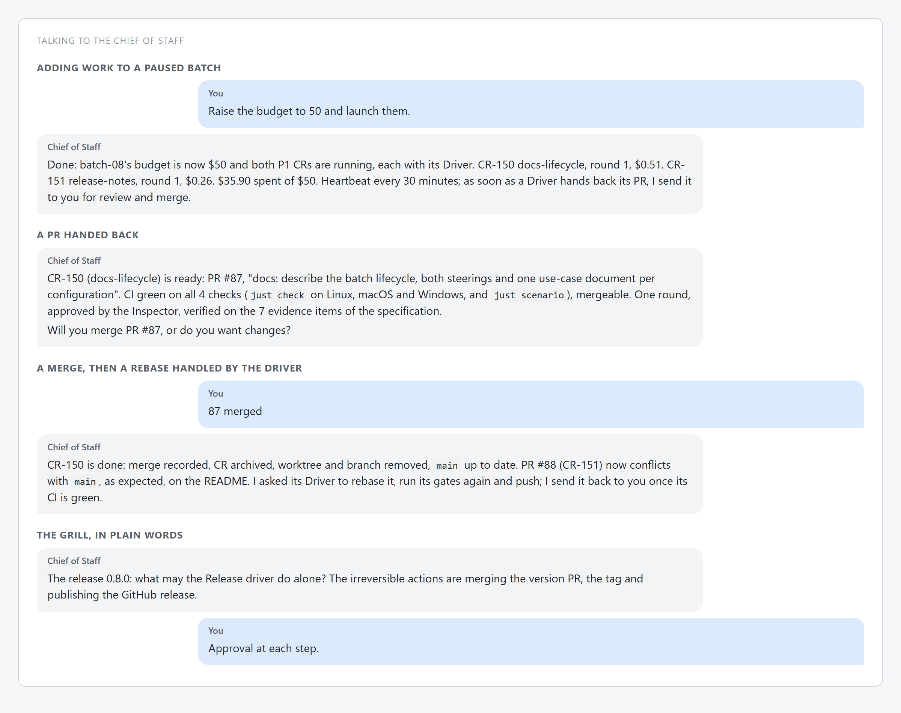
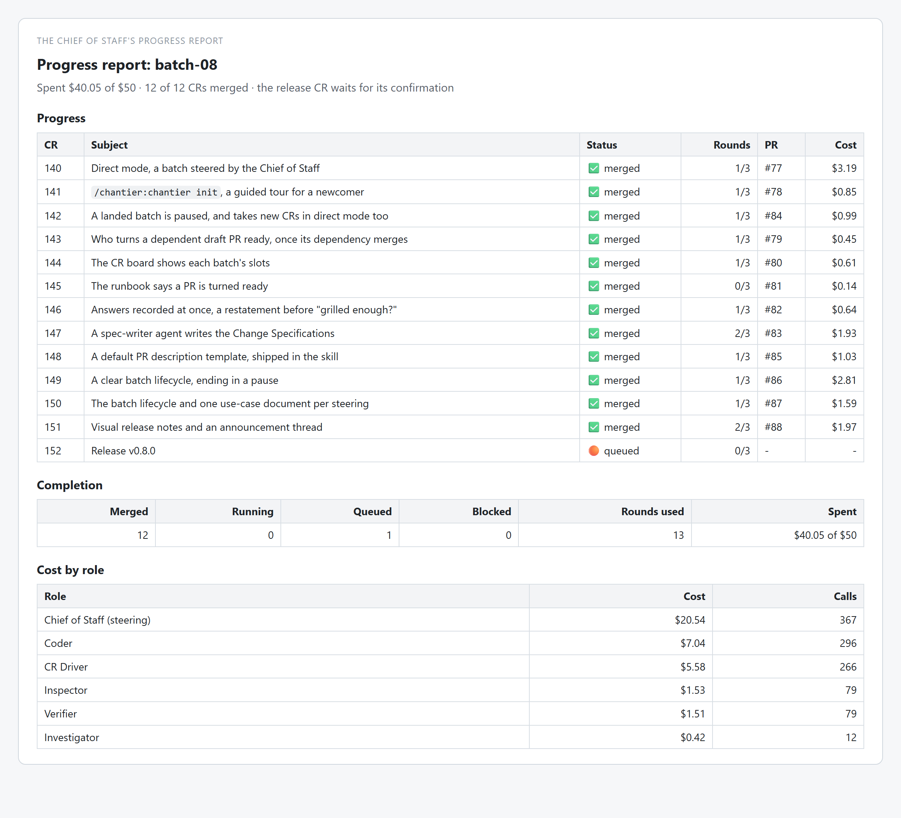
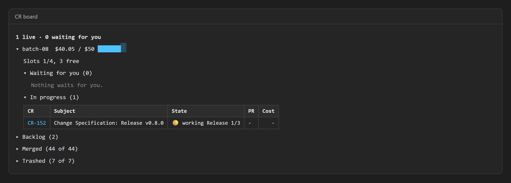
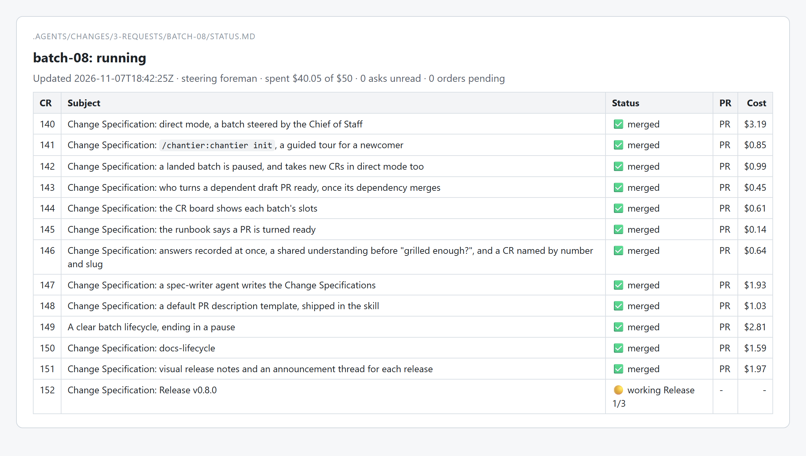

<h1 align="center">chantier 0.8</h1>

<b>Steer a batch yourself, pause it when its work is done, and see its slots at a glance</b>

13 changes since 0.7.0 · Claude Code and GitHub Copilot · MIT

<a href="https://github.com/gsemet/chantier#install">Install</a> ·
<a href="https://github.com/gsemet/chantier/blob/v0.8.0/docs/tutorial-claude-code.md">Tutorial</a> ·
<a href="https://github.com/gsemet/chantier/blob/v0.8.0/docs/use-cases.md">Use cases</a> ·
<a href="https://github.com/gsemet/chantier/compare/v0.7.0...v0.8.0">Full changes</a>

---

## 🧭 Steer a batch from the conversation you are already in

Until now a batch needed a Foreman: a second session that the Chief of Staff started next to
yours. That works in the Claude Desktop app, but not in a terminal, an IDE or a Remote Control
session. In **direct mode** the Chief of Staff steers the batch itself: it starts the Drivers on
the free slots, hears their hand-backs and brings you each PR to review, in the conversation you
are already having. The plan it shows before a batch says who steers it, and it proposes direct
mode when a Foreman cannot be started.

> "Run the P1s."

The Chief of Staff checks the preflight, shows the plan, and on your go opens the batch. From there
you talk to it as usual: it tells you when a PR is ready, and you tell it when you merged it.

See [direct mode](https://github.com/gsemet/chantier/blob/v0.8.0/docs/use-cases-direct.md) and
[Foreman mode](https://github.com/gsemet/chantier/blob/v0.8.0/docs/use-cases-foreman.md).

chantier now runs on any Claude Code entry point, not only on the desktop app.

## ⏸ A batch ends in a pause, with its cost to date

A batch had no clear end: a finished batch was "landed", and the next step pushed you straight
to closing it. A batch now has three states and only these: **running**, **paused** and
**closed**. Once every change is merged or cancelled, the batch is paused and you get the
Completion report with its cost to date. A paused batch takes new work, which sets it running
again, in both steering modes. It is closed only when you say so.

> "Close the batch."

The Chief of Staff checks that nothing runs, shows the final cost, and closes the batch on your yes.

See [the batch lifecycle](https://github.com/gsemet/chantier/blob/v0.8.0/docs/use-cases.md).

You can stop for the day and add work tomorrow, and the cost of the whole batch stays in one place.

## 📋 See how much room the batch has left

The CR board now shows each batch's slots: how many Drivers are running and how many more can
start. With the batch's `STATUS.md`, you can see what runs, what waits for you and what each
change cost, without asking.

> "/chantier-board"

The command opens the board in a pane next to your conversation. It refreshes by itself.

<table>
<tr><td></td>
<td></td></tr>
<tr><td align="center">The CR board in Claude Code: slots 1/4, 3 free</td>
<td align="center">The batch's <code>STATUS.md</code></td></tr>
</table>

See [the README](https://github.com/gsemet/chantier/blob/v0.8.0/README.md).

When a slot is free you can see it at once and give the batch more work.

## 🛠 Smaller changes

- **A guided tour for a newcomer.** Say "init" or "I am new here": `chantier init` creates the
  five folders where chantier keeps your changes, then the Chief of Staff walks you through how your
  project works with chantier. Run it again whenever you like: it changes nothing.
- **A spec-writer agent.** Once you say a change is grilled enough, a spec-writer agent writes its
  Change Specification in the background, and the board shows it as specifying, then specified.
- **A default PR description template.** Each pull request now comes with a full description:
  summary, deliverables, changes, impacts, blast radius, test plan, autonomous decisions. The
  reviewing agent checks the description against the template. Your project's own template ranks
  above it.
- **Visual release notes.** Each release ships reviewed notes like these, with captures and a
  short announcement thread. The release Driver writes them, and you review them in the version
  PR. Other projects get a default template.
- **The grill.** Each answer you give is written down at once. The Chief of Staff restates the
  whole change before it asks whether it is grilled enough, and names a change by its number and
  short name together.
- **Dependent pull requests.** Once a dependency merges, the steering session sends the dependent
  draft PR back to its Driver, which rebases it, retargets it and turns it ready.

<b>🐞 All fixes</b>

- **Scenario titles.** The end-to-end scenario files a distinct title for each specification
  state it refreshes.

<b>🛠 For contributors</b>

- `just check` runs `scripts/release_notes.py --check`: from 0.8.0 on, a version needs its
  reviewed release folder in `docs/release-notes/`. `--scan` checks the capture sources for
  private data before rendering, and `--prepare` points the images to the release assets.
- The docs describe the batch lifecycle, and there is one use-case document per steering mode.
- The real-eval runbook says that a change's PR is turned ready.
- Known: direct mode on Copilot has not been run yet.

