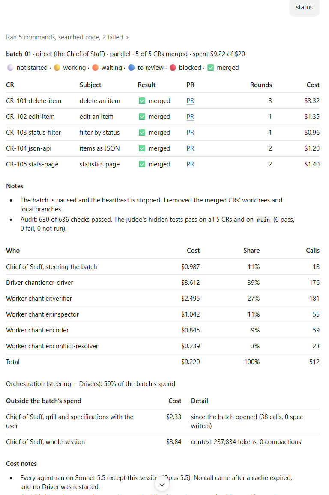
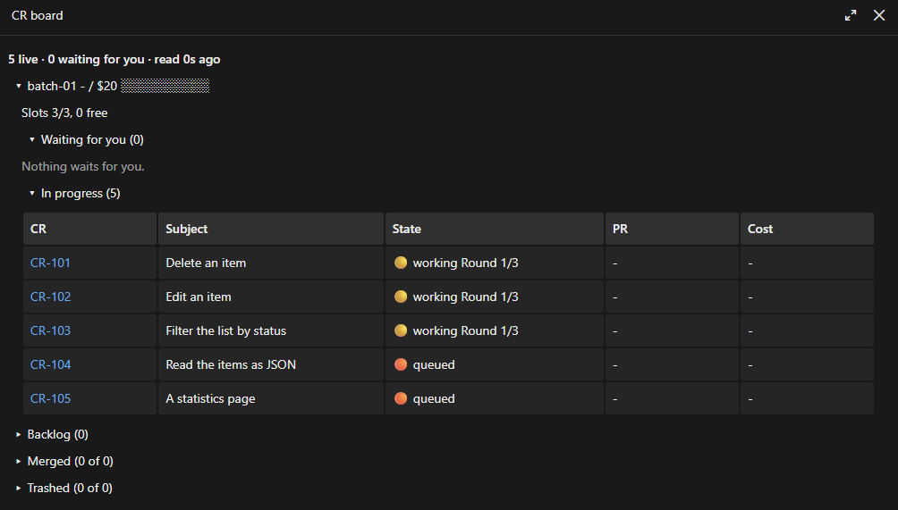
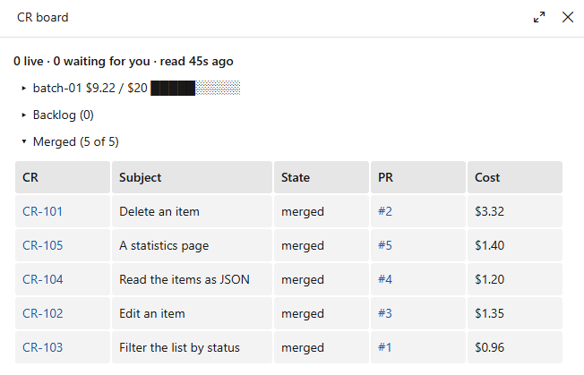

<h1 align="center">chantier 0.9</h1>

<p align="center"><b>Start a batch in the mode your screen can run, ship the release with the batch, and refresh the board yourself</b></p>

<p align="center"><sub>95 changes since 0.8.0 · Claude Code and GitHub Copilot · MIT</sub></p>

<p align="center">
<a href="https://github.com/gsemet/chantier#install">Install</a> ·
<a href="https://github.com/gsemet/chantier/blob/v0.9.0/docs/tutorial-claude-code.md">Tutorial</a> ·
<a href="https://github.com/gsemet/chantier/blob/v0.9.0/docs/use-cases.md">Use cases</a> ·
<a href="https://github.com/gsemet/chantier/compare/v0.8.0...v0.9.0">Full changes</a>
</p>

---

## 🧭 Start a batch in the mode your screen can run

A batch is steered either by a Foreman, a second session that the Chief of Staff starts next to
yours, or by the Chief of Staff itself in direct mode. You used to say which one. Now
`/chantier:chief-of-staff` with no argument picks it from where you are: a Foreman at the desktop,
direct mode under Remote Control, in a terminal or in VS Code, and wherever a Foreman cannot
start. It decides again at the plan of each batch, so a session started at your desk and later
driven from your phone plans its next batch as direct. Two words force a mode for the session:
`foreman` or `direct`.

> `/chantier:chief-of-staff direct` then "Run the P1s."

The Chief of Staff shows the plan with who steers it, and on your go opens the batch. The README
is reorganised around this: one boot skill, the planning modes, then the batch modes.



See [direct mode](https://github.com/gsemet/chantier/blob/v0.9.0/docs/use-cases-direct.md) and
[Foreman mode](https://github.com/gsemet/chantier/blob/v0.9.0/docs/use-cases-foreman.md).

You start the same way from every Claude Code entry point, and chantier takes the mode that works.

## 🚀 The release arrives with the batch it ships

A release used to run alone, after the batch. A release change can now join the batch whose work it
ships. It is a normal change of that batch: it waits for all the others, starts on top of their
stack, and its version PR is the last PR of the stack, with its release notes. A batch can run
overnight and leave, in the morning, one stack to review from the bottom up. Your merge of the
whole stack is the go for the rest of the release procedure. The release asks for no version
confirmation: the version comes from the grill, or the release Driver picks it and says why in
the PR.

```text
$ chantier order --help
...
  --release          add: the folder is the batch's release CR, which waits
                     for every other CR (refused once it has started)
```

See [the release process](https://github.com/gsemet/chantier/blob/v0.9.0/docs/release-process.md).

You review the work and its release notes together, and one merge ships both.

## 📋 Refresh the board, and open it from your phone

The CR board in the Claude Code pane now has a **Refresh** button on every view: it checks the
planning folder at once, without hiding the pane and without losing your page or your folds. The
header says when the pane last checked and its period, so a quiet batch no longer reads as stale.
For the days you are away from the desktop, `chantier board` serves a read-only web view of the
same record, to open in any browser: it writes no file and answers nothing, it only shows.

```text
$ chantier board --help
usage: chantier board [-h] [--host HOST] [--port PORT] [--seat SESSION]
  --host HOST     the address to listen on (default: chantier.yaml's
                  board.host, else 127.0.0.1)
  --port PORT     the port (default: chantier.yaml's board.port, else 8765)
```

<table>
<tr><td></td>
<td></td></tr>
<tr><td align="center"><sub>A batch in progress</sub></td>
<td align="center"><sub>The same batch, merged</sub></td></tr>
</table>

See [the boards](https://github.com/gsemet/chantier/blob/v0.9.0/docs/boards.md).

You see the state of a batch whenever you look, from the desk or from a browser.

## 🛠 Smaller changes

- **A planning folder of its own.** An external planning surface is a git repository that holds
  the planning of several projects, so the plan lives outside the code repository.
- **Evals you can replay.** The campaigns (real-foreman, real-direct, claude-planted and copilot)
  run on a shelf sandbox project with frozen changes, hidden judge tests, a reset, one scorecard
  and an audit on every campaign. A dry run of the whole path checks eval-kit changes in CI.
- **Proof you can trust.** A gate proof binds to one full commit, each proof names the commit it
  judged, and an unproven claim is marked. A handback to ready needs a passed long gate and a
  VERIFIED verdict.
- **A Driver stops its own long gate.** `gate <cr> --stop` stops it, records it as stopped (neither
  a pass nor a failure) and frees the gate. `cancel` no longer runs bare.
- **A clean main checkout follows each merge.** After each merge it records, the steering session
  fast-forwards a clean main checkout, so a batch that fixes chantier stops running the unfixed one.
- **Honest costs.** Calls of a model with no price are counted and named, the cost is a floor,
  prices can come from `chantier.yaml`, and the report has one fixed skeleton. A budget refuses a
  round it cannot pay. `claude-fable-5-2` has a built-in price.
- **One forge stack, merged in one go.** A stack is one forge stack merged in one action from its
  top PR, and a change can be inserted into a ready stack. `forge-stack create` and `forge-stack show`
  make and check the native stack on GitHub. Every agent states the first line its prompt must start
  with.
- **Cheaper rebases.** The plan proposes that a change wait for another one that edits the same
  lines, and a working change is rebased once per push.
- **Batch modes.** A batch is parallel (the default), series or stack. Several changes can join a
  paused batch, and the first take sets it running again. A ready change sent back to its Driver
  can be handed back again.
- **Dead Drivers.** The steering session sees a dead Driver in the per-change activity lines and
  restarts it from the recorded state.
- **Retros.** A retro runs at each pause and `close` keeps the batch's retro in the archive.
  The Chief of Staff offers `release auto` and gives one tip at four key moments.
- **Sonnet by default.** The Foreman and the Drivers run on Sonnet, with escalation on named
  trouble and a 300K auto-compact window.
- **A force push that was refused.** The Chief of Staff judges it and runs it without asking you.
- **A write guard for workers.** Workers cannot write outside their worktree: a `writes:` line
  names the folders, and what the guard cannot judge passes with a note on the board.
- **Tracker issues.** A batch reports back on the issue of a change: an issue line, a closing
  line, a grill comment and a `Released in` note.
- **`chantier.yaml`.** An optional playbook, parsed and resolved by the CLI.
- **A changes tree, version 2.** `3-ready`, `4-batch` and the archives and trash folders, with
  `/chantier:status` and a short report card that keeps the approved shape.
- **A Verifier reads the PR description.** It checks the description as posted, against the diff.
  The default description folds its details and shows your grill decisions.
- **Several sessions on one repository.** One Chief of Staff, Grillers beside it, and a skill for
  each role. The Chief of Staff keeps its rules through compaction and reloads them by hand.
- **A configuration check.** chantier recommends and checks the Claude Code configuration:
  allow rules, compaction and prerequisites.

<details><summary><b>🐞 All fixes</b></summary>

- **Costs.** A direct batch's steering turns count as steering, not as grill, unless they write a
  change's files or start a spec-writer.
- **The long gate.** A stop of the long gate is a separate marker: never lost, never a failure.
- **Evals.** The audit passes a Verifier's detached worktree and a direct batch's report refresh,
  counts a release go that was answered by a merge, reads CLI calls, git verbs and shell writes
  as the shell runs them, checks only the agents of its own batch, and reads a PR body past its
  BOM. The dry run applies its patch from an LF copy on Windows, and CI warms the uv cache first.
  The sandbox reset ignores `refs/pull`.
- **Cards.** Quoting of `gh --jq` in PowerShell 5.1, and the exact list of commands that take the
  Foreman's token. A Driver stages the round's files by name, never `git add -A`. The no-edit rule
  covers CR and stack Drivers only. After a compaction the rule files are read again, review fixes
  go to a coder and the final PR body is verified. A Foreman reads the rules each batch. A missing
  gate pass goes back to the Driver. The reload reads the renamed status layout, the QA file is
  `04-result.md`, and the status card and QA notes get names the host's write guard accepts.
- **Byte-order marks.** Files a role writes, the PR body included, are UTF-8 without a BOM; the
  CLI reads a planning folder's files through a leading BOM; a stray BOM left `commands.py`.
- **The scenario.** It clears the recorded agent before a take, follows the batch modes, and
  writes a priced transcript before `status --refresh`.
- **The heartbeat.** In direct mode it says something true: wake gap, recorded stop, one rule.
- **The write guard.** The broken guard came off main, and the guard covers workers only, never
  a Driver.
- **The batch shape.** The shape shown covers series, and the default is parallel.
- **The release tag.** `just tag` refuses unless origin/main is the release commit, the full
  `gh release` command is given, the user's merge is not a go, and the UUID scan follows an
  underscore.
- **Status.** The status command reads each change's icon from the batch `STATUS.md`, and the
  batch folder is `4-batch`, where one batch runs at a time.

</details>

<details><summary><b>🛠 For contributors</b></summary>

- Tests reject a UTF-8 byte-order mark in tracked files, and the worker card repeats the rule.
- The cards say: post a multi-line forge text from a file written with the Write tool; read the
  rules after each claim; record each approved review as a note before the PR body cites it; read
  a CI job's result from the forge's checks at the pushed head; prove a CI job's steps once with a
  cold uv cache before the push.
- The docs say that Claude Desktop's Auto-fix events belong to the change's Driver, and the
  heartbeat prompt has no interval. The README is reorganised and its detailed end moved to
  docs pages. A Release driver diagram was added. No git stash and no kill by pattern.
- The eval reports of the real-foreman and real-direct runs of 2026-11-12 are in the docs.
- Known: direct mode on Copilot has not been run in a real campaign.

</details>
