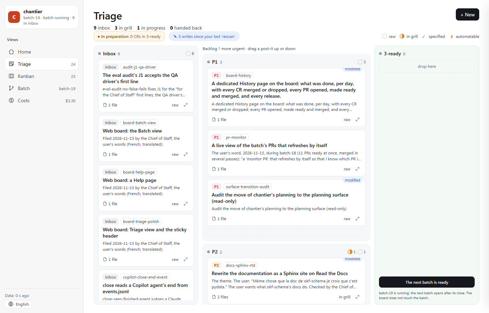
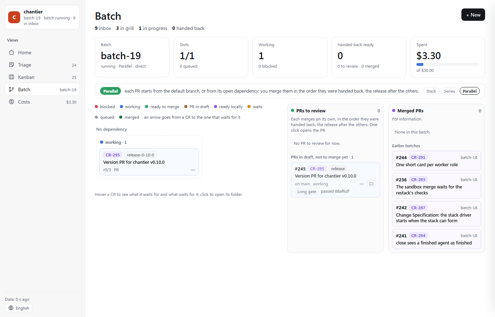

<h1 align="center">chantier 0.10</h1>

<p align="center"><b>Introducing the board web UI, tested by intensive evals: edit your backlog in the browser, run a stack from the start, and keep each proof across a clean rebase</b></p>

<p align="center"><sub>124 changes since 0.9.0 · Claude Code and GitHub Copilot · MIT</sub></p>

<p align="center">
<a href="https://github.com/gsemet/chantier#install">Install</a> ·
<a href="https://github.com/gsemet/chantier/blob/v0.10.0/docs/tutorial-claude-code.md">Tutorial</a> ·
<a href="https://github.com/gsemet/chantier/blob/v0.10.0/docs/use-cases.md">Use cases</a> ·
<a href="https://github.com/gsemet/chantier/compare/v0.9.0...v0.10.0">Full changes</a>
</p>

---

## 📋 Introducing the board web UI

`chantier board` serves the record and the planning folder as a web board, for this machine and the
local network, behind a key in its URL. Open the link it prints and you have a Home, a Kanban, a
Batch, a Costs and an All projects view, a file panel with a Markdown renderer, and a Triage view
with a journal, a New dialog and a Markdown editor. The Triage view is your backlog: the inbox, the
priorities P1 to P4 and the ready folder, where you drag a post-it up or down to change its priority.
The Batch view is the running batch: its mode, its slots, the changes at work and what each waits for,
the PRs to review, the PRs in draft, the spend against the budget, and the earlier batches. The board
edits the backlog through the CLI's own commands, so each move is the same as the one you would type.
It never edits a running batch and never messages an agent.

| The backlog, in the Triage view | The running batch, in the Batch view |
| --- | --- |
|  |  |

```text
$ chantier board --help
usage: chantier board [-h] [--host HOST] [--port PORT] [--seat SESSION]
                      [--clock TIMESTAMP] [--new-key]
  --port PORT        the port, or 0 for a free one the system picks (default:
                     chantier.yaml's board.port, else 8765)
  --new-key          replace the board's key: the old link stops working
```

The Kanban has a Done column and a priority filter, and the Costs and Home views show earlier
batches. Edits are checked by hash, so a file changed elsewhere is never overwritten.

See [the web board](https://github.com/gsemet/chantier/blob/v0.10.0/docs/web-board.md).

## 🧪 Intensive evals, and a release that says what they saw

This release was put to the test harder than any before it. A real Foreman ran a stack and a real
Chief of Staff ran a parallel batch in direct mode, both on 2026-11-15, and each run is scored against
the scorecard's rows. The eval kit grew to match: the sandbox merge waits for the checks of a restacked
head and goes through GitHub's asynchronous merge, so a PR in a native stack merges; the judge judges
the PR's head from the forge, so a restacked stack is judged; the audit reads Chief of Staff prompts,
claim calls and here-docs without a false FAIL; the dry run's fake forge answers the stacks; and the
setup stages the ticket-summary campaign with its frozen issue and request. The evals folder is
self-sufficient: anyone can run a campaign from its README.

A release now has a claims file that lists each change it makes, the scorecard row that would catch
it, and whether an eval run brought it to the test. Its results are `exercised`, `scenario only` or
`not exercised`, and the notes below name every change an eval has not seen.

```text
$ ls evals/results
real-direct-2026-11-15-run3.md
real-foreman-2026-11-15-run2.md
claims-v0.10.0.md
```

See [the evals](https://github.com/gsemet/chantier/blob/v0.10.0/evals/README.md).

## 🧱 A stack that forms itself, on GitHub and GitLab

In a stack batch, each change used to start on `main` and was stacked afterwards, which cost a
restack, a conflict to resolve and a new review on each change above the first. Now a change starts
on the top of the stack as soon as two changes are ready, and the PRs form one native stack on the
forge as each one gets its PR. A change you drop leaves the stack cleanly, the restack's progress is
recorded, and a stack that breaks half-way is held for you instead of going on. On GitLab the stack
is the chain of merge requests, with the same five checks as on GitHub. In a parallel batch, the
Foreman now checks each ready PR against the others with `git merge-tree` and offers you a stack
when two of them conflict; nothing switches without your word. You can also switch a running batch
between parallel, series and stack at any time.

```text
$ chantier order --help
...
  mode: parallel, series or stack
$ chantier forge-stack --help
usage: chantier forge-stack [-h] [--batch BATCH] [--stack N]
                            {create,show,rebuild,unstack}
```

A ready change reads one of three words, `ready locally`, `PR in draft` or `ready to merge`, with
the icons purple, brown and green, in the status files, on the board and in the pane. The merge
route also works for a PR of a native GitHub stack, which `gh pr merge` refuses.

See [the use cases](https://github.com/gsemet/chantier/blob/v0.10.0/docs/use-cases.md) and
[the boards](https://github.com/gsemet/chantier/blob/v0.10.0/docs/boards.md).

## ♻️ A clean rebase keeps its proof

A rebase that leaves a change's patch unchanged used to cost a new long gate and a new Verifier.
Now the gate's pass and the Verifier's verdict carry over a clean rebase, which git proves and the
hand-back records, and a rebase with a conflict is gated again. After a rebase that needs a gate,
the Driver pushes at once and runs the gate beside CI, with the PR in draft until both are green. The
queue runs the next merge's gate first. Your `chantier.yaml` can allow more than one long gate at
once, and a project can run CI beside the long gate for every change. On a stack, `order waive`
lets the lower changes skip the gate when the top one validates the whole.

```text
$ chantier gate --help
...
  --stop         stop this CR's running long gate: its suite, the gate lock;
                 recorded `stopped`, no pass; nothing else changes
  --first        the steering session's: put this CR's waiting long gate at
                 the head of the queue
```

The gate and the verdict still bind to one commit: a hand-back that cannot show the replay of the
gated commits onto the new base is refused with `does not carry`, and a verdict `VERIFIED` is
refused when its note does not name the head.

See [the gates](https://github.com/gsemet/chantier/blob/v0.10.0/docs/gates.md).

## 🛠 Smaller changes

- **A closed batch leaves a record.** Each batch leaves a record of its own in the planning folder's
  archives, with its cost, its changes and its retro, and the next batch's number is read from it.
  `close` judges a running agent by the end of its transcript; when one looks running but was cut, by an
  app restart for example, only you can say it stopped, and `close --stopped` records that on your word.
  The spend is refreshed where the budget is checked, `status` says how old it is, and a working change
  whose Driver ended with no hand-back is flagged.
- **The ready line says what a PR waits on.** A PR in draft names its draft state and the change it
  waits for, and `ship` reads each PR's base and draft state from the forge.
- **Every worker points to its card.** Each agent file names its card and refuses a prompt without
  it, and the CLI prints each worker's opening prompt lines. Coder, Inspector and Verifier reply in
  an exact template, a long reply is noted and not restarted, and `verdict` names its accepted words.
- **A Driver stays a Driver.** A round guard, a context line and a shell write guard keep it from
  coding. Its context limit is 130,000 tokens, from the measured compaction point, and the
  Inspector's reply is capped. A reply out of format is a failed worker, started again once; so is
  an agent that ended or was refused. A forge server error is re-run once. The change Drivers get the
  Edit tool, and a blocked Driver can hand back ready.
- **A merge may come at any moment.** One PR at a time in any batch shape, and a Driver merged under
  its feet ends cleanly.
- **A step for each working change.** `chantier status` and the board show the step a Driver is at,
  and mark the next change to start.
- **Steering commands name the Foreman.** Every steering command refuses a missing Foreman number,
  and its messages say "Foreman n°".
- **A shorter retro.** The retro critic cuts every list of changes the Foreman or the Chief of Staff
  proposes on its own, and each retro point is tagged `project` or `chantier`, chantier's offered as a
  GitHub issue draft.
- **Allow rules, per capability.** Preflight checks the allow rules by the commands they let
  through, warns strongly before the go and checks the forge's rights at the start. The Chief of
  Staff asks to add the missing rules and adds them on your yes. The release rules left the
  recommended set.
- **A planning surface that stays in sync.** A surface can name its own autosync, which preflight and
  `status` check and the board shows as a pill with a panel; the board's project picker marks the
  current line.
- **A spec critic.** An impactful change's specification is checked by a spec critic before it is
  final.
- **Tickets.** A ticket's summary, plan and demo are posted on your yes, and the ticket is named in
  the PR's Issues References.
- **A summary per change.** Each change carries a condensed `summary.json`, kept fresh by a linter
  and commands.
- **One way to run the CLI.** It is declared once in a root `pyproject.toml` and runs with `uv`: from
  the local code in a chantier checkout, and with `uvx` from the plugin's folder.
- **Quiet turns.** The Chief of Staff stays quiet on a Foreman's turn-end notice.

<details><summary><b>🐞 All fixes</b></summary>

- **Stacks and PRs.** Preflight finds the `gh stack` extension with `gh extension list`, `forge-stack
  rebuild` exits 4 when a stack stays open, and `ship` skips a token of digits only in its stale-SHA
  scan. On GitLab the default branch is read from the batch's settings when a merge request merged
  below is checked.
- **The long gate.** A merge stops the change's long gate and waits for it to end before it moves the
  folder; a recorded process counts as alive only while it is the same process, and the activity line
  shows a queued gate.
- **The board.** The server's socket listens before its start line prints. A dragged group lands over
  post-its, a hidden post-it leaves the selection, the editor guards back and forward, and a post-it
  holds no nested button. A selected Triage card shows no blue border, and the sidebar line says
  inbox.
- **The CLI.** `phase` refuses a change that is not working, a review with no detail and a long
  detail, and opens the repository the common way. A paused batch is named with the way out, and so is
  a held board port. The spend and the steering role are priced by the mode: a direct batch's whole
  session is priced and named. A Windows-only process flag is guarded so that mypy passes elsewhere.
- **The write guard.** It reads a Git Bash drive path as its drive form.
- **Evals.** The kit gives the CLI paths relative to the planning folder.
- **The scenario.** The stack unit fits its time budget, measured again; the rebase takes of the
  mode-switch block carry the batch's own number; the board's write steps read the request under the
  intake folder; one case expects the top-level key list with `long_gate`; the summary case triages by
  the relative path; `stack` with no change prints `take stack`'s lines; and the Copilot cost module
  keeps `shutil` imported where the scenario patches it. Two Chief of Staff examples and the
  scenario's agents carry the Foreman number after the restack.
- **Code size.** `order` and `orders_apply` stay under their limits after two rebases.
- **The docs.** The web-board paragraph keeps the text of both changes after a rebase.

</details>

<details><summary><b>🛠 For contributors</b></summary>

- **Not exercised by an eval.** The two runs that count for this release (a real-foreman run on a
  stack and a real-direct run on a parallel batch, both of 2026-11-15) ran chantier before the last
  25 changes landed, and no `full` campaign ran. These changes of the release were not brought to the
  test by them:
  - Not proved by the runs and not by the scripted scenario or the unit tests either: the claims file
    itself; the board's Kanban, Triage, file panel, views, editor and check mark, and the fixes of
    their drawing; the eval kit's paths, its asynchronous merge, its fake forge, its self-sufficient
    folder, its judge on a restacked head, its audit, its restack wait and its ticket-summary setup;
    the merge route for a native stack's PR; the Chief of Staff's quiet turn on a Foreman's notice, and
    its offer to add allow rules; the spec critic; the ticket's summary, plan and demo; a worker reply
    out of format restarted and a forge error re-run; an ended or refused agent restarted once; the
    Edit tool of the change Drivers; a blocked Driver that hands back ready; the write guard's Git
    Bash path; the Windows process-flag guard.
  - Proved by the scripted scenario or the unit tests alone, and by no run: the conflict check and the
    offer of a stack; the stack started on the stack, made at two ready PRs, rebuilt, restacked with a
    recorded progress, switched between modes and unstacked; the GitLab stack; the long-gate waiver,
    the number of gates at once and the carry of the verdict; CI beside the long gate; a merge that
    stops the gate; the verdict that must name the head; the step of a working change and the refusals
    of `phase`; the board's server, its write routes, its page structure and its held port; the
    autosync of a surface; the summary of each change; the readiness ask; `close --stopped` and the end
    of a transcript; a Driver that ended with no hand-back, the spend's refresh and age, the paused
    batch's name and the steering role by mode; the allow rules per capability and by the commands they
    let through; the one way to run the CLI; the code-size limits and the scenario's own fixes.
  - Exercised by a run: the readiness words and `ship` on the forge's draft state, the Foreman number on
    each steering command, the gate queue and the carry over a clean rebase, the record of a closed
    batch, the retro and its critic, the worker cards and prompts, the exact reply templates, the
    Driver's context limit and write guard, and the merge that may come at any moment.
- The release's claims file is `evals/results/claims-v0.10.0.md`: one row per change, its rail and
  its result.
- Known: direct mode on Copilot has not been run in a real campaign, and neither has GitLab.

</details>
