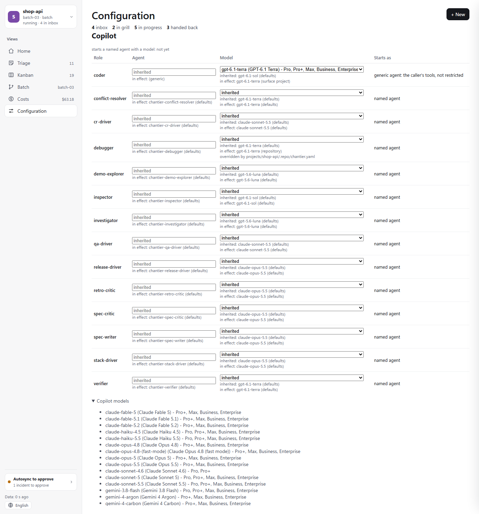
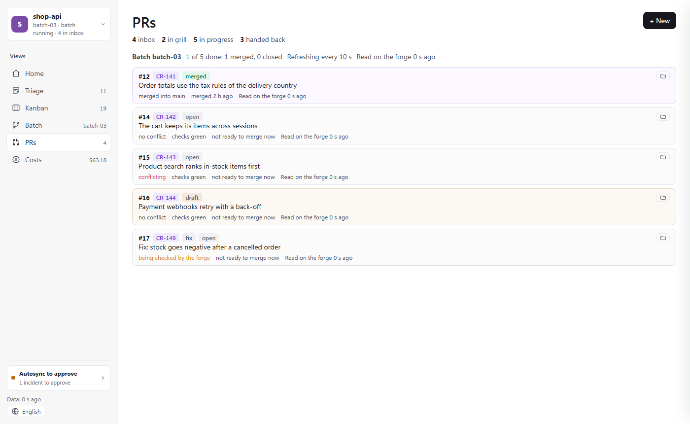
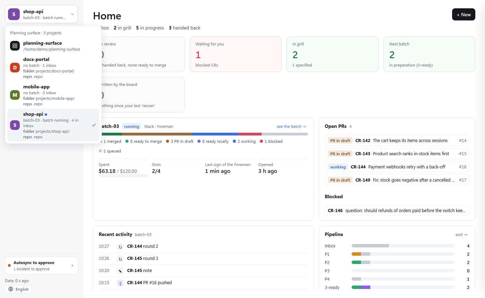

<h1 align="center">chantier 0.11</h1>

<p align="center"><b>Choose each role's agent and model on Claude Code and Copilot, edit them from the board, and watch your batch's PRs live</b></p>

<p align="center"><sub>18 changes since 0.10.0 · Claude Code and GitHub Copilot · MIT</sub></p>

<p align="center">
<a href="https://github.com/gsemet/chantier#install">Install</a> ·
<a href="https://github.com/gsemet/chantier/blob/v0.11.0/docs/tutorial-claude-code.md">Tutorial</a> ·
<a href="https://github.com/gsemet/chantier/blob/v0.11.0/docs/use-cases.md">Use cases</a> ·
<a href="https://github.com/gsemet/chantier/compare/v0.10.0...v0.11.0">Full changes</a>
</p>

---

## 🎛 Pick the model of each role, per host

Each role now has a model on each host, and you choose it. chantier reads its configuration in four
layers, from weakest to strongest: its own shipped defaults, your planning surface's `chantier.yaml`,
the project's file in that surface, and the code repository's `chantier.yaml`. A layer carries only
what it changes, and `default` takes a value back to the layer below. A role with a model and no agent
of yours starts the plugin's agent on that model; on Copilot, where a named agent cannot take a
chosen model yet, it starts a generic agent with the role's contract in its prompt. Copilot's model
names come from GitHub's own tables, with each model's plans, and a name that matches several models
is refused with the identifiers it matches.

```yaml
hosts:
  claude:
    roles:
      inspector:
        model: opus
  copilot:
    roles:
      coder:
        model: gpt-6.1-terra
```

Say "run the inspector on Opus" to the Chief of Staff and it writes the lines. A running batch keeps
the team it started with; the change applies to the next one.

See [your own agents and models](https://github.com/gsemet/chantier/blob/v0.11.0/docs/agents-and-models.md).

## 🖥 Edit them from the board

The board has a Configuration page: for each host, one row per role, with the agent and the model in
the project's file in your planning surface, the value in effect and the layer it comes from, and how
the role starts. Every change is judged first, then written by Save, keeping the file's comments and
its other keys. When the code repository's own file overrides a value, the row says so.

| Configuration, per host and role |
| --- |
|  |

See [the web board](https://github.com/gsemet/chantier/blob/v0.11.0/docs/web-board.md).

## 🔀 A live PRs page, and a merge it tells you about

The new PRs page reads your batch's PRs from the forge with your own `gh` or `glab`, read-only: one row
per change in merge order, with the PR's state, whether it conflicts and its checks, refreshed every
ten seconds while a PR is not done. "Ready to merge" needs the record and the forge to agree. When the
page sees a PR merged that the record does not hold, it leaves one line in a local file, and
`chantier status` prints it, so the Chief of Staff records the merge at its next look.

| The PRs page |
| --- |
|  |

See [the web board](https://github.com/gsemet/chantier/blob/v0.11.0/docs/web-board.md).

## 🛠 Smaller changes

- **The board shows your planning surface.** The project picker's first entry is the surface, by name
  and path, and each project's line shows its folder and its repository.

  | The project picker |
  | --- |
  |  |

- **A roomier Triage.** The cards are at most 320 px wide, the backlog is a
  grid, hovering shows no scroll bar, and the side panel closes when you change view.
- **A model check for Copilot.** The Copilot evaluation checks that each role runs on its chosen model.

<details><summary><b>🐞 All fixes</b></summary>

- **The board.** Every Triage card has the same width at every window size, and the project count of
  the picker button wraps so its number stays readable.
- **The configuration page.** It writes the project file with LF, also when the file had CRLF.

</details>

<details><summary><b>🛠 For contributors</b></summary>

- **Not exercised by an eval.** No campaign has run for this release yet; the two chosen, a
  real-direct run on a stack and a real-foreman run on a parallel batch, run before the merge, and these
  notes are updated from their reports. `full` and the Copilot campaign are not run for this release.
  None of the release's changes has been brought to an eval's test:
  - the Copilot roles running on their chosen model and the model check, the Copilot model catalog;
  - the four layers of configuration with the shipped model defaults, and a role started on its
    configured model, with a generic agent where the host cannot;
  - the board's Configuration, PRs and Triage pages, the planning surface in the selector, the picker's
    count and the LF of the project file;
  - the local signal of a merge the PRs page sees, which `status` prints.
- This release also carries the short startup core: every role reads a short contract at start and
  defers its full card until an action names it. No campaign has brought it to the test yet.
- The release's claims file is `evals/results/claims-v0.11.0.md`: one row per change, its rail and
  its result.
- Known: direct mode on Copilot has not been run in a real campaign, and neither has GitLab.

</details>
