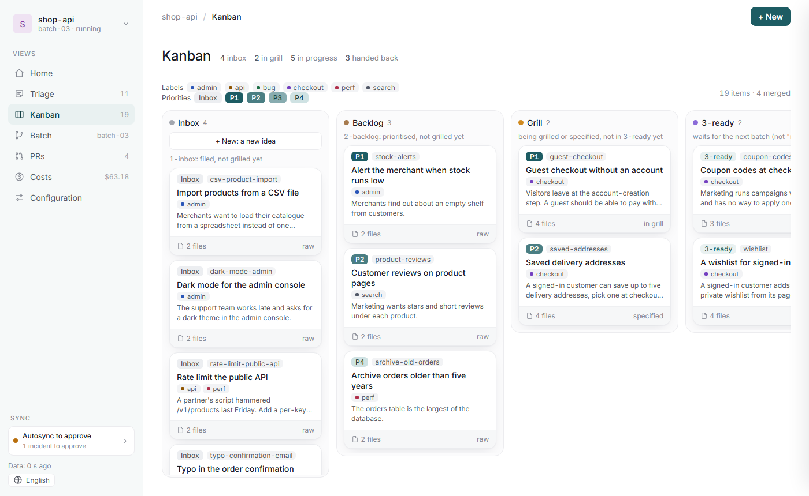
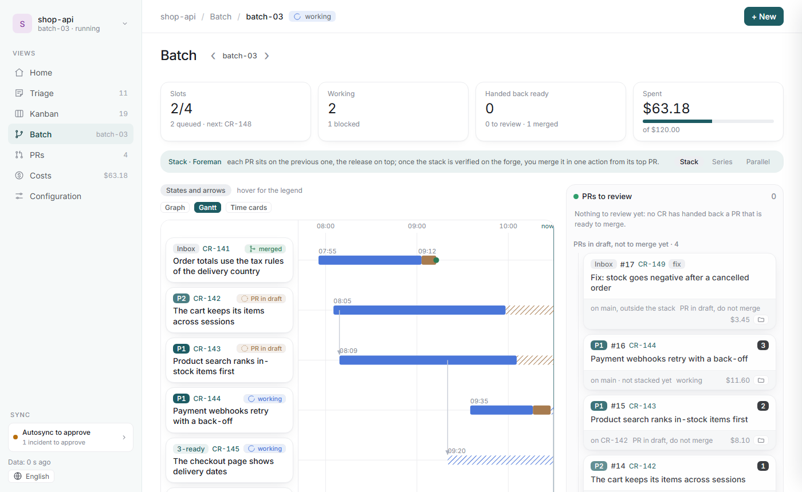
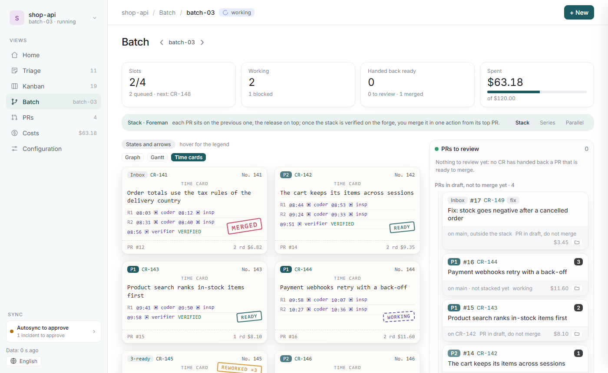
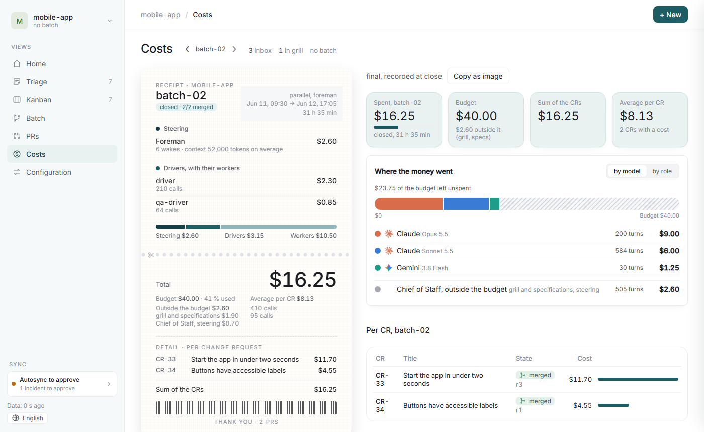

<h1 align="center">chantier 0.12</h1>

<b>Read the board in one design, see a batch as a graph, a Gantt or time cards, and open every PR and issue on its forge</b>

60 changes since 0.11.0 · Claude Code and GitHub Copilot · MIT

<a href="https://github.com/gsemet/chantier#install">Install</a> ·
<a href="https://github.com/gsemet/chantier/blob/v0.12.0/docs/tutorial-claude-code.md">Tutorial</a> ·
<a href="https://github.com/gsemet/chantier/blob/v0.12.0/docs/use-cases.md">Use cases</a> ·
<a href="https://github.com/gsemet/chantier/compare/v0.11.0...v0.12.0">Full changes</a>

---

## 🎨 One design for every page of the board

The board now follows written design rules, so a card, a column and a chip look the same wherever they appear. A lighter look sets the board in Inter, with a sticky breadcrumb, state badges and a single PR column. Triage and Kanban draw every card and column once, with the priority chip first in the card's top row, teal priority colours and pastel tints. The Kanban's scrollbar stays in view, and the sidebar is lighter. The rules are in a file of the board's sources, and a check in `just check` fails when its token table and the board's colours, spacings and sizes disagree, so a later change cannot drift away from them.

| Kanban |
| --- |
|  |

See [the web board](https://github.com/gsemet/chantier/blob/v0.12.0/docs/web-board.md).

## 📊 See a batch three ways

The Batch page's central view now has three tabs over the same batch: **Graph**, the levels and arrows you know, **Gantt** and **Time cards**. The Gantt draws one line per change on a real time scale, each bar cut into one segment per state, with a "now" line. The time cards are one paper card per change: a stamped line per round, the verifier's verdict, the PR and the cost, and a rubber stamp for merged, ready or working. The tab is in the address (`&t=gantt`, `&t=cards`), so a link opens the same one.

| Gantt | Time cards |
| --- | --- |
|  |  |

See [the web board](https://github.com/gsemet/chantier/blob/v0.12.0/docs/web-board.md).

## 🔗 Open any PR, MR or issue on its forge, and sort the PRs page

A row of the Home page opens its PR or MR on the forge, and its CR number opens the CR's folder. In the side panel, the facts row links the change's PR or MR and a backlog item's issue, and a web link in a drawn Markdown file opens in a new tab. The PRs page filters by batch and by state (all, open, draft, merged), sorts by the batch's order, by opening date, by last activity or by change number, and keeps the choice in its address. On a GitLab project the board says MR wherever it says PR, and writes `!n`. The page also sees a stacked PR that landed with its base, and `chantier status` tells the Chief of Staff to record it instead of waiting for the base.

See [the web board](https://github.com/gsemet/chantier/blob/v0.12.0/docs/web-board.md).

## 🛠 Smaller changes

- **Where the money went.** The Costs page shows a batch's spend by model and by role, and a batch that is not closed carries a red NOT FINISHED stamp on its receipt. The receipt's figures are recorded at close, and it can be copied as an image.

  | Costs |
  | --- |
  |  |

- **Navigate batches.** The Costs and Batch pages have a batch navigator, and the Configuration page shows each role's description.
- **One board per planning surface.** Preflight and `status` list the surface's other batches, and the staging rule is per project.
- **The CR board pane names the project** its session steers on a planning surface.
- **A stack that holds together.** A stack change is based on the nearest earlier change that has a PR, the final order is set once at the batch's end, and the stack rows show a change's hand-back state apart from its PR's draft flag. `status` prints a trigger line when a stack batch's first stack is due.
- **Gate and verdict carry over a clean rebase.** When a rebase leaves a change's patch unchanged, `ship` proves it by exact patch-ids and records that the passed gate and the verdict carry over. It also names stale image links.
- **A PR out of draft is checked.** `ship` refuses a main-based PR out of draft that carries another change's commits.
- **The batch ends cleanly.** At the last change's end, chantier pauses the batch and removes the merged changes' worktrees and branches. `close` judges only the agents the batch holds and lists the session's other subagents apart.
- **A fresh Driver for the closing step** once the verdict is `VERIFIED`, and a Driver stopped from outside is restarted on the batch's go and flagged in `status`.
- **Escalation and timing in the configuration.** The escalation model is set per host and role, and escalation fires on every blocked rounds. The steering wake, the cache TTL and the CI re-runs are settings, per host and model family.
- **Prompts that are complete.** `take`, `take stack` and `order qa` print the Driver's whole prompt skeleton, workers get a bare writes line and Verifiers a scratch folder, and a specification names a host and default matrix, probed before a change's first push.
- **A compacted session recovers.** The hook tells it to call its role's skill again with `reload`.

<b>🐞 All fixes</b>

- **The board's look.** Kanban cards keep their full height and the Costs receipt its header box; the drawer, the priority chips and the CR titles render correctly; the Gantt fits its panel at desktop width so the now line stays visible; the surface item of the picker opens the overview from any page and is the menu's header; the address's filter and sort survive the first load, and the remaining GitLab words say MR.
- **The board's data.** A link keeps its chosen batch at first load, a record without dates shows no duration, and an older record's cost receipt shows its roles-not-recorded line once.
- **Escalation.** The playbook prints a role's contract when its escalation starts as a generic agent, also with the shipped default.
- **Stacks.** A working change the stack driver has not placed stays out of the stack's ask, and the forge's empty unstack reply is taken as a success, with what to run after a failed rebuild.
- **CI.** Timing-bound checks get a margin on a loaded machine, and the tool download retries once.

<b>🛠 For contributors</b>

- **Not exercised by an eval.** No eval campaign ran for this release (the maintainer's word). The changes below were not brought to an eval's test, and each marked "(proved by the scripted scenario)" is proved by a named check of it:
  - the board's design rules and every page change of this release, the tabs, the forge links, the PRs page's filters, the Costs page and the picker: no run draws a board page;
  - a PR out of draft refused when it carries another change's commits;
  - a specification's host and default matrix, probed before the first push;
  - the escalation model per host and role, and the playbook's contract for a generic agent;
  - the hook that tells a compacted session to reload;
  - the CR board pane naming its project;
  - a stacked PR that landed with its base, which `status` tells the Chief of Staff to record;
  - a stack change based on the nearest earlier PR, the stack rows, the trigger line and the forge-stack steps (proved by the scripted scenario);
  - the gate and verdict carry over a clean rebase, and the stale image links `ship` names (proved by the scripted scenario);
  - the batch's pause and cleanup at its last change's end, and the close's judgement of the batch's agents (proved by the scripted scenario);
  - the fresh Driver for the closing step, a Driver restarted after a stop from outside, the timing settings, the one board per planning surface, the complete prompts and the writes line (proved by the scripted scenario).
- The release's claims file is `evals/results/claims-v0.12.0.md`: one row per change, its rail and its result.
- The eval kit starts Claude campaigns without a Foreman away from the desk, and its dry run pauses the batch only when the last merge did not already pause it.
- The scenario models the real flow under the ship refusal and skips the board's local-network line.
- Known: direct mode on Copilot has not been run in a real campaign, and neither has GitLab.

