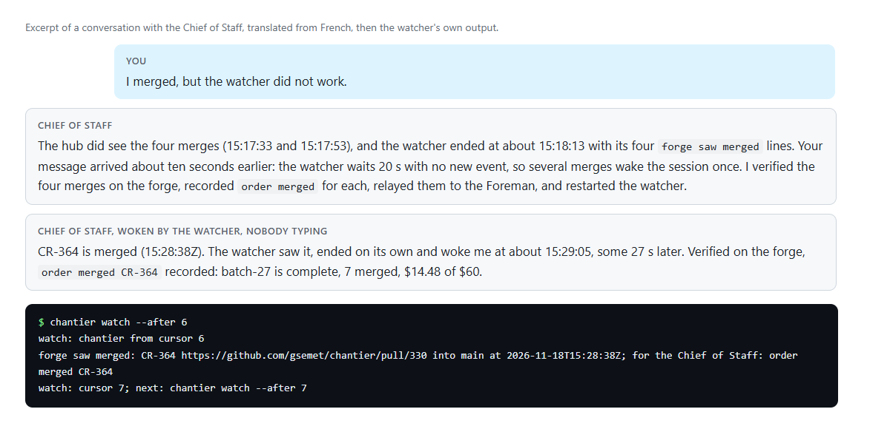
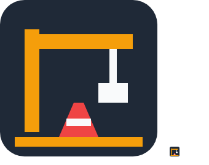

<h1 align="center">chantier 0.13</h1>

<p align="center"><b>Hear about a merge without saying it, take over a Foreman batch in direct mode, and keep the CR archive out of your PRs</b></p>

<p align="center"><sub>14 changes since 0.12.0 · Claude Code and GitHub Copilot · MIT</sub></p>

<p align="center">
<a href="https://github.com/gsemet/chantier#install">Install</a> ·
<a href="https://github.com/gsemet/chantier/blob/v0.13.0/docs/tutorial-claude-code.md">Tutorial</a> ·
<a href="https://github.com/gsemet/chantier/blob/v0.13.0/docs/use-cases.md">Use cases</a> ·
<a href="https://github.com/gsemet/chantier/compare/v0.12.0...v0.13.0">Full changes</a>
</p>

---

## 🔔 A merge on the forge wakes the Chief of Staff

Until now, the Chief of Staff learned that you merged a PR only when you told it ("I merged #42"): one round trip per merge. The new `chantier watch` runs in the background of the Chief of Staff's session, on your yes, once per session. One watcher per planning surface and machine becomes the forge hub: it reads the forge with your own `gh` or `glab`, read-only, at most every 20 s, and writes each merge the record does not hold, and each red check on a PR ready to merge, to the project's local journal. Each session's watcher reads only its project's journal and ends 20 s after the last new event, so a stack merged in one go wakes the session once. The Chief of Staff then checks the merge on the forge and records it, with no message from you. `status` prints a `forge hub:` and a `watch:` line, and the merges the forge saw.

```text
$ chantier status
...
forge hub: PID 41008, last read none yet
watch: chantier watch --after 7
...
```

| A merge, then the woken session |
| --- |
|  |

On trial: the session's wake by the watcher's end was observed once, on Claude Code, in the batch these captures come from; the host reference still lists it as unproved, and it is unproved on GitHub Copilot.

See "The watcher" in [the session's start](https://github.com/gsemet/chantier/blob/v0.13.0/skills/chantier/references/session-start.md) and in [the Chief of Staff's card](https://github.com/gsemet/chantier/blob/v0.13.0/skills/chantier/references/chief-of-staff.md).

Merges are the moments a batch moves on; now it moves on when they happen, not when you remember to say so.

## 🔀 Switch a Foreman batch to direct mode with changes in flight

When a Foreman stopped with several changes in flight (at the usage limit, for example), the only ways out were to drop the work or start a new Foreman. Now you can tell the Chief of Staff to switch the batch to direct mode. It claims the next Foreman number itself, the batch becomes direct, and each change whose Driver stopped restarts through the usual restart path, once `close`'s check shows its old Driver ended. Queued changes stay queued; PRs, branches and worktrees are kept; the old Foreman's spend stays in the batch's cost. The switch to Foreman mode is unchanged, so the switch can be undone and redone.

> "Switch the batch to direct mode." · "Take over the batch."

```text
$ chantier foreman transcript <transcript id> --epoch <n+1>
transcript <uuid>
steering direct: the Chief of Staff steers <batch> as Foreman n°<n+1>
```

See [Switch to direct mode](https://github.com/gsemet/chantier/blob/v0.13.0/docs/use-cases-foreman.md#switch-to-direct-mode).

A stopped Foreman no longer costs you the batch's work in flight.

## 📦 The CR archive stays out of the PR unless you say yes

**Change of default.** With an external planning surface, a change's cleaned archive went into its PR unless the project's `project.md` said `- Archive in the PR: no`. It is now off by default: only `- Archive in the PR: yes` puts it in the PR. With the setting off, `take` prints `archive: not in the PR`, the Driver writes only in the change's folder, and `ship` reports no missing archive. A project that relied on the old default adds the one `yes` line. A planning folder inside the project is unchanged: never an archive in the PR.

| `project.md` of the surface | Before | After |
| --- | --- | --- |
| no file, or no `Archive in the PR` line | archive in the PR | not in the PR |
| `- Archive in the PR: no` | not in the PR | not in the PR |
| `- Archive in the PR: yes` | in the PR | in the PR |

See [the planning modes](https://github.com/gsemet/chantier/blob/v0.13.0/docs/planning-modes.md).

A project that keeps its changes on a planning surface no longer has to say so on every change.

## 🛠 Smaller changes

- **The pane shows the batch's shape.** The CR board pane ends the batch's slots line with its shape, for example `Slots 2/3, 1 free · parallel` (`stack`, `series`, `parallel`, or `unknown`).
- **A Driver starts in its worktree and cleans up after itself.** On Claude Code a change's Driver starts in its worktree, or in the project's root before the worktree exists, never in the change's folder, which it could keep from moving on Windows. Each Driver stops its own background tasks before it hands back, with the `TaskStop` tool.
- **A CLI that cannot run stops the session.** If chantier's CLI cannot start, at any call and in either mode, the session reports the exact error and stops: no work "without it", no reinstall, no other way to launch it.
- **A logo.** chantier has a small building-site logo, `docs/logo.svg`, and a `t3.json` that shows it as the project's icon in T3 Code.

  | The logo at 256 px and 16 px |
  | --- |
  |  |

<details><summary><b>🐞 All fixes</b></summary>

- **The cost receipt after a switch.** After a batch switched who steers it, the board's cost receipt and the `cost` text now show the same Chief of Staff steering figure outside the budget.
- **`status` after a closed batch.** The `forge hub:` and `watch:` lines print right after the last closed batch's line.
- **The board's panel.** A document's YAML front matter is no longer drawn above it; the raw editor still shows and saves the file as it is.
- **The planning folder's ignore list.** `work/gates/` is ignored at any depth, so a change's raw gate logs are never published with the planning surface; an older `.gitignore` gets the new line at the next CLI call.
- **The summary lint hint.** The `summary set` command that `summary lint` prints now names a folder that `summary set` can read, so it works as printed.

</details>

<details><summary><b>🛠 For contributors</b></summary>

- **Not exercised by an eval.** No eval campaign ran for this release (the maintainer's word). The changes below were not brought to an eval's test, and each marked "(proved by the scripted scenario)" is proved by a named check of it:
  - the forge hub and the watchers (proved by the scripted scenario); the session's wake by a watcher's end, observed once on Claude Code and unproved on GitHub Copilot, is not;
  - the `forge hub:` and `watch:` lines after the last closed batch (proved by the scripted scenario);
  - the switch of a Foreman batch to direct mode (proved by the scripted scenario), and the same steering figure in the cost receipt and the cost text (proved by the scripted scenario);
  - the CR archive out of the PR by default (proved by the scripted scenario);
  - `work/gates/` ignored at any depth, and the summary lint hint's path (proved by the scripted scenario);
  - the batch's shape in the CR board pane: no screenshot of the pane from a real session yet;
  - a Driver's start in its worktree and its stop of its background tasks: no run in a real batch yet;
  - a session that stops when its CLI cannot run: a test checks the cards' text, no run with a model;
  - the panel that hides a front matter, and the logo with its `t3.json`.
- The release's claims file is `evals/results/claims-v0.13.0.md`: one row per change, its rail and its result.
- The startup reading budget rose from 12,288 to 12,544 bytes, its allowed maximum, for the CLI stop rule every role reads.
- The partial-stack ask states whether the local gate ran at the mergeable top, and in a batch with no stack the batch's top runs the local gate.
- Known: direct mode on Copilot has not been run in a real campaign, and neither has GitLab.

</details>
