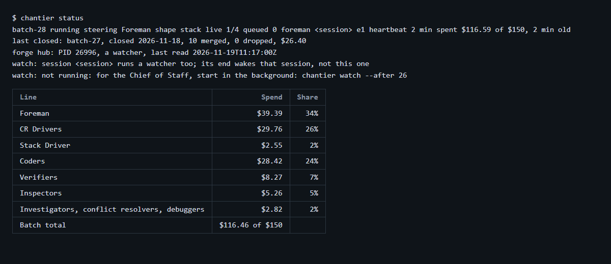
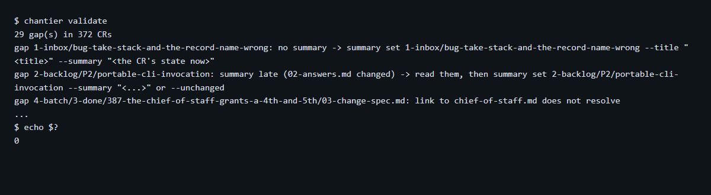

<h1 align="center">chantier 0.14</h1>

<p align="center"><b>Open a batch that takes each ready change on its own, steer from the board, and let one server per surface run the board and the forge hub</b></p>

<p align="center"><sub>22 changes since 0.13.0 · Claude Code and GitHub Copilot · MIT</sub></p>

<p align="center">
<a href="https://github.com/gsemet/chantier#install">Install</a> ·
<a href="https://github.com/gsemet/chantier/blob/v0.14.0/docs/tutorial-claude-code.md">Tutorial</a> ·
<a href="https://github.com/gsemet/chantier/blob/v0.14.0/docs/use-cases.md">Use cases</a> ·
<a href="https://github.com/gsemet/chantier/compare/v0.13.0...v0.14.0">Full changes</a>
</p>

---

## 🏭 A factory batch takes each ready change on its own

Until now, a batch started from a list of changes, and each new change meant a go from you. Now you can open a batch with no change in it: it is born paused and waits. A change made ready joins it in the same call (`triage <folder> --ready`), as if you had added it, with no go per change. The batch stays open at its last change's end and closes only on your word. The budget is unchanged: a change may join past it, but no Driver starts past it. A release still joins with its own go and turns the factory off, so the batch then ends like any other. `order factory on` turns the open batch into a factory, `order factory off` back.

> "Open an empty batch." · "Open a factory, stack mode, four slots."

```text
$ chantier open --mode stack --slots 4
$ chantier triage <folder> --ready
```

No capture of this one: it is a behaviour of the record, covered by the scripted scenario, and nothing in this release's batch ran as a factory.

See [Factory mode](https://github.com/gsemet/chantier/blob/v0.14.0/README.md#factory-mode).

You give the go once, then keep filing and specifying while the batch works.

## 🎛 The board is the place to steer

Two things you do in the board now reach the session without a word from you.

- **The limits are set from the Configuration page.** A new **Limits** tab holds the number of changes specified at once (`specifying.parallel`) and the slots of a new batch (`batch.slots`). Each shows its value and the layer it comes from; `open` takes `batch.slots` when you give no `--slots`, and `playbook` prints the limits.
- **The watcher wakes the session on what you do in the board.** Every backlog write and every Configuration save goes into the project's journal, and the session's watcher wakes on it: the Chief of Staff learns that you moved a change to `3-ready`, or changed the slots, at once. The watcher runs with or without a batch, ends when another session takes the seat, and `watch --once` reads the journal at your next message when no watcher runs.

| `status` lines the watcher and the server keep, and the batch's cost table |
| --- |
|  |

See [the board's Limits tab](https://github.com/gsemet/chantier/blob/v0.14.0/docs/web-board.md) and "The watcher" in [the planning folder](https://github.com/gsemet/chantier/blob/v0.14.0/docs/planning-folder.md).

The board stops being a place you look at and becomes one the Chief of Staff listens to.

## 🔌 One elected server per surface runs the board and the forge hub

The board and the forge hub were two processes, each with its own file. They are now one server per planning surface and machine: the process that holds the hub's lock serves the board and reads the forge (read-only, with your own `gh` or `glab`, at most every 20 s). `server.json` in the repository's git folder replaces `board.json` and `hub.json`: the board's key, its address and the hub's record sit in one place, so a second session finds the running server and gets its link instead of starting another.

The journal it feeds is now typed and addressed: each line carries a version, a sequence number, a kind, its source and its audience, and a watcher wakes only on lines for it (`watch --for`). Lines from older chantier read as version 0. The wake rate limit is a setting, `events.wake_every` (20 s or more, 20 s by default).

```text
$ chantier status
...
forge hub: PID 26996, a watcher, last read 2026-11-19T11:17:00Z
watch: session <session> runs a watcher too; its end wakes that session, not this one
```

On trial: the election between watchers is covered by the scripted scenario and the tests, but it has no run on Windows yet and no eval ran it.

See [the planning folder's journal](https://github.com/gsemet/chantier/blob/v0.14.0/docs/planning-folder.md) and [the board](https://github.com/gsemet/chantier/blob/v0.14.0/docs/web-board.md).

One server to find, one journal to read, one rule for whom it wakes.

## 🛠 Smaller changes

- **`chantier validate` checks a whole planning folder.** It reads the stages, each change's folder, `summary.json`'s format, missing or late summaries and broken Markdown links. A gap passes and is printed with the command that fixes it; an error exits 3. It writes nothing.

  | `validate` on a real planning folder |
  | --- |
  |  |

- **A release is finished after you publish it by hand.** When the host refuses the publication command and you run it yourself, your word that it is done goes back to a Driver, which checks the release on the forge and runs the closing checklist.
- **The release's post-merge word is asked with the merge go.** A release approval recorded while the release PR waits is no longer spent by the merge under a grant; the cards ask for the post-merge steps' word at the ready ask.
- **A board started by hand serves until you stop it.** Started with no `--seat`, it records the seats that register on it and follows none; started with `--seat`, it keeps stopping when its seats leave. The docs describe the agent-free launch as the code does it.
- **The CLI says when the session's watcher is not running.** The commands that set a batch running (`open`, `take`, `order qa`, the direct-mode switch) and `status` end with the exact command to start it in the background.
- **The pane and the board show the spend's age.** A cost reads `12 min old`, a draft PR's line takes the ready line's wording, and a carried verdict gets its own step. No screenshot of the pane from a real session yet.

<details><summary><b>🐞 All fixes</b></summary>

- **A release's merged PR stays shown.** After a release PR merged, `handoff`, `status`, the board and the archive showed only an open PR; they now show the merged one too.
- **The scripted scenario.** Its surface-board unit expects the watcher's restart line, stops the board it started by hand before the steps that expect none, and its empty-batch leg reads only the batch's own status line.

</details>

<details><summary><b>🛠 For contributors</b></summary>

- **Not exercised by an eval.** No eval campaign ran for this release (the maintainer's word). The changes below were not brought to an eval's test, and each marked "(proved by the scripted scenario)" is proved by a named check of it:
  - factory mode and the batch opened with no change (proved by the scripted scenario);
  - the limits set from the board, the board's writes in the journal and the watcher that wakes on them (proved by the scripted scenario); a session's wake by the watcher needs a real host and was not run;
  - the one elected server and the addressed journal (proved by the scripted scenario); the election has no run on Windows yet;
  - `chantier validate`, the release finished after a publication by hand, the post-merge word with the merge go, the board started by hand, the line that says the watcher is not running, and a release's merged PR kept in the readers (each proved by the scripted scenario);
  - the spend's age, the carried verdict and the draft wording: the text is proved by the scripted scenario, the pane drawn in a real session has no screenshot yet;
  - the eval audit that accepts the QA driver's first line.
- The release's claims file is `evals/results/claims-v0.14.0.md`: one row per change, its rail and its result.
- The startup reading of every role and host shrank: each boot rule is said once and first, the manifest is compact, and a role reads at most 8,664 bytes at boot and reload. `$CHANTIER` is written in full, never in a shell variable.
- `just check` runs ruff's lint rules on `scripts/`.
- The Chief of Staff may grant a fourth and a fifth round when the batch itself caused the red.
- The cards say a refusal before it is met, and the direct-batch docs match the CLI.
- Known: the elected server has no run on Windows, direct mode on Copilot has not been run in a real campaign, and neither has GitLab.

</details>
