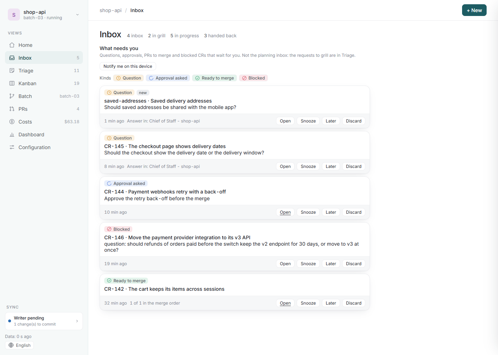
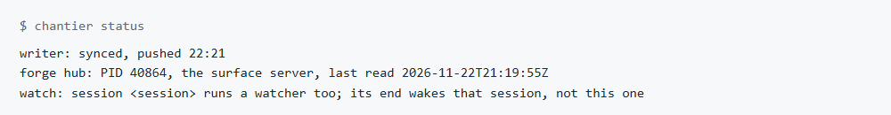

<h1 align="center">chantier 0.15</h1>

<b>Steer from the web board, run chantier commands from another machine through the surface server, and let the forge be followed for you</b>

135 changes since 0.14.0 · Claude Code and GitHub Copilot · MIT

<a href="https://github.com/gsemet/chantier#install">Install</a> ·
<a href="https://github.com/gsemet/chantier/blob/v0.15.0/docs/tutorial-claude-code.md">Tutorial</a> ·
<a href="https://github.com/gsemet/chantier/blob/v0.15.0/docs/use-cases.md">Use cases</a> ·
<a href="https://github.com/gsemet/chantier/compare/v0.14.0...v0.15.0">Full changes</a>

---

## 🎛 The web board is the place to steer

The board now has an Inbox of what waits for you (questions, approvals, PRs to merge, blocked changes), a History of what was done per day, week or month, a Dashboard of productivity and spending by closed batch, a Help page of chantier's concepts and roles, a Kanban and a graph of the running batch, and a Grill button that opens a discussion panel on an idea or a backlog item.

The Grill button runs the plugin's Griller from the board, one shared conversation per item, only with the private key. See [the web board](https://github.com/gsemet/chantier/blob/v0.15.0/docs/web-board.md).

## 🔑 Run chantier commands from another machine

`chantier serve` is now the command that starts the surface server, and `chantier webui` prints the board's link with its key and starts the server when none runs. The server has two keys: a private one that reads and acts, and a public one that only reads. After `chantier login <link>` on another machine, each command you run for that project goes to the server, which runs it in its own planning folder and returns the output and the exit code. The board listens on this machine unless you ask for the network, and its cookie lasts 30 days. `chantier live` reads the server from a terminal and shows up to four boards in one screen.

No capture of this one: it is a behaviour of the server's API, proved by the scripted scenario, and nothing in this release's eval ran under a login. See [the server's API](https://github.com/gsemet/chantier/blob/v0.15.0/docs/server-api.md).

## 📡 The forge is followed for you

A change waits for an answer, an approval, a pipeline or a merge, and chantier now records which. The surface server reads the forge, read-only and with your own `gh` or `glab`, only for what a running batch awaits, and only while a board or a watcher is subscribed. It watches the planning files itself, the session's watcher subscribes to it, and its writer commits, rebases and pushes the plan's published files within five minutes of a change. Forge connectors are plugins, and a program of yours can write an issue event into the journal with `journal add`.

See [the planning folder](https://github.com/gsemet/chantier/blob/v0.15.0/docs/planning-folder.md) and [the server's API](https://github.com/gsemet/chantier/blob/v0.15.0/docs/server-api.md).

## 🛠 Smaller changes

- **The batch page is lighter.** The mode and the legend sit in the title row, each waiting change has one arrowhead, lit arrows come on top, and the mode switch has a tooltip. Each Triage priority row folds and explains its writes count, and the backlog's last column is split into the running batch and the next one.
- **A change taken out of a batch says where it goes.** `order drop` names the trash, the inbox or the backlog, or `ready` (never the inbox for a ready change), and the change comes back under its number with its branch and PR.
- **Hold a change out of a stack, or park one.** `order hold` keeps a ready change out of the stack and a live one in every batch mode; the Foreman can park a change stuck on an outside wait. The factory mode is replaced by a choice of destination at the grill.
- **A stack is checked as a git chain.** `ship` and `stack --out-of-draft` check it, a stack CR starts on another CR's branch only once that CR is ready, a stack batch keeps its shape after compactions, and `take` prints the base the forge shows.
- **A change's title stays short.** At most 72 characters, checked by `validate`, `summary lint`, `file` and the board. `validate` also checks an outside archive's name, and a PR merged without chantier can be archived.
- **`chantier access` explains why a session may or may not write, claim or push.** It changes nothing.
- **Drivers hold a lease on their unit.** `--lease`, `lease renew`, `lease hold` (it runs nothing) and `take --reclaim`.
- **`gate` runs only the long gates you name.**
- **A blocked `uv sync` names its holders.** It waits and never kills one. Other projects run chantier in plugin mode, only chantier's own checkout in dev mode, and a dev session is told when the surface server runs a foreign build.
- **Preflight's allow rules name real paths,** and a broad rule is named as such.
- **A refused force push climbs.** The Driver, then the Foreman, then the Chief of Staff, then you.
- **One Driver per change.** The Driver card is smaller and a closing step resumes from the record.
- **`just tag` fast-forwards the main checkout before it tags.**
- **The writer keeps downloaded CI artifacts out of the published plan** and names a too-long path as the reason it is blocked.

<b>🐞 All fixes</b>

- **Board.** The phone's bottom bar scrolls sideways when its items no longer fit; a batch change's card shows its batch folder, not its old priority chip; a native stack's merges into the branch below are told landed; a change's plain subject is recorded and shown, without the specification lead; a lease hold keeps its file pattern.
- **Stacks.** One base function serves an unplaced change of a stack; a placed change keeps only its recorded start base; a clean rebase in a stack carries whatever branch the record names; a change started on a held one starts on the default branch; an ended start owner still falls back below.
- **Open and store.** `open` refuses a missing project clone instead of crashing; on Windows a held change folder is waited out, then refused with the cause; a transient read error no longer erases the server's state; the long gate's queue survives a sharing violation.
- **Titles and `just tag`.** A several-line request with no heading is refused with the long-title message; `version.py` dispatches the `ff-main` subcommand.
- **Tests and scenario.** The scripted scenario follows the new `serve` and `webui`, the typed journal lines, the server's welcome (its operations and topics), the plugin-mode launch form and the new cookie name; a few of its steps expect no seat or an initialised planning folder. Two flaky tests are deterministic, and a writer test's hook is executable on POSIX.
- **Lint and size.** Several functions, imports and docstrings were adjusted after rebases to pass the lint and size gates.

<b>🛠 For contributors</b>

- **Not exercised by an eval.** One eval ran for this release, `real-foreman` in stack mode (five changes merged in one stack). It brought two changes to the test: the clean rebase that carries a gate in a stack, and one Driver per change. Every other change was not brought to an eval's test, and each is proved by a named check of the scripted scenario or of the tests, but for three lint, import and size fixes after rebases, a lease-hold pattern fix and the phone-layout fix, which have no check of their own. No `full` run and no `real-direct` run ran before this release (the maintainer's word). The ones that matter most:
  - the Inbox, History, Dashboard, Help, Kanban, graph and Grill pages of the board (proved by the scripted scenario and the tests; no eval drove the board);
  - the commands run through the server under a login, the two keys, `serve` and `webui` (proved by the scripted scenario);
  - typed waits, forge connectors, the hub that reads only what is awaited, the writer and the watcher's subscription (proved by the scripted scenario);
  - hold, park and drop of a change, the git-chain check of a stack, the base `take` prints, short titles, `access`, leases, named long gates, the foreign-build line and the refused force push's ladder (proved by the scripted scenario).
- The release's claims file is `evals/results/claims-v0.15.0.md`: one row per change, its rail and its result.
- The plan's storage sits behind a small store interface, and every reader of the planning folder reads through it.
- The server's API runs over a WebSocket, and over HTTP for a network where a WebSocket does not pass; the web client lives in `clients/web` and `serve --ui <folder>|none` serves another one.
- Known: a real eval under a login is untested, there is no remote watcher (a session working through a login reads `status` each turn), and direct mode on Copilot and GitLab have not been run in a real campaign.

