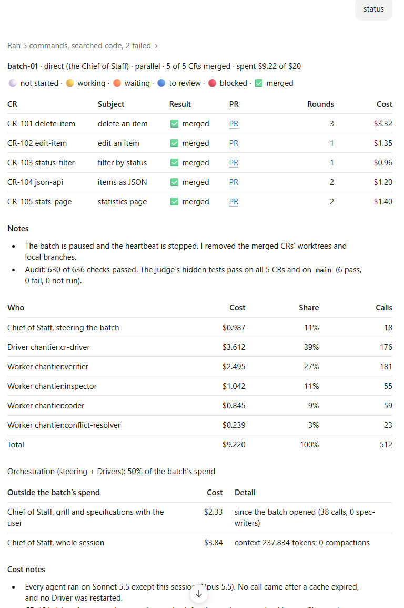

# Tutorial: chantier in Claude Code, step by step

This tutorial takes you from nothing to a merged pull request made by a chantier batch, in the
Claude Desktop app. It takes about twenty minutes, most of it waiting for the team to work.

You need:

- the **Claude Desktop app**, with its Code tab. Foreman mode starts the Foreman as a nested
  session, which only the Desktop app can do. In a terminal or in VS Code, or under Remote Control,
  the batches are in [direct mode](use-cases-direct.md) with no argument, where the Chief of Staff
  steers the batch itself;
- [`uv`](https://docs.astral.sh/uv/), `git`, and your forge's CLI logged in to its host: the
  [GitHub CLI](https://cli.github.com/) `gh` (`gh auth status`) or the
  [GitLab CLI](https://gitlab.com/gitlab-org/cli) `glab` (`glab auth status`), self-hosted
  servers included;
- a GitHub or GitLab repository you can push to, cloned on your machine.

We recommend turning on "Connect new sessions to Remote Control" in the app's settings: you can
then follow the Foreman's session from your phone, and answer it there when it needs your word.

## 1. Install the plugin

In a terminal:

```bash
claude plugin marketplace add gsemet/chantier
```

```bash
claude plugin install chantier@chantier
```

This installs four skills (the router `chantier`, `chief-of-staff`, `griller` and `status`) and twelve
agents (`chantier:cr-driver`, `chantier:coder`, …). Restart the Desktop app so it loads them. There is nothing else to install
and nothing to configure.

## 2. Tell chantier how your project builds

chantier reads your project's `AGENTS.md` (or `CLAUDE.md`) to learn how to check a change. If you
have neither, add an `AGENTS.md` at the root of the repository with at least:

```markdown
# AGENTS.md

- Default branch: `main`.
- Fast gate (after each change): `npm run lint`, `npm test -- --changed`.
- Long gate (before a pull request): `npm test`.
- Commits follow Conventional Commits.
```

The first line is the **fast gate** (the Coder runs it after every round), the second the
**long gate** (the Driver runs it once before the PR, through `chantier gate`, alone in the
repository). One command may serve as both; write one command per item, never chained with `&&`
or `;`. On Windows, the long gate runs in `cmd.exe`. The page
[Your gates](gates.md) says more: exemptions, and a project with no long gate.
Everything else `AGENTS.md` says (how to commit, the PR template, the merge method, what a
skipped job means, how to release) binds the team too: the Drivers commit, push and open the
PRs themselves, and your rules rank above chantier's own.

## 3. Open the repository and meet the Chief of Staff

In the Desktop app, open the Code tab on your repository's folder (its root, not a worktree), and
type:

```text
/chantier:chief-of-staff prepare yourself to work on this project
```

`/chantier:chief-of-staff` is the session that opens and runs batches. With no argument its mode
follows where you are (Foreman at the desktop, direct under Remote Control, in a terminal or VS
Code); `foreman` or `direct` after it forces one. `/chantier:griller` is a session that refines the inbox and the backlog
while the Chief of Staff runs batches. One Chief of Staff holds the seat per repository; a
second session that asks for it becomes a Griller and offers "become chief of staff", which you
say to take over. `/chantier:status` shows the progress report of the running batch at once, from any session, and changes nothing.

The Chief of Staff introduces chantier in a few lines, reads your `AGENTS.md`, and tells you
what it learned: how you check, ship and merge, and the default branch. It asks about anything your instructions do
not settle, and offers to write the answer in `AGENTS.md`. It records nothing anywhere else: it
reads `AGENTS.md` again at every session, and everything chantier writes later goes to
`.agents/changes/`.

New to chantier, or on a project with no `.agents/changes/` yet? Type
`/chantier:chief-of-staff init` instead. It creates the empty stage folders (inbox, backlog, `3-ready`,
batches, archives, trash), then gives you a guided tour of your project, in the chat or as an HTML page.
It writes nothing in the project except what you say yes to at the end.

You can check at any time:

```text
chantier, what do you know about this project?
```

## 4. File a change

```text
chantier, file this: the login form should show an error when the password is empty.
```

The Chief of Staff creates a **Change Request** folder in `.agents/changes/1-inbox/`, with
your request kept as written. Then it asks the questions that change the result ("only on submit,
or as you type?"), each with its recommended answer, and records your answers in `02-answers.md`.
When the questions are done, it restates the CR and asks whether it is grilled enough. On your
word, a **spec-writer** agent writes the **Change Specification** (`03-change-spec.md`) in the
background, and the Chief of Staff shows it to you after checking it against your answers. Read
it: it is exactly what the team will build.

File as many items as you like. To prioritize one:

```text
make it a P1
```

## 5. Run a batch

```text
run the P1s, two at a time
```

The Chief of Staff:

1. runs the **preflight** (Desktop app, plugin agents, `uv` and `git`, main checkout, project
   instructions, the forge's CLI logged in) and stops with the reason if anything is missing. It
   also checks, as warnings only, the forge's rights and branch rules (can you push, force-push
   a `chantier/` branch, edit PRs), and whether your allow rules let through the commands the
   agents run, judged by what they match and not by their text;
2. shows you the plan: the CRs, the slots, the budget, the agents, and who steers the batch
   (a Foreman or the Chief of Staff itself, and why: the surface, or your `foreman` / `direct`);
3. waits for your **go**.

For fewer auto-mode interruptions, when the preflight finds allow rules missing the Chief of Staff
asks you whether to add them, and adds them to `~/.claude/settings.json` on your yes, and nothing
else there; when the host refuses that edit, it gives you one command line to run at your
computer. The rules, the risk each accepts and what must stay refused are in the host reference's
section "Configuration" ([claude-code.md](../skills/chantier/references/hosts/claude-code.md)).

Say "go". It opens the batch (each CR is named a branch `chantier/batch-<n>/…` and a worktree
next to your repository, which its Driver creates when it starts), then starts the **Foreman**
in its own session. You will see that session in the sidebar; you never need to talk to it. In
direct mode, which the plan names, with the reason, when the session is under Remote Control, when
a Foreman session cannot start, or when you forced it, no Foreman starts: the Chief of Staff steers the batch itself and, while it does, answers only
"status?", "what did it cost?", your answers to a blocked CR and orders on the batch. Direct mode
is less dynamic (no CR joins a running batch, and that session holds no grill) but has the same
lifecycle: running, paused, closed on your word.

## 6. Follow and steer

While the team works, keep talking to the Chief of Staff:

| You say | What happens |
| --- | --- |
| "status?" | one line per CR, with its PR link |
| "drop CR-102" | the Foreman stops its Driver; the folder goes to `6-trash/` |
| "CR-103 first" | a note on the CR; the Foreman gives it the next free slot |
| "for CR-101, also handle the remember-me checkbox" | a note on the CR; the Driver takes it into its next round |
| "what did it cost?" | the measured cost so far: the Foreman, each Driver type, each worker type |

What "status?" or `/chantier:status` gives once a batch is done: the CR table with its result, PR,
rounds and cost, the notes, the cost by role with the orchestration share, the spend outside the
batch and the cost notes.



When a CR needs a decision only you can take, the Chief of Staff brings you the question. Your
answer is recorded in the CR's `02-answers.md` and the work resumes.

## 7. Review and merge

When a CR is ready, the Chief of Staff gives you its pull request. Each PR was built in rounds
(Coder, then a fresh Inspector), passed the long gate and CI, and was checked at its pushed head
by a Verifier that did not write it; the Driver committed, rebased, pushed and opened it by your
project's rules; its description follows the default PR template shipped in the skill, unless
your project has its own template, which ranks above it. Review it like any PR. **chantier never merges your PRs**: you do (only a
release's PR or fix is merged by the Foreman, on your word).

After merging, tell it:

```text
I merged #42
```

The CR's folder moves at once to `3-done`, then to `5-archives`, named by the time of the merge,
at `close`. When every CR of
the batch is merged or dropped, the Foreman removes the merged CRs' worktrees and branches with
git, pauses the batch (its `STATUS.md` is the exit report, its cost to date) and goes idle.
The batch stays paused, and takes new CRs, until you say "close the batch". Then the Chief of Staff runs `chantier close` without `--yes`, which refuses while anything
still runs or nothing at all can be priced (it names the cause) and otherwise prices it, with the calls of a model it has no price for shown apart; it shows what closing deletes (the batch's own files,
the dropped CRs' worktrees and branches) and that cost; on your yes, `chantier close --yes` moves the merged CRs to `5-archives`, deletes those files and removes the rest with git.
Without a yes, everything stays.

## 8. Make the team yours

Any role can run one of your own agents (in `.claude/agents/` or `~/.claude/agents/`), and you
can add review steps:

```text
use my rust-coder agent as the coder
add a security review with my sec-reviewer agent: OWASP top 10 on the diff
which agents and models?
```

The agent goes in `chantier.yaml`, an optional file at your project's root, and the review step in
a `chantier` section of your `AGENTS.md`. A model and the skills a role needs go in the same
`chantier.yaml`:

```yaml
roles:
  coder:
    agent: rust-coder
    model: opus          # the CLI resolves it to the exact model, or refuses the name
    skills: [jira]       # the Chief of Staff warns you if its session lacks it
```

```markdown
## chantier

- security-review: `sec-reviewer`, after the Inspector: OWASP top 10 on the diff
```

"Which agents and models?" runs `chantier playbook`, which prints what each role runs. A built-in role keeps its contract (its card in the skill, named in the prompt the Driver
writes), so your agent only brings its model, tools and know-how. A new role runs after the Inspector approves each round and answers with
the same verdict. The next batch uses the new team; a running batch keeps its own.

By default the spec-writer runs on Opus 5.5 (what a specification must say), and the Foreman, every
driver and the workers on Sonnet 5.5; run your own session (the Chief of Staff) on Opus 5.5. On a
named trouble (a CR blocked twice, the rounds used up with the Inspector still asking for fixes, a
red check nobody could explain, a conflict nobody could settle, a restack that failed) the task goes
to a new agent on the escalation model (Opus 5.5 by default), and the report says so.

None of them needs a 1M-token context. The plugin's agents compact at 200,000 tokens
(`autoCompactWindow` in their files). The Foreman is a session of its own, which chantier cannot
configure: to keep it lean too, set the window in your user settings, `~/.claude/settings.json`
(300,000 leaves the Foreman room for a long batch). It applies to every session you run, yours
included.

```json
{ "autoCompactWindow": 300000 }
```

## If something goes wrong

- **"chantier cannot run here: nothing was started."** The preflight names the failed condition
  and what to do. The usual one: you are in the terminal or VS Code, where no Foreman can start.
  With no argument, direct mode is used there; a forced `foreman` is refused with the reason, and
  you can say "direct" or open the Desktop app.
- **The app restarted during a batch.** Say "resume". The Chief of Staff checks the Foreman, and
  on your word starts a new one that picks up every CR where it was.
- **A CR is blocked.** "status?" shows why; answer the question or drop the CR.
- Anything refused (a permission, a tool, a model) is reported with its exact text: chantier
  never works around a refusal.
- **The classifier refused a chantier command** (a push, a `$CHANTIER` command, a PR): say yes
  when the Chief of Staff asks to add the allow rules of the "Configuration" section of the
  [host reference](../skills/chantier/references/hosts/claude-code.md) to your settings, or run
  the one command line it gives you at your computer when the host refuses that edit.
- **The Foreman was refused an action by a classifier.** It wants your word in that session: type
  one line in the Foreman's session allowing that action, from your phone if you are away.

Next: [use cases](use-cases.md) for more ways to work with chantier, or
[planning modes](planning-modes.md) to plan in a git repository of its own.
