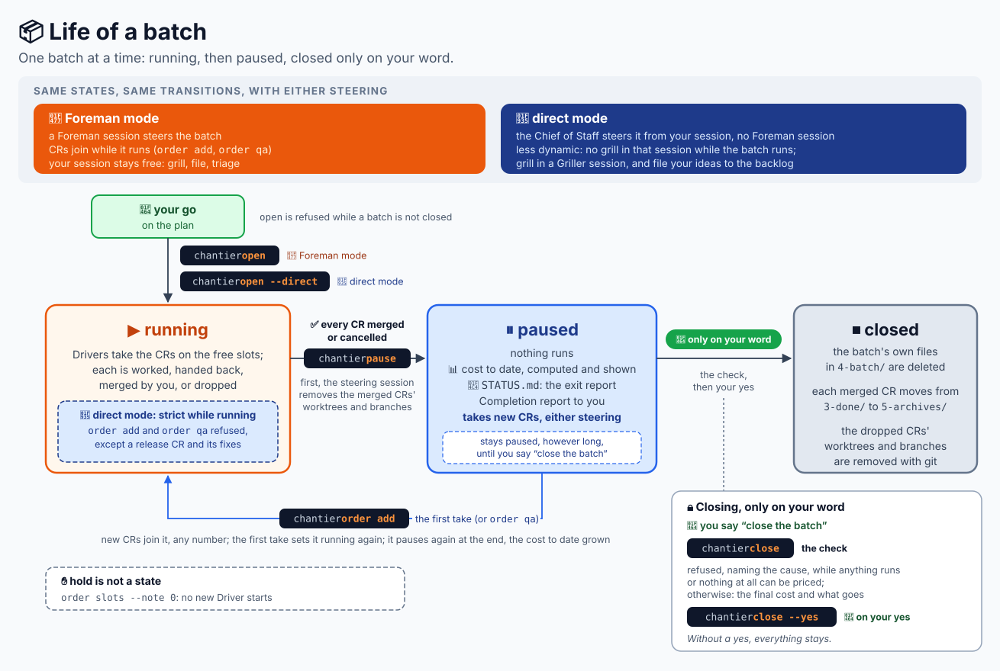

# chantier by use case

Each section is a situation, what you say to the Chief of Staff, and what happens. New to
chantier? Start with the [tutorial](tutorial-claude-code.md).

This page holds what does not depend on who steers a batch. The situations that do (running a
batch, steering it, releasing) are in one document per configuration, below.

## Choose your configuration

A batch is steered by a session of its own, a **Foreman**, or by the Chief of Staff itself in
**direct mode**. The lifecycle is the same; what differs is how dynamic the batch is while it runs.

| Configuration | Where it runs | Use cases |
| --- | --- | --- |
| Foreman mode | Claude Desktop (nested session), a Copilot agent session | [Foreman mode](use-cases-foreman.md) |
| Direct mode | any Claude Code entry point (the Desktop app, the terminal, VS Code, a Remote Control session), a Copilot agent session | [Direct mode](use-cases-direct.md) |

GitHub Copilot is not a third configuration: each document ends with its own "On GitHub Copilot"
section.

The plan the Chief of Staff shows before a batch says who steers it. It proposes direct mode when
the host cannot start a Foreman session (a terminal or IDE host, a Remote Control session with no
Foreman to reuse) or when the batch has few CRs, and says why. Your go decides: nothing starts
without it.

## The life of a batch

- A batch is **running** from `open` until every CR is merged or cancelled.
- It is then **paused**: the cost to date is shown, `STATUS.md` is its exit report, and you get the
  Completion report. New work sets it running again; it pauses again at the end.
- It is **closed** only on your word ("close the batch"), after a check and the final cost.

One batch at a time. Whoever steers it, the three states are the same.

## Start on a new project

> "init" · "I am new here."

`chantier init` creates the five stage folders of `.agents/changes/` (`1-inbox`, `2-backlog`,
`3-requests`, `4-archives`, `5-trash`), empty, and says which it created and which existed. The
Chief of Staff then gives a guided tour of your project: it reads your instructions, your build
files and your CI lightly, and tells the story of one CR of your project, from the request to the
archive. You choose the chat or an HTML page. The tour writes nothing in the project, except what
you say yes to at the end: `AGENTS.md` rules, or a CR filed in the inbox for work that needs code.
Without a git repository, it explains what chantier needs and offers `git init`, which it runs
only on your yes. Run `init` again whenever you like: it changes nothing and assesses the
improvements again.

The other way in:

> "chantier, prepare yourself to work on this project."

The Chief of Staff reads `AGENTS.md` (or `CLAUDE.md`, or `.github/copilot-instructions.md`) and
tells you how it will build, test, ship, merge and release here, and on which branch. It asks
about what the instructions leave open (a long gate, say), with a recommended answer, and offers
to write that answer in `AGENTS.md`. There is no other configuration: every agent reads
`AGENTS.md`, at every session, and chantier writes only in `.agents/changes/`.

## Turn ideas into ready work

> "File this: export the report as CSV." · "Make it a P2." · "Let's refine the CSV export."

Each item becomes a CR folder in the inbox, with the raw request kept as received. Refining
(the "grill") can happen at any stage: the Chief of Staff asks only the questions that change the
result, each with a recommended answer, and writes every answer in `02-answers.md` at once, so
nothing waits in the conversation only. Only you set priorities.

When the questions run out, the Chief of Staff restates the CR: what it changes, every decision
taken, what is still open. You correct it, and a correction is an answer. Only then it asks
whether the CR is grilled enough, and you decide, never the Chief of Staff.

> "It is grilled enough."

A **spec-writer** agent writes the Change Specification (`03-change-spec.md`) in the background,
while you go on talking. The Chief of Staff reviews it against your answers, nothing dropped and
nothing invented, before it shows it to you; open questions come to you, and the writer runs again
with your answers. A specified CR waits in the inbox or the backlog until you prioritise it and
pick it for a batch.

> "Drop the dark-mode idea for good."

Only on your explicit word does a CR go to `5-trash/`.

## Your pull requests' description

Each CR's pull request (a merge request on GitLab) is described from a default template shipped in
the skill, for a reader outside your team: Summary, Deliverables (with small visuals), Changes,
Impacts, Blast radius, Test plan, Autonomous decisions, and Internal references. The title and the
body are in English, and name no CR, batch, round or agent: the CR's name goes in the last
section, "Internal references", and nowhere else. The Inspector checks it.

Your project ranks above the default: a pull request template the forge reads, or a PR rule in
your instructions, is used as written.

> "I want my own PR template."

The Chief of Staff files it as a CR, grilled and specified like any other; a CR Driver delivers it
by pull request, and once merged your version ranks above the default.

## Use your own agents

> "Use my `rust-coder` agent as the coder."

The Chief of Staff writes it in the `chantier` section of your `AGENTS.md`; every Driver's prompt
names it, and the coder role runs your agent with the same contract as ours: it gets the
specification, the worktree, the work folder and the project's rules in its prompt.

> "Add a security review with `sec-reviewer`: OWASP top 10 on the diff."

A new role becomes an extra review step: after the Inspector approves a round, your reviewer
checks the diff from its angle and answers APPROVE or FIX-REQUIRED; a fix sends the CR into
another round.

> "Which agents and models?" · "Back to the default coder."

The Chief of Staff writes the team in a `chantier` section of `AGENTS.md`, so your colleagues get
the same one. The next batch uses it; a running batch keeps the team it started with.

## Know what it costs

> "What did tonight's batch cost?" · "Who cost the most?"

`chantier cost` measures the steering session and every agent under it, in one line for the
steering session, one per Driver type and one per worker type (or by CR), from the transcripts
(Claude) or the billed records (Copilot). With a Foreman, the first line is the Foreman; in direct
mode it is `Chief of Staff (steering)`, counted in the batch's spend and budget as a Foreman's
is. A missing transcript or an unknown model is an error, never an estimate. The rest of your own
session is priced apart. Ask "why did it cost that?" and the figures are explained from what was
measured: the calls, the model, the shares of cost, the calls after the cache expired, the
restarted Drivers.

On a batch with no recorded steering transcript yet (no Foreman started, or the Chief of Staff's
steering not claimed), `cost` and `close` both refuse: `close` deletes nothing it cannot price.
Once a batch is paused, `status` and `cost` without `--batch` answer `no running batch`: pass
`--batch <name>`.

You also get it unasked: one line per CR when it is ready or merged, and the full cost to date when
the batch is paused, final at `close` (total, budget, the split between the steering session,
Drivers and workers, the costliest CRs).

## When chantier says no

chantier stops instead of improvising: in a linked worktree, unattended, without project
instructions, with a missing agent, a refused tool or an unknown model. Foreman mode also needs
the Desktop app or a Copilot agent session; where the host cannot start a Foreman session, the
plan proposes direct mode instead. It tells you which condition failed and what you can do; it
never offers a workaround.
