# The web board

`chantier board` serves a small web page over a planning folder, for any device on your network: your laptop, or your phone while the batch runs somewhere else. It shows the batch and its CRs, the backlog, the costs and each CR's files, and it lets you triage the backlog. It never touches a batch. It reads your forge with your own `gh` or `glab`, read-only, for its PRs page.

The pictures on this page are taken from the real board by `just docs-screenshots`, on a made-up planning surface (`docs/demo/`, see [its README](demo/README.md)): three fictional projects, the clock fixed at 2026-06-18 10:30 UTC. Nothing in them is a real project.

For the other board, the pane in Claude Code, see [boards](boards.md). To start it, keep it on the machine and stop it, see [Starting the board](#starting-the-board).

## The views

The breadcrumb at the top names where you are, and stays in place when the page scrolls. The left bar lists the views and the project. On a phone the bar becomes a bottom bar and the project picker sits at the top. A planning surface with several projects opens the picker's menu with the surface as its header: the grid icon, its name in bold and "overview · N projects" under it. A click on that header opens the overview from any page. A line follows, then the projects, slightly indented; a single project has no such header.

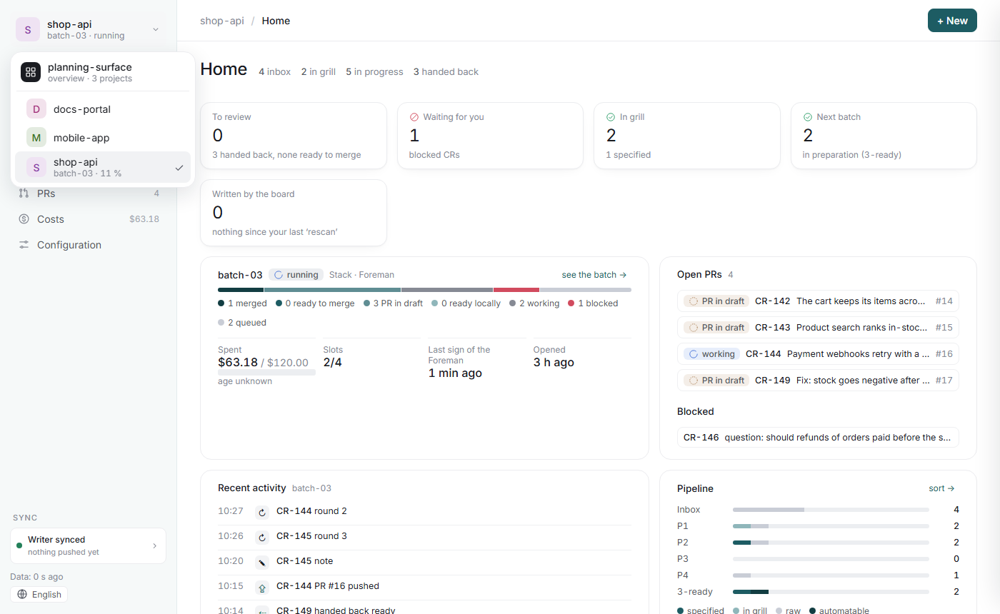

The data refreshes by itself. The line under the bar says how old it is (`Data: 0 s ago`), or that the board is unreachable.

### Home: the planning surface

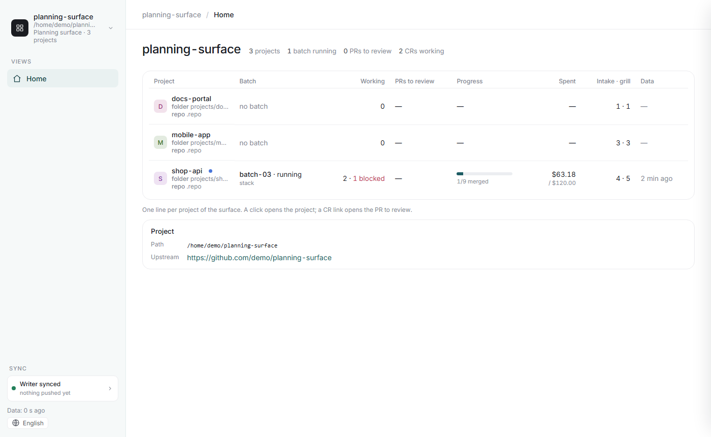

With several projects, Home is the table of the surface (its name is the page's title): each project's line shows its folder in the surface and its code repository as its `checkout.yml` names it (`.repo` with no `repo:` line), then the batch (running or not), the CRs working, the PRs to review (ready to merge), a progress gauge, what was spent against the budget, and the numbers of the intake and the grill. A path too long for its place is cut, and shown whole when you hover it. A click on a line opens that project. The surface's Home is read-only.

### Home: a project


A project's Home answers "what needs me?": five tiles (**To review**, the PRs ready to merge; **Waiting for you**, the CRs that are blocked; **In grill**, the items being grilled or specified; **Next batch**; **Written by the board**), the batch with its progress gauge, the open PRs (a row opens its PR or MR on the forge, and its CR number opens the CR's folder), the pipeline of the backlog, the recent activity of the batch (with no batch running, it names the last closed one), the last merged CRs and the five latest closed batches, one line each, with a link to the costs.

### Batch

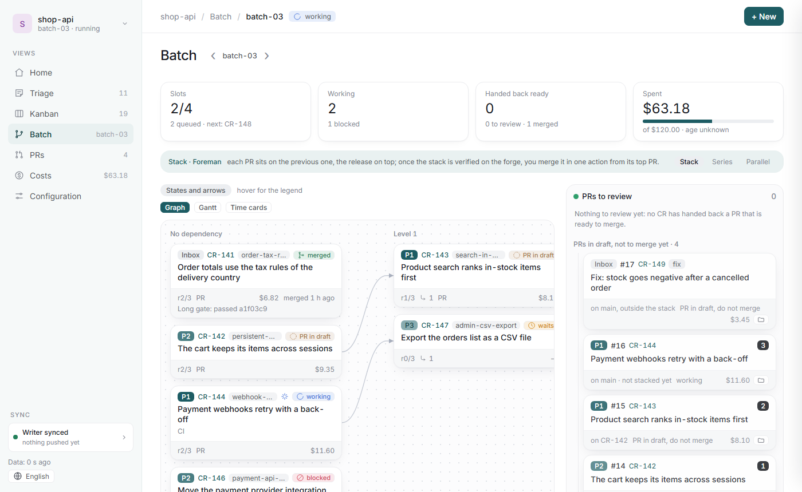

The batch in four figures (the slots, the CRs working, the CRs handed back ready, what was spent), then the CRs as boxes in levels, "Level 1", "Level 2" and so on: a CR sits in the level below the CRs it waits for, and an arrow goes from a CR to the one that waits for it. Each CR stays in one place for its whole life, merged ones included. The state is a badge in the CR's top right corner, its icon and word in the state's colour: blocked, working, **ready to merge**, **PR in draft**, **ready locally** (done, no PR yet), waits, queued, merged; its legend is in the "States and arrows" tooltip. Hover a CR to see what it waits for and what waits for it; a click opens its folder.

Above the central view, three tabs show the same batch three ways: **Graph** (the levels above), **Gantt** and **Time cards**. The tab is in the address (`&t=gantt`, `&t=cards`; the graph is the default and writes nothing), so a link opens the same tab; it is kept while you stay on the Batch page of the project and dropped by any other view or project. The legend pill stays above the tabs. A CR that changed state in the last ten minutes shows a small burst in its state's colour beside its badge (it plays once, and again when you come back to the Graph tab). A CR's top row begins with the stage it came from, a priority chip (`P1` to `P4`, `Inbox` or `3-ready`) read from the batch's `add` event; a batch that did not record it shows none.

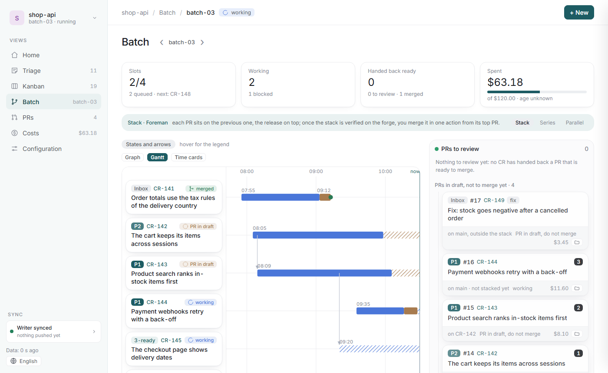

**Gantt**: one line per CR on a real time scale, from the batch's start to now. A CR's bar is cut into segments, one per period in a state, in that state's colour; the open segment runs to the "now" line, hatched. A CR that has not started is a cross at the right edge, a finished one ends on a round mark (merged green, cancelled grey), with its start and end times above the bar. The arrows are the graph's, vertical at the start of the CR that waits; hover a CR to light what it waits for and what waits for it. The times come from the batch's events, so a closed batch's record (which keeps none) shows only a note under the Gantt and Time cards tabs.

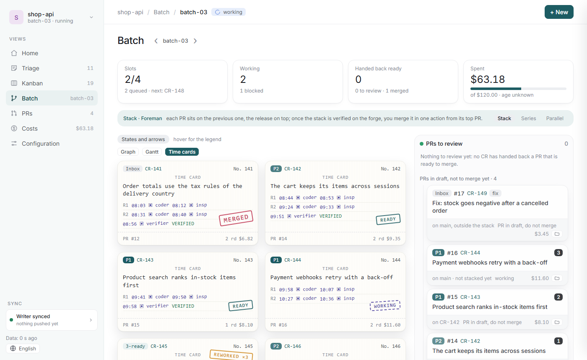

**Time cards**: one paper card per CR, in the receipt's paper. Each round is one stamped line (the coder, then the inspector's first phase), then the verifier line with its verdict, the PR and the cost. A rubber stamp says merged, ready or working, and a CR at its third round or more also carries a "reworked" stamp.

The same navigator sits next to the title. On a closed batch the page draws the record: four figures (CRs merged out of the total, the dropped ones, the rounds, spent against the budget), the mode, and the graph of its CRs in levels with its arrows, each CR carrying its badge (merged or cancelled), its rounds, its cost and "PR"; there is no PR column and a click opens nothing. The crumb shows the batch's id with a grey "closed" chip. A batch closed since this change keeps each CR's `order` and `after` in its record, so its graph is complete. For an older batch the board reads the `depends.json` the archived CR folders still hold: a line above the graph says "Dependencies from the archived CR folders only" (those set during the batch were not kept) or, when nothing can be read, "Dependencies not recorded for this batch: no arrow".

The right column is one column, the PRs to review then the drafts, and follows the batch's mode (stack, series or parallel, named in the bar under the numbers):

- **PRs to review**: the PRs ready to merge now. In a stack, only a fix CR, which sits on the default branch outside the stack, is to review while the stack is not built and verified on the forge; the others are listed as **PRs in draft, not to merge yet**, with their place in the stack (1 is the bottom, not a merge order). A click on a PR opens it on the forge; the folder icon opens the CR's folder.

### PRs

The PRs of the batch as the forge says they are now, one row per CR that has a PR, in the merge order. A row shows the PR (a click opens it on the forge), the CR and its kind, the PR's state on the forge (open, draft, merged, closed), whether it conflicts, its checks (green, failing, running, none), and the CR's folder icon. The page only reads: it writes nothing on the forge and nothing in a batch, and in the planning folder only the signal below.

The batch navigator is on this page as on Costs and Batch: a past batch's PRs are read once on the forge when shown, and with no batch running the page shows the last closed batch. A row of chips filters by state (all, open, draft, merged; a closed PR shows under "all" only) and a second sorts (the batch's order, opened, last activity, CR number; dates newest first), and each row shows the date it is sorted by. The choice is in the address (`b=`, `st=`, `sort=`), so a copied address reopens the page the same way. On a GitLab project the board says "MR" wherever it says "PR" and writes a number `!n`; it knows GitLab from the project's MR links, or from the `origin` host while no MR exists.

- **Ready to merge now** is both at once: the record says the CR is to review, and the forge says the PR is open, not a draft, with no conflict and its checks green (or none to run). The forge alone never makes a PR ready.
- **Being checked by the forge**: the forge has not finished computing the PR's mergeability or has not started its checks yet. The page says so rather than "no checks".
- **Merged**: the row names the branch the PR went into, and the CR whose branch it is when it is one.
- **Merged on the forge, not recorded yet: tell the Chief of Staff**: the PR is merged but the record does not say so. Tell the Chief of Staff, who records it with `order merged`; the line goes once it is recorded. The same line style warns when the record says a CR is ready but the forge says draft, closed, conflicting or checks failing.
- **The signal**: when a read finds a PR merged that the record does not hold, the board appends one line to `forge-journal.jsonl` at the planning folder's root (once per batch and CR; a cached read or a PR closed without a merge writes none). The file is local, never published, and is not the batch's: the board records nothing and messages no agent. `chantier status` prints the line (`forge saw merged: <cr> <pr> into <branch> at <time>; for the Chief of Staff: order merged <cr>`; for a PR merged into another CR's branch, `into <cr>'s branch at <time>; for the Chief of Staff: not landed, tell the user, record nothing until <cr> lands`), in the Chief of Staff's own `status` and in the Foreman's heartbeat alike, and the Chief of Staff records the merge with `order merged` at the `status` that shows it, in direct and Foreman mode alike. The Foreman does nothing with the line. The Configuration page writes a line of its own type (`config@1`, `source: board`) when a save changes the effective `specifying.parallel` or `batch.slots`: `status` prints `config changed on the board: batch.slots <old> -> <new>; <batch> keeps <n> until an order slots` (only the newest slots line of the running batch, until an `order slots` follows it) and the watcher wakes on it. A PR merged into another CR's branch has landed when that CR's PR is merged on the forge, at the same time or later, into a branch that is no CR's (a chain of such CRs is followed to its end): the read then carries `landed_with` and `landed_at`, and the page writes one second line for that CR, once (the file holds at most one line per batch, CR and landed-or-not). `status` prints the landed line instead of the first (`forge saw merged: <cr> <pr> into <other cr>'s branch at <time>, landed with <cr> at <time>; for the Chief of Staff: order merged <cr>`), and the Chief of Staff records it like any merge. Once the merge is recorded the line no longer prints. The forge hub of `chantier watch` writes the same lines to the same file (`source: hub`), by the same rules, so a merge is one line whichever of the two reads it first.
- **The signal is read only when a `status` runs**: when nothing runs (no heartbeat), the row's "merged on the forge, not recorded yet: tell the Chief of Staff" means just that: tell the Chief of Staff, who records it.
- **A PR merged into another CR's PR** (a stacked batch) is signalled too, with that CR's branch. It is a merge to record once the PR under it has landed (the line then says `landed with <cr>`); until then the line says not landed, and the Chief of Staff tells you and records nothing.
- **Refresh**: the page reads the forge when it opens and at once on each change of the batch shown, then every 10 s while the page is visible and a PR of the batch shown is not done. The server keeps one read per project and batch shown for 10 s, however many pages are open. It stops when every PR is merged or closed (a closed PR counts as done), and starts again when a new PR joins the batch.
- **A forge error** (no login, no network, a hung call) shows as one line above the rows; the
  last good read stays on screen with its age. A PR link of a forge chantier has no connector for
  shows as `no connector reads <link>`, and the other rows are read.
- **A paused batch** says so in the header; with no batch running the page shows the last closed batch (read once), and says "No batch running" only when the project has no history at all.

### Kanban

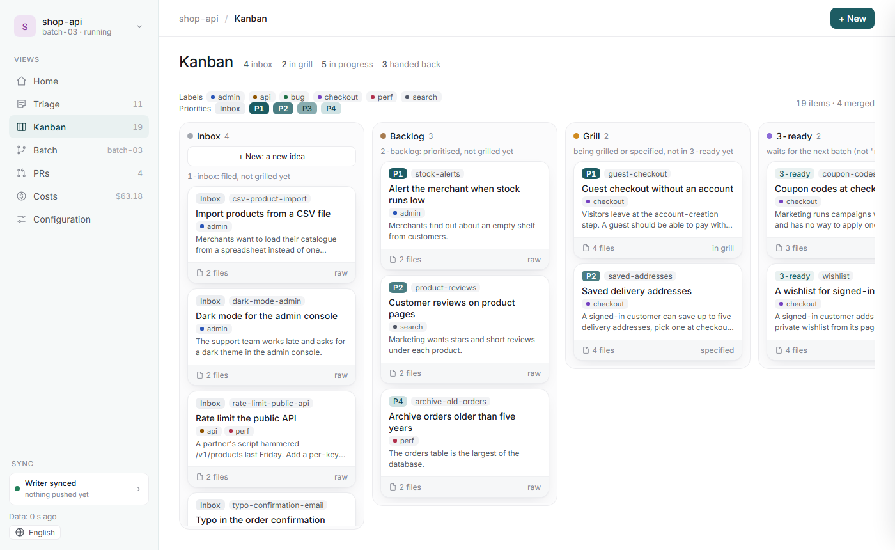

Seven columns, from the idea to the merged CR: **Inbox** (`1-inbox`), **Backlog** (`2-backlog`, P1 to P4, not yet grilled), **Grill** (items being grilled or specified, from the inbox or the backlog), **3-ready** (waits for the next batch), **In progress** (queued, working, blocked), **Handed back** and **Done** (the newest merged CRs; the total is in the column's head). A card shows its priority (a teal shade, darkest for P1 and palest for P4, on its `Pn` chip), its labels, its first lines, the number of files and its state (raw, in grill, specified, automatable), or its round for a CR of the batch. A working CR of the batch shows its step (`coder r2`, `gate scenario`, `CI`), a blocked one "waits for the user", and the CR the batch would start next carries a "next to start" tag (the Batch view's Slots figure names it). A CR (of the batch or of the backlog) with an open typed wait (answer, approval, pipeline or merge; `wait`) shows `waits: <types>` in its meta line; the board only shows it, the steering session clears it. A click opens the folder. The labels at the top filter the cards, and a priority filter (the inbox and P1 to P4) sits beside them. **+ New: a new idea** files an idea (see below).

### Triage

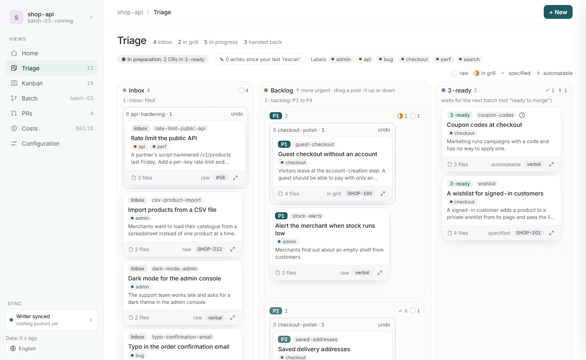

The place where you sort the backlog. Each item is a post-it, the same card as the Kanban's with the selection and the drag added: its folder name, where the request came from (an issue number, a Jira key or `verbal`), its labels, and a mark for how far it has been worked (raw, in grill, specified, automatable). A dashed post-it with a clock has a late summary: the CR changed after its summary was written. On a wide screen each priority shows its post-its side by side, as many per row as fit, each the width of an inbox post-it. The post-its of P1 to P4 carry the same teal shade of their priority, on their chip, as on the Kanban (the panel's head shows the same chip).

- Drag a post-it between **Inbox**, a priority (P1 more urgent than P4) and **3-ready**, or up and down in a column.
- Select several post-its for the bar that groups them under a theme (a group moves to the first post-it's column, **undo** takes it apart) or labels them (one lower-case word).
- **The next batch is ready** records that you said so (`next-batch.json`, the time and the CRs then in `3-ready`). It decides nothing and opens nothing: the next batch opens after the running one closes, on your word to the Chief of Staff.
- The button **✎ n writes since your last 'rescan'** lists what the board wrote. The board does not talk to the Chief of Staff itself: a Chief of Staff whose watcher (or pull path) runs hears each write within about 20 s, and "rescan" stays for one that runs neither: tell it "rescan" in the chat, then press **I said 'rescan' to the CoS**.

Each change is written at once, with the CLI's own file and triage commands, in the backlog only: the inbox, the priorities, `3-ready`, the labels, the groups. The surface's Home and a running batch's CRs are never written.

### Costs


The page shows the cost of the batch the navigator chose as a supermarket receipt; by default the running batch's, and, with no batch running, the newest closed batch's. The navigator sits next to the title, on this page and on the Batch page: `‹ batch-04 ›` moves to the previous and the next batch (greyed on the first and on the last), and a **Latest** pill, shown when the page is not on the last batch, goes back to it. The batch shown is in the address (`&b=batch-04`), so a link opens the same batch; it stays between Costs and Batch, and any other view or project drops it. An unknown `b` shows the latest batch. A record that is neither closed nor the running batch (an abandoned one) is not in the navigator. On a wide screen the receipt (the ticket) stays on the left and the cards on the right; on a phone the ticket comes first, the Per CR table keeps the CR and its title and the figures follow.

The ticket prints the batch, its state and how long it lasted, then the steering (the Foreman or the Chief of Staff, with its wakes and its average context), one line per Driver with its workers, a bar of the split between the steering, the Drivers and the workers, and, after a cut line, the total in large figures, the budget used, the average per CR and what lies outside the budget (the grill and the specifications, and the Chief of Staff's steering outside its claim window, the same figure as `cost`'s line). Below a dashed rule come one line per CR, their sum and a barcode. The cards show the figures again (spent, budget, sum of the CRs, average), one row per CR of the batch, the last merged CRs of all the batches and **Earlier batches** (closing day, mode, CRs merged, cost against the budget; a click on a row unfolds its CRs). A figure the batch could not price reads "at least"; a record made after the fact shows a dash where it has no figure.

**Copy as image** (above the cards, next to Recompute) puts the ticket in the clipboard as a PNG, with the board's font and without the button; it works for a running and for a closed batch. A browser allows it on a secure origin only: on `127.0.0.1` or `localhost`. From another machine of the network, over plain http, the button is greyed and its tooltip (on hover and on focus) says so and links to the same page at the board's 127.0.0.1 address; a browser without the clipboard's image support greys it too. There is no download.

A closed batch's ticket is the `cost_receipt` its record kept at close: final, it never changes. A batch that is not closed (running, paused) carries a red "NOT FINISHED" stamp on its ticket and on its copied image, so it is not taken for a final receipt. A closed record from before the receipt reads "roles not recorded". A running or paused batch with no live figure yet reads "not computed yet"; **Recompute** makes the server read the transcripts again, with no agent turn.

The first card on the right, **Where the money went**, shows where the shown batch's money went: by model by default, or by role with the switch at its top right. One bar runs from $0 to the batch's budget, one coloured segment per model (or per role: the steering, the Drivers, the workers) with the unspent rest hatched, and the line above it reads "$X of the budget left unspent" ("at most" when some calls have no price); over the budget the hatch goes, a thin mark shows the budget's place and the line reads "$X over the budget"; with no budget the bar spans the spend and the line reads "No budget: $X spent". Under the bar, one row per model gives its swatch (the segment's colour), its provider's logo, its name and version, its turns (model calls) and its cost; a model with no known provider shows its exact id and no logo. The Chief of Staff's spend outside the budget is one grey row under the rows, with no segment in the bar, and reads "unknown" where it cannot be measured. `close` records the per-model figures (`models` in `cost_receipt`) from now on: a batch closed before shows "not recorded for this batch". The providers' marks come from [Lobe Icons](https://github.com/lobehub/lobe-icons) (MIT; the licence sits beside them, in `js/ui/logos-LICENSE.txt`) and are their owners' trademarks, shown only to name the provider of a model.

### Configuration

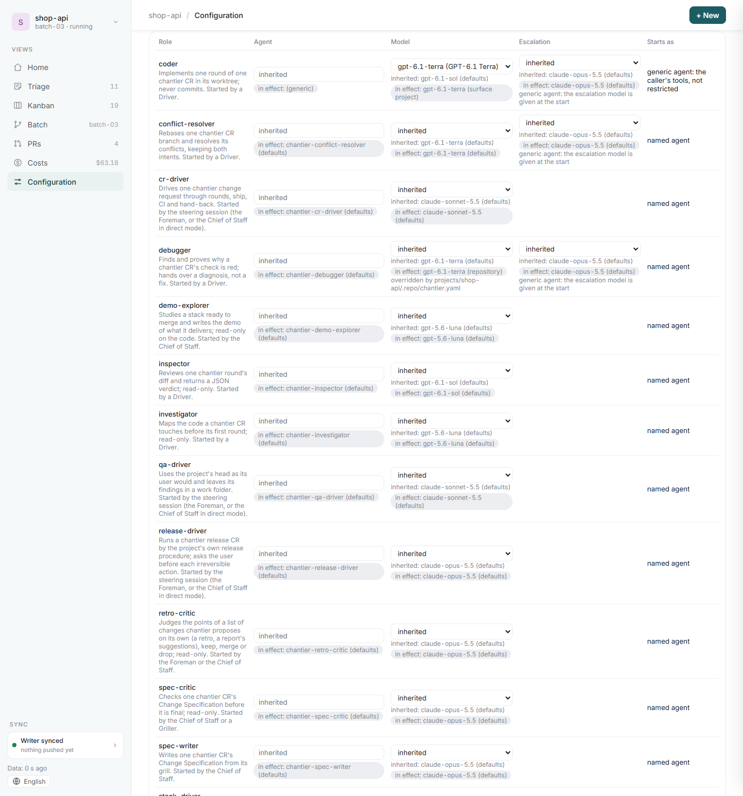

For each host (Claude Code, Copilot), one row per role: the agent and the model it has in the project's configuration file in the planning surface (`projects/<name>/chantier.yaml`), the value in effect and the layer it comes from, and how the role starts (the plugin's agent, a named agent, or a generic agent when the host cannot start a named agent on a chosen model). Choosing "inherited" removes the key from the file. Each change is judged first (a dry run) and written by **Save**, keeping the file's comments and its other keys; it applies at the next batch, never to a running one. The other settings are shown read-only, and with no planning surface the whole page is read-only.

A second tab, **Limits**, holds the two numbers of a project: **CRs specified at once** (`specifying.parallel`, 1 or more, 4 by default) and **slots of a new batch** (`batch.slots`, 0 or more, 4 by default). Each shows the value in effect and its layer, an empty box means inherited, and "use the inherited value" removes the key from the surface's file. A new batch takes its slots from here when `open` gets no `--slots` (a configured 0 is refused); a running batch keeps the slots it opened with until the Chief of Staff orders a change, and a save that changes the slots writes one `config@1` line in the signal below, so the Chief of Staff hears it at the next `status` or watcher end (a paused batch has no watcher: `status` is its route). A change of `specifying.parallel` applies from the next spec-writer start.

A value the code repository's own `chantier.yaml` overrides is still written to the surface's file, and its row says "overridden by <path>". The Copilot table shows each model's plans, from GitHub's tables; they refuse no model. A Copilot role with its own agent and a model is shown refused, with the CLI's line, and blocks nothing on the page.

## A CR's files


A click on a CR, a card, a row or a PR's folder icon opens its folder in a side panel: the tree of its files on the left (sub-folders such as `intake/`, `evidence/` and `work/` included), the file on the right. Markdown is drawn, other text is shown as text, images are shown, and a file the page cannot show (too large, or another type) offers a download. A web link or URL of the drawn Markdown opens in a new tab; the facts row links the CR's PR or MR and a backlog item's issue, and an MR's number is `!n`. The panel reads the planning folder only.

### Editing a Markdown file


A backlog item's Markdown file has an **Edit** button (never a batch CR's, never on the surface's Home). **Save** (or Ctrl+S) writes the file only if it is still the one you opened: if the Chief of Staff or another device changed it meanwhile, the board refuses and tells you, so that nothing is overwritten. Leaving the file, the item or the page with unsaved changes asks first.

## A new idea


**+ New** (at the top right of a project's views) files an idea in the project's `1-inbox/`: write it, optionally name its folder (lower case, dashes), press **File**. The folder holds an `intake/request.md` with your text. If the name is taken the dialog asks for another one.

## The surface's writer

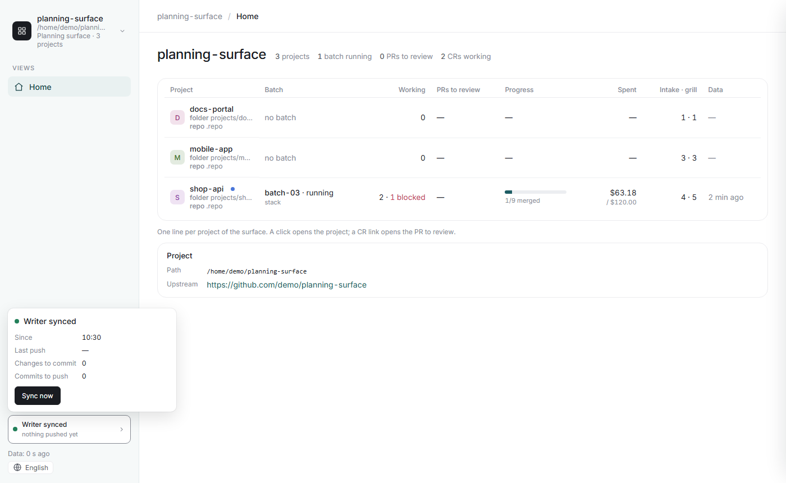

On a planning surface, the bottom of the left bar shows a pill with the state of the surface's writer, the part of the board that commits and pushes the plan ([planning-modes](planning-modes.md#the-surfaces-writer)): **synced** (green, with the time of the last push), **pending** and **syncing** (blue), **offline** (grey, the origin is out of reach), **conflict** and **blocked** (red, the Chief of Staff must integrate or fix it) or **off** (grey: no writer runs). A click opens a panel: the state and since when, the last push, the paths to commit, the commits to push, the conflict's files or the blocked reason with its way out, and one button, **Sync now**, that asks the writer for a cycle at once. There is no Start, Stop or Approve: the writer lives as long as the board does. A board on a project's own folder has no pill.

## On a phone

Each view fits a phone: the bar is at the bottom, the project picker and **+ New** at the top, the writer pill is a dot beside the picker, and the tables and boards become lists and stacked cards.

| Batch | Triage | Triage, two selected | Picker | Writer |
| --- | --- | --- | --- | --- |
|  | 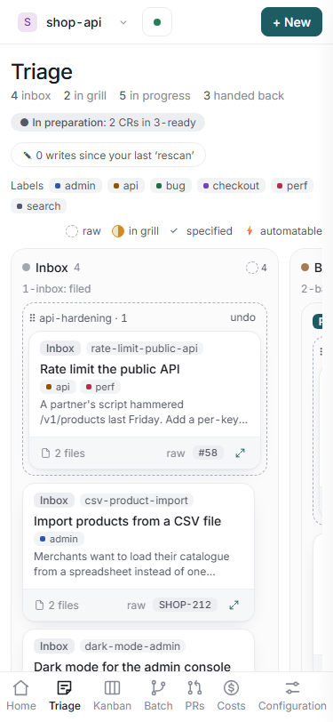 |  |  | 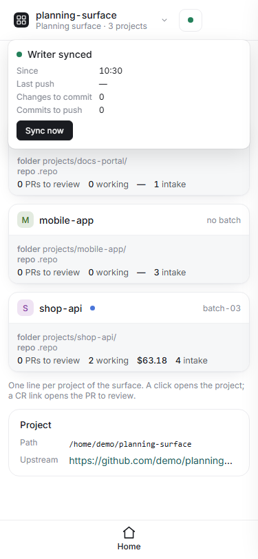 |

The other views, each at both sizes, are in [`docs/web-board/`](web-board/): `<view>-pc.png` and `<view>-phone.png`.

## Language

The page is in English or French; a button at the bottom of the bar switches it (`?lang=en` or `?lang=fr` in the address does the same), and the board remembers your choice and your project. The pictures here are the English page; the French page is not captured.

## Retaking the pictures

`just docs-screenshots` copies `docs/demo/` to a temporary folder, as a git repository with a bare origin (the writer's pill shows `synced`), starts the real board on the copy (loopback, a free port, the clock fixed with `--clock`), takes every picture in Chromium (Playwright) at 1400x860 and 375x812, with a fixed time zone and language and no animation, and stops the board. The surface's path is a temporary folder of the machine, so the script shows a made-up one (`/home/demo/planning-surface`) in its place. Twice in a row gives the same files. The first run downloads Chromium. It needs chantier's own checkout and `uv`.

## Starting the board

The board needs your own `gh` (GitHub) or `glab` (GitLab) login, and the network, for the PRs page only; every other view reads the planning folder.

On any device, the Chief of Staff starts a small web server, `chantier board`, that serves the
batch with its CRs (state, round, cost, PR), the inbox, `3-ready` and the backlog, the merged and
trashed CRs, the costs, and each CR's files (text and images). Started by a session, it stops when
that session leaves the seat; started by hand, it serves until you stop it. It writes in the backlog only (the inbox, the priorities, `3-ready`), never in a batch:
file an idea, move items between those places, label and group them, edit an item's Markdown
files, and declare the next batch ready (`next-batch.json`, the time and the CRs then in
`3-ready`; it decides nothing). Every write lands in `board-journal.jsonl` (not committed); the
"rescan" button empties it, to tell the Chief of Staff the backlog changed. Each write also lands as one `board@1` line in the project's `forge-journal.jsonl`, which a Chief of Staff's watcher (or its pull path) reads: "rescan" is for one that runs neither. The surface's Home
(the overview of the projects) is read-only.

- **The link.** The Chief of Staff gives you one link, `http://<address>:8765/?k=<key>`. When the
  board listens on every address (the default), it prints a second line,
  `on this machine: http://127.0.0.1:<port>/?k=<key>` (same key): open that one on the machine
  that runs the board, where the Costs page's image copy works (a browser allows it on a secure
  origin only). Open it
  once: the board keeps the key in a cookie and takes it out of the address. The link is yours
  only; whoever has it reads the planning folder. `chantier board --new-key` replaces the key
  and the old link stops working. The key lives in the repository's git folder
  (`chantier/server.json`), so it survives restarts and is never pushed. While the board runs,
  the same file holds its record next to the key (`server`: PID, address, port, version): one
  board serves a planning surface, on whatever port, so a second session finds it and gets its
  link instead of starting another. The board is also the surface's forge hub while it runs
  (the `hub` entry of the same file): it reads the forge, read-only, every 20 s with your own
  `gh` or `glab` (only the PRs a running batch waits for; `chantier interests --kind pr` lists them; it never
  reads an issue), so it needs the network for that.
- **The writer.** On a planning surface the board also runs the surface's writer, one per surface
  and machine (the `writer` entry of the same file), whether a session started the board or you
  did: it commits, rebases and pushes the plan, and prints its `writer:` line at the start. If it
  cannot start (another process holds its lock), the board prints `board: writer not started: ...`
  and serves anyway. Without a writer, chantier refuses every write in the surface. An older
  board still serving after an upgrade runs no writer: the refusal and the `writer:` line name its
  version, PID and stop command.
- **The local network.** By default the board listens on every address of the machine
  (`0.0.0.0`): your phone on the same network reaches it. It speaks plain HTTP, so keep the link
  off any network you do not trust. On Windows, the first start asks the firewall for permission:
  that prompt is the machine's own.
- **Keeping it on the machine.** Set the address once in `chantier.yaml` (on your word, the Chief
  of Staff writes it):

```yaml
board:
  host: 127.0.0.1   # only this machine; default 0.0.0.0, the local network
  port: 8765        # default 8765
```

- **By hand.** `chantier board --host <address> --port <n>`. With no plugin and no agent, on a
  machine where only `uv` is installed, start it from a planning surface with
  `uvx --from git+https://github.com/gsemet/chantier@v<version> chantier --project <folder> board`
  (`<version>` is the release the surface's planners use). In chantier's own checkout, start it
  with `uv run --no-sync --project <checkout> chantier board` after a `uv sync --locked --project
  <checkout>`; never `uvx --from <checkout>`. From the surface's root, with no `--project`, the
  board serves every project of the surface; it runs until you stop it, so a scheduled task or a
  service may start it (the surface's own setup; chantier ships none).
- **When it stops.** With Ctrl-C. The writer first runs one final cycle, up to 30 s, that commits and pushes what is pending. A board a session started (`--seat`) also stops by itself once
  no session that registered a seat holds it any more; a board started by hand (no `--seat`)
  does not, even when sessions register a seat on it and leave. A second `chantier board` on the same address says the board is already running and
  prints the same link. Two refusals leave the board alone and tell you what to do
  yourself: a board of another chantier version already serves the surface, or one holds it and
  does not answer. Each prints one line with the version, the PID and the command that stops it
  (`taskkill /PID <pid> /T /F` on Windows, `kill <pid>` elsewhere); chantier never stops it for
  you. The record of a board that was killed is ignored once its process is gone. A port held by
  something else stops the start with the port named
  and the way out (the running board's link when it is chantier's behind the same key, else `--port`).
