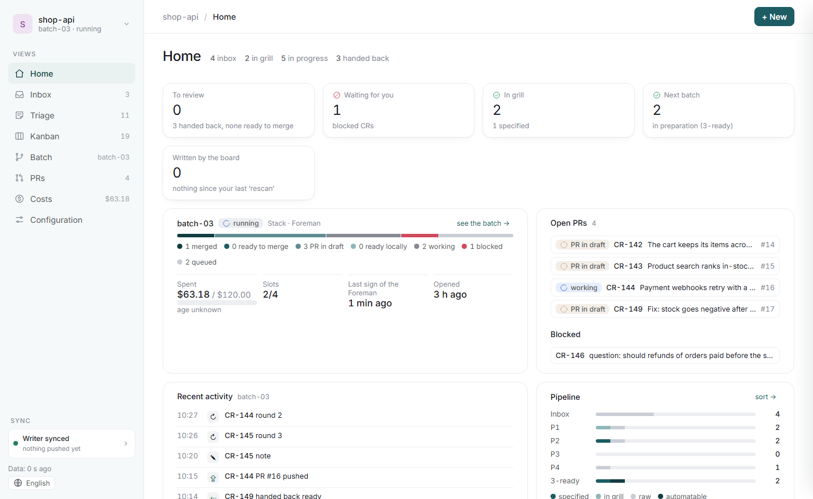
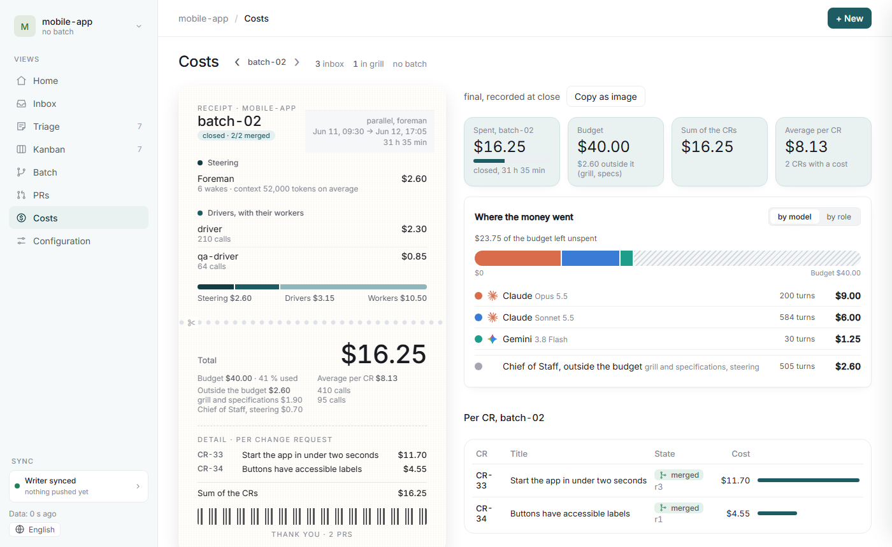
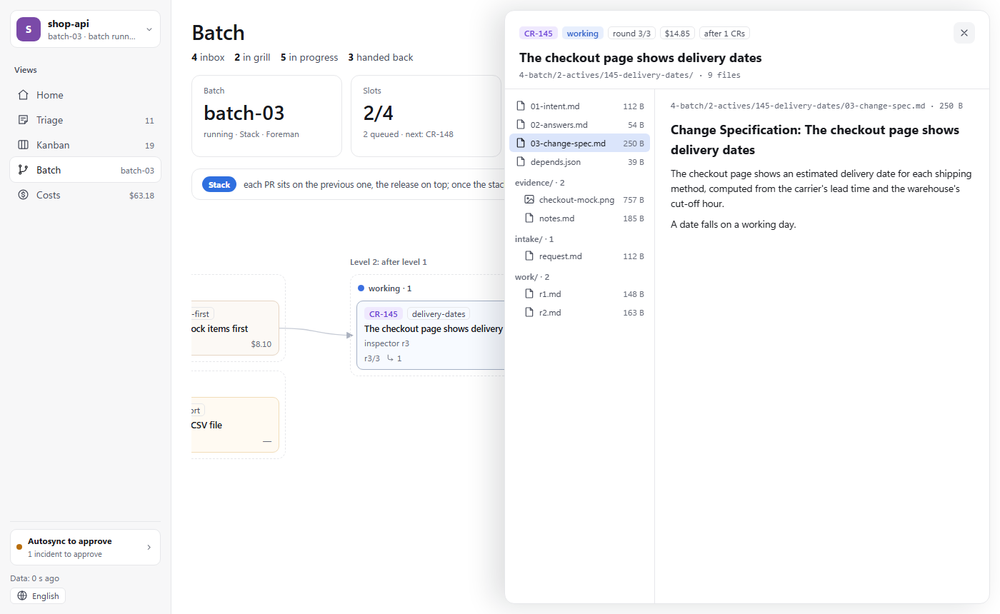
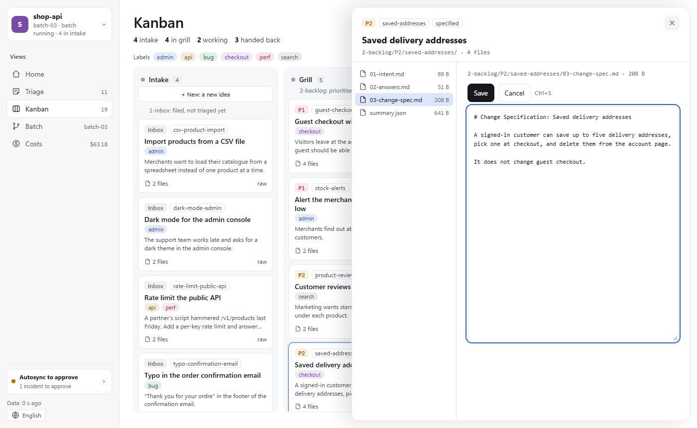
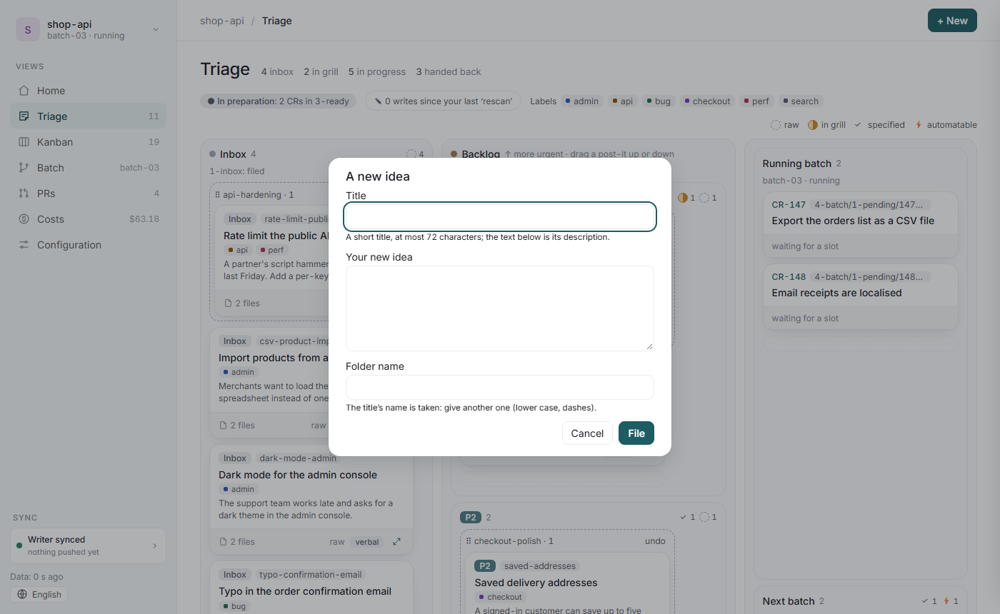
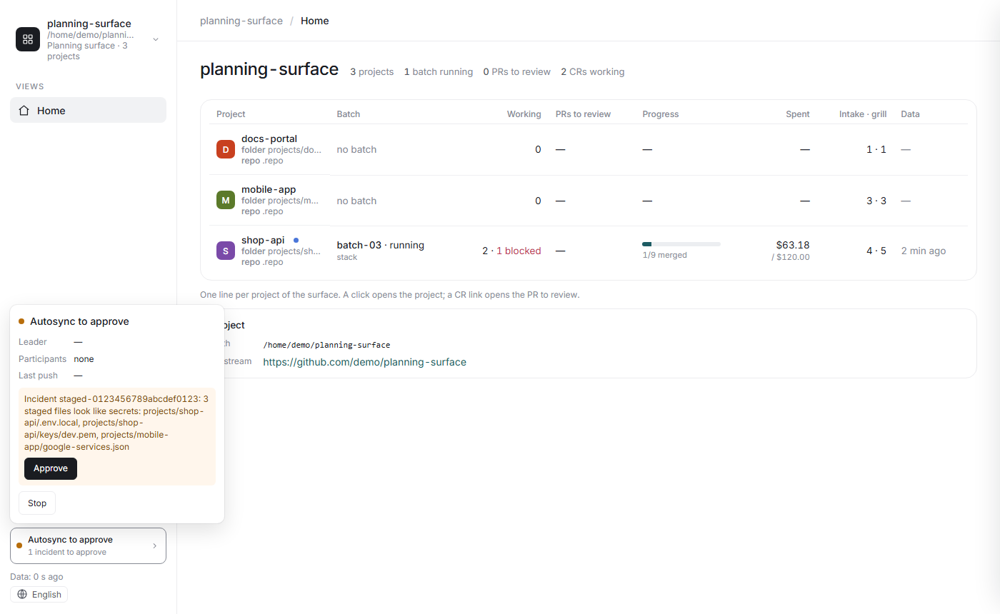
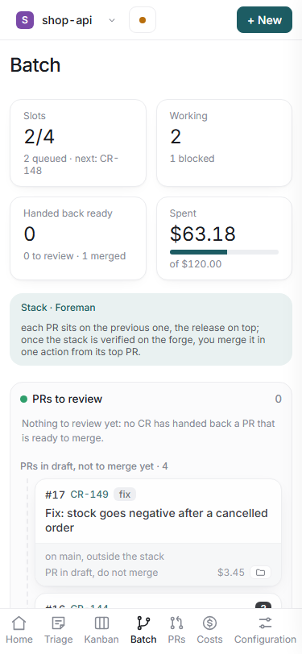
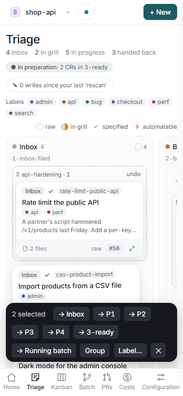
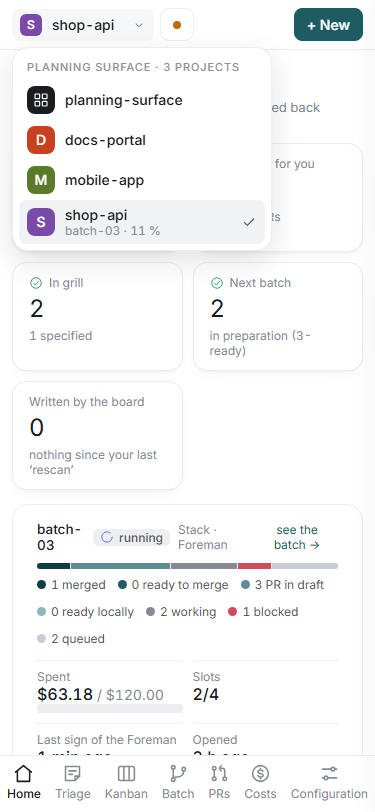
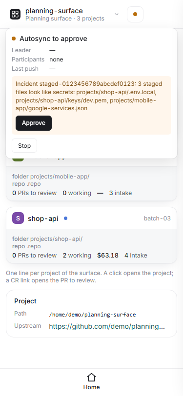

# The web board

`chantier board` serves a small web page over a planning folder, for any device on your network: your laptop, or your phone while the batch runs somewhere else. It shows the batch and its CRs, the backlog, the costs and each CR's files, and it lets you triage the backlog. It never touches a batch.

The pictures on this page are taken from the real board by `just docs-screenshots`, on a made-up planning surface (`docs/demo/`, see [its README](demo/README.md)): three fictional projects, the clock fixed at 2026-06-18 10:30 UTC. Nothing in them is a real project.

For the other board, the pane in Claude Code, see [boards](boards.md). To start it, keep it on the machine and stop it, see [Starting the board](#starting-the-board).

## The views

The left bar lists the views and the project. On a phone the bar becomes a bottom bar and the project picker sits at the top. A planning surface with several projects adds an **All projects** entry to the picker; a single project has none.


The data refreshes by itself. The line under the bar says how old it is (`Data: 0 s ago`), or that the board is unreachable.

### Home: all projects


With several projects, Home is the table of **All projects**: the batch of each (running or not), the CRs working, the PRs to review (ready to merge), a progress gauge, what was spent against the budget, and the numbers of the intake and the grill. A click on a line opens that project. All projects is read-only.

### Home: a project



A project's Home answers "what needs me?": five tiles (**To review**, the PRs ready to merge; **Waiting for you**, the CRs that are blocked; **In grill**, the items being grilled or specified; **Next batch**; **Written by the board**), the batch with its progress gauge, the open PRs, the pipeline of the backlog, the recent activity of the batch (with no batch running, it names the last closed one), the last merged CRs and the five latest closed batches, one line each, with a link to the costs.

### Batch


The batch in a few numbers (its id, the slots, the CRs working, the CRs handed back ready, the cost against the budget), then the CRs as boxes in levels: a CR sits one level after the CRs it waits for, and an arrow goes from a CR to the one that waits for it. The colour is the state: blocked, working, **ready to merge**, **PR in draft**, **ready locally** (done, no PR yet), waits, queued, merged. Hover a CR to see what it waits for and what waits for it; a click opens its folder.

The right column follows the batch's mode (stack, series or parallel, named in the bar under the numbers):

- **PRs to review**: the PRs ready to merge now. In a stack, only a fix CR, which sits on the default branch outside the stack, is to review while the stack is not built and verified on the forge; the others are listed as **PRs in draft, not to merge yet**, with their place in the stack (1 is the bottom, not a merge order). A click on a PR opens it on the forge; the folder icon opens the CR's folder.
- **Merged PRs**: for information, this batch's and the earlier batches'.

### Kanban


Seven columns, from the idea to the merged CR: **Inbox** (`1-inbox`), **Backlog** (`2-backlog`, P1 to P4, not yet grilled), **Grill** (items being grilled or specified, from the inbox or the backlog), **3-ready** (waits for the next batch), **In progress** (queued, working, blocked), **Handed back** and **Done** (the newest merged CRs; the total is in the column's head). A card shows its priority, its labels, its first lines, the number of files and its state (raw, in grill, specified, automatable), or its round for a CR of the batch. A working CR of the batch shows its step (`coder r2`, `gate scenario`, `CI`), a blocked one "waits for the user", and the CR the batch would start next carries a "next to start" tag (the Batch view's Slots figure names it). A click opens the folder. The labels at the top filter the cards, and a priority filter (the inbox and P1 to P4) sits beside them. **+ New: a new idea** files an idea (see below).

### Triage


The place where you sort the backlog. Each item is a post-it, the same card as the Kanban's with the selection and the drag added: its folder name, where the request came from (an issue number, a Jira key or `verbal`), its labels, and a mark for how far it has been worked (raw, in grill, specified, automatable). A dashed post-it with a clock has a late summary: the CR changed after its summary was written.

- Drag a post-it between **Inbox**, a priority (P1 more urgent than P4) and **3-ready**, or up and down in a column.
- Select several post-its for the bar that groups them under a theme (a group moves to the first post-it's column, **undo** takes it apart) or labels them (one lower-case word).
- **The next batch is ready** records that you said so (`next-batch.json`, the time and the CRs then in `3-ready`). It decides nothing and opens nothing: the next batch opens after the running one closes, on your word to the Chief of Staff.
- The button **✎ n writes since your last 'rescan'** lists what the board wrote. The board does not talk to the Chief of Staff: tell it "rescan" in the chat, then press **I said 'rescan' to the CoS**.

Each change is written at once, with the CLI's own file and triage commands, in the backlog only: the inbox, the priorities, `3-ready`, the labels, the groups. All projects and a running batch's CRs are never written.

### Costs



What was spent against the budget, the sum of the CRs (the rest is the steering sessions), the average per active CR, one row per CR of the batch with its state and its cost, and the last merged CRs of all the batches. **Earlier batches** lists the closed batches, newest first (closing day, mode, CRs merged, cost against the budget); a click on a row unfolds its CRs. A record made after the fact shows a dash where it has no figure. The figures are those the batch recorded; **Recompute** makes the server read the transcripts again, with no agent turn. The costs of the CRs a batch has not yet priced read as a dash.

## A CR's files



A click on a CR, a card, a row or a PR's folder icon opens its folder in a side panel: the tree of its files on the left (sub-folders such as `intake/`, `evidence/` and `work/` included), the file on the right. Markdown is drawn, other text is shown as text, images are shown, and a file the page cannot show (too large, or another type) offers a download. The panel reads the planning folder only.

### Editing a Markdown file



A backlog item's Markdown file has an **Edit** button (never a batch CR's, never in All projects). **Save** (or Ctrl+S) writes the file only if it is still the one you opened: if the Chief of Staff or another device changed it meanwhile, the board refuses and tells you, so that nothing is overwritten. Leaving the file, the item or the page with unsaved changes asks first.

## A new idea



**+ New** (at the top right of a project's views) files an idea in the project's `1-inbox/`: write it, optionally name its folder (lower case, dashes), press **File**. The folder holds an `intake/request.md` with your text. If the name is taken the dialog asks for another one.

## Autosync



When the planning surface runs the autosync tool (its `AGENTS.md` names the guidelines [planning-modes](planning-modes.md#the-surfaces-autosync) describes), the bottom of the left bar shows a pill with the state of the group that keeps the surface in sync: **active** (with the time of the last push), **stopped**, **blocked** (the Chief of Staff must integrate, then restart) or **to approve**. A click opens a panel: the leader, the participants, the last push, and the buttons **Start**, **Stop** and, for an incident the tool holds (a push that would carry staged files or secrets), **Approve**. The board approves only the incident it shows: if another one is waiting by then, it says so. A surface without autosync has no pill.

## On a phone

Each view fits a phone: the bar is at the bottom, the project picker and **+ New** at the top, the autosync pill is a dot beside the picker, and the tables and boards become lists and stacked cards.

| Batch | Triage | Triage, two selected | Picker | Autosync |
| --- | --- | --- | --- | --- |
|  |  |  |  |  |

The other views, each at both sizes, are in [`docs/web-board/`](web-board/): `<view>-pc.png` and `<view>-phone.png`.

## Language

The page is in English or French; a button at the bottom of the bar switches it (`?lang=en` or `?lang=fr` in the address does the same), and the board remembers your choice and your project. The pictures here are the English page; the French page is not captured.

## Retaking the pictures

`just docs-screenshots` copies `docs/demo/` to a temporary folder, starts the real board on the copy (loopback, a free port, the clock fixed with `--clock`), takes every picture in Chromium (Playwright) at 1400x860 and 375x812, with a fixed time zone and language and no animation, and stops the board. Twice in a row gives the same files. The first run downloads Chromium. It needs chantier's own checkout and `uv`.

## Starting the board

On any device, the Chief of Staff starts a small web server, `chantier board`, that serves the
batch with its CRs (state, round, cost, PR), the inbox, `3-ready` and the backlog, the merged and
trashed CRs, the costs, and each CR's files (text and images). It stops when its session leaves
the seat. It writes in the backlog only (the inbox, the priorities, `3-ready`), never in a batch:
file an idea, move items between those places, label and group them, edit an item's Markdown
files, and declare the next batch ready (`next-batch.json`, the time and the CRs then in
`3-ready`; it decides nothing). Every write lands in `board-journal.jsonl` (not committed); the
"rescan" button empties it, to tell the Chief of Staff the backlog changed. All projects is
read-only.

- **The link.** The Chief of Staff gives you one link, `http://<address>:8765/?k=<key>`. Open it
  once: the board keeps the key in a cookie and takes it out of the address. The link is yours
  only; whoever has it reads the planning folder. `chantier board --new-key` replaces the key
  and the old link stops working. The key lives in the repository's git folder
  (`chantier/board.json`), so it survives restarts and is never pushed.
- **The local network.** By default the board listens on every address of the machine
  (`0.0.0.0`): your phone on the same network reaches it. It speaks plain HTTP, so keep the link
  off any network you do not trust. On Windows, the first start asks the firewall for permission:
  that prompt is the machine's own.
- **Keeping it on the machine.** Set the address once in `chantier.yaml` (on your word, the Chief
  of Staff writes it):

```yaml
board:
  host: 127.0.0.1   # only this machine; default 0.0.0.0, the local network
  port: 8765        # default 8765
```

- **By hand.** `chantier board --host <address> --port <n>`. With no plugin and no agent, on a
  machine where only `uv` is installed, start it from a planning surface with
  `uvx --from git+https://github.com/gsemet/chantier@v<version> chantier --project <folder> board`
  (`<version>` is the release the surface's planners use). In chantier's own checkout, start it
  with `uv run --no-sync --project <checkout> chantier board` after a `uv sync --locked --project
  <checkout>`; never `uvx --from <checkout>`.
- **When it stops.** With Ctrl-C, or by itself once no session that registered a seat holds it any
  more. A second `chantier board` on the same address says the board is already running and
  prints the same link.
